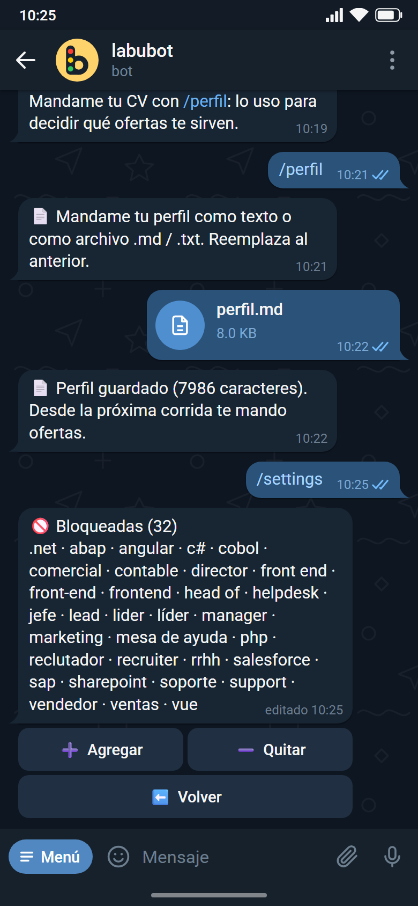
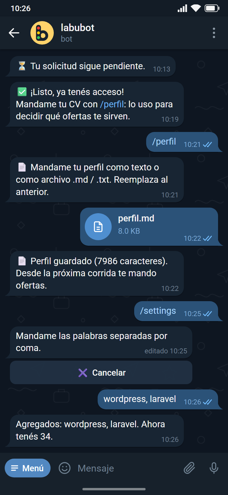
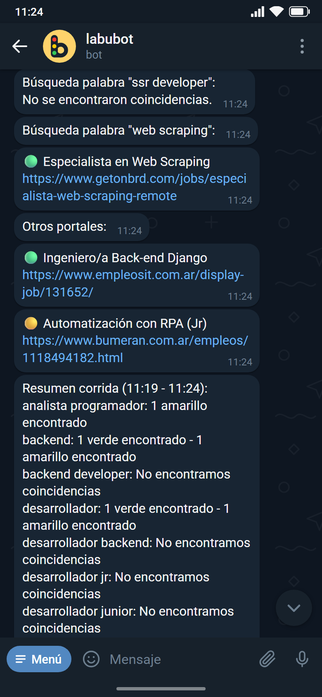
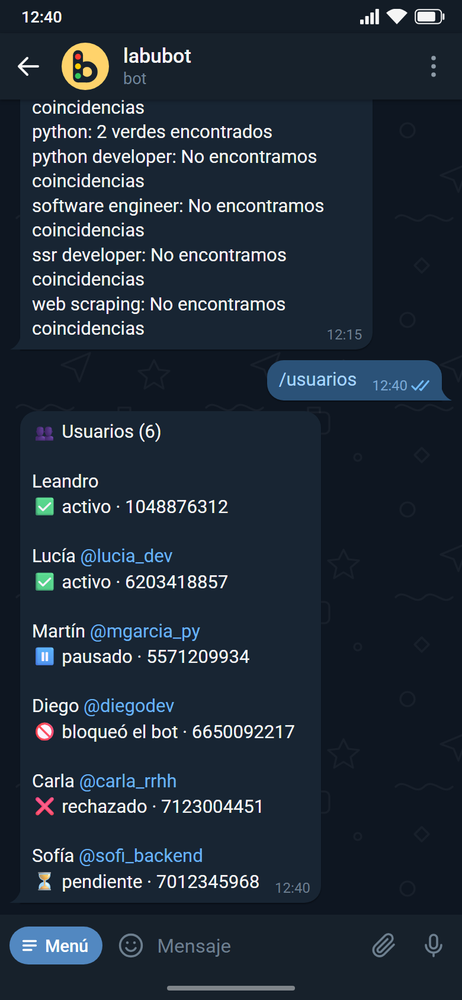
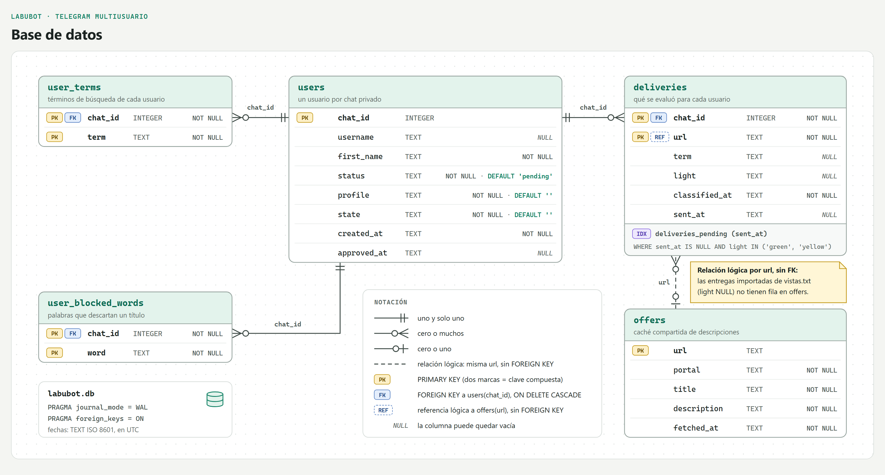

# labubot multiusuario por Telegram

Hoy labubot busca cada hora en 11 portales, evalúa las ofertas contra un único
`perfil.md` y manda las 🟢 y 🟡 a un chat fijo. El bot no recibe mensajes. Este
cambio lo convierte en un bot con usuarios: cada uno pide acceso con `/start`, el
admin lo aprueba y desde el chat carga su CV, sus palabras clave y sus palabras bloqueadas.
Es un bot interno, de hasta 5 usuarios. La corrida va usuario por usuario, uno tras otro,
reusando lo que ya se buscó en esa corrida; cada descripción se baja una sola vez y el LLM
se llama una vez por usuario y oferta. Llega un bloque por palabra clave, con sus 🟢🟡 o
con "No se encontraron coincidencias", y al final el resumen de la corrida con lo que
encontró cada palabra. Corre en un VPS Linux
(proveedor a definir) con dos procesos, `api` (webhook) y `worker` (cada hora), que
comparten `labubot.db`.

**Estado:** solo diseño (revisado el 31/10/2026); todavía no hay código.

## Decisiones

Están tomadas, pero el usuario puede revisarlas. El por qué de cada una está en [`diseno.md` §1](diseno.md#1-resumen-y-decisiones).

| | Decisión | Por qué | Revisable |
|---|---|---|---|
| D1 | Un VPS Linux, de un proveedor todavía a definir, con dominio propio. Telegram llama por webhook a Caddy (HTTPS), que pasa a uvicorn en `127.0.0.1:8000`. En la PC, un túnel `cloudflared` | Contestar a toda hora sin un proceso de polling, con el mismo código en la PC y en el VPS | Sí. El proveedor se elige después de la prueba de IP (T0.3; el plan de [`vps.md`](vps.md) §7 vale para cualquiera). Si LinkedIn o Indeed fallan, F4 se hace en la PC con el túnel |
| D2 | Cada usuario tiene su perfil, sus términos y sus bloqueadas. Al aprobarlo se le siembran `DEFAULT_TERMS` y `DEFAULT_BLOCKED_TITLE_WORDS` | El veredicto depende del CV, y qué buscar o descartar depende de cada uno | Es el núcleo del cambio. La semilla se puede cambiar y vale para los usuarios nuevos |
| D3 | `/start` deja al usuario en `pending` y el admin (`ADMIN_CHAT_ID`) aprueba o rechaza con botones | Cada usuario cuesta ~50 llamadas al LLM por hora, y las paga la cuenta del admin | Sí, pero abrir el bot sin aprobación deja el gasto sin control |
| D4 | Una ejecución por usuario, uno tras otro y sin hilos, cada uno con sus palabras, sus bloqueadas y su perfil. Una caché en memoria de la corrida (`searches[(portal, palabra)]`) evita repetir búsquedas; cada descripción se baja una vez (`offers`) y el LLM se llama una vez por (usuario, oferta) | En paralelo serían hasta 5 búsquedas a la vez a LinkedIn desde la misma IP; en serie entra en la hora porque el primero paga el scraping y los demás salen casi enteros de la caché | Sí. Si la corrida deja de entrar en la hora, el riesgo y las salidas están en [`diseno.md` §11](diseno.md#11-riesgos-y-trade-offs) |
| D5 | Sin Redis ni Celery: `api` y `worker` sobre SQLite en modo WAL. Huey con `SqliteHuey` queda para F5 | Una corrida por hora y pocos usuarios no justifican un broker | Sí. F5 entra solo si hace falta `/buscar` |
| D6 | Telegram a mano: FastAPI solo recibe, y todo lo que sale va por `Driver.post_json()` / `get()` | `python-telegram-bot` y `aiogram` traen su propio httpx y romperían la regla del `Driver` | Sí, si el bot llega a usar mucho más de la Bot API |
| D7 | Un bloque por palabra, en orden alfabético. Con 🟢🟡: `Búsqueda palabra "{term}":` y después un mensaje por oferta, `"{emoji} {title}\n{url}"`, verdes primero. Sin nada: `Búsqueda palabra "{term}":` + `No se encontraron coincidencias.` en un solo mensaje, sin sonido. "Otros portales" al final, solo si trajo algo. `PAUSE = 1` s antes de cada mensaje | Formato definido por el usuario (01/11/2026): cada búsqueda dice qué encontró, y cada oferta se sigue pudiendo reenviar sola, como hoy | Sí. Falta decidir la vista previa del link (ver abajo) |
| D8 | Un 403 al enviar lanza `LabubotForbiddenError`: el usuario pasa a `blocked` y la corrida sigue con los demás. Un `/start` lo vuelve a `active` | Quien bloqueó el bot no frena a los demás ni se le reintenta para siempre | Sí |
| D9 | `migrate.py`, una sola vez: el admin con `perfil.md` y las semillas, y `vistas.txt` cargado como `deliveries` con `light` NULL | El admin no pierde su perfil ni vuelve a pagar las 1.564 urls que ya vio | Hasta que se corra |
| D10 | Solo chats privados (`chat.id == from.id`); los grupos se ignoran | `chat_id` es la clave del usuario, y en un grupo se mezclarían perfiles | Sí, pero cambia la clave de `users` |
| D11 | Al final de la corrida de cada usuario, siempre, `Resumen corrida (inicio - fin):` con una línea por palabra: `python: 1 verde encontrado - 2 amarillos encontrados` o `developer: No encontramos coincidencias`. Va sin sonido, igual que los bloques vacíos | Saber que la corrida anduvo y qué rinde cada palabra. Con 22 palabras son ~23 mensajes por corrida aunque no haya nada: solo suenan las ofertas | Sí. Si molesta el volumen, los bloques vacíos pueden ir solo dentro del resumen |
| D12 | Indeed y Workable buscan palabra por palabra. La palabra de cada oferta es la primera del usuario cuya búsqueda la trajo; en los portales sin búsqueda, la primera contenida en el título, y si no hay, 🗂 Otros portales | Con el `OR` de todos los términos no se sabe qué palabra trajo cada oferta | Sí. Si dan 429, se vuelve al `OR` y se atribuye por título |

## Mapa de la documentación

| Documento | Qué tiene |
|---|---|
| [`diseno.md`](diseno.md) | Cómo queda el código: procesos, árbol, módulos con firmas, fragmentos, `.env`, Bot API, despliegue, migración, riesgos y un anexo con los cambios respecto del contrato |
| [`tareas.md`](tareas.md) | El plan: 42 tareas de F0 a F6, cada una con su aceptación y sus dependencias |
| [`plan.pdf`](plan.pdf) | Resumen del plan para leer de corrido: orden, tiempos estimados y por dónde arrancar |
| [`vps.md`](vps.md) | Evaluación de proveedores (el elegido todavía no está decidido) y el plan para probar la IP de cualquier VPS antes de comprometerse |
| [`bdd.html`](bdd.html) | Diagrama ER, cada columna explicada, índices y consultas con su plan real |
| [`schema.sql`](schema.sql) | El DDL de referencia de `labubot.db` |
| [`conexion.html`](conexion.html) | El camino Telegram → Caddy → `api` → `labubot.db`, y qué habla el `worker` con quién |
| [`ciclo-usuario.html`](ciclo-usuario.html) | El ciclo de vida de `users.status` |
| [`casos-de-uso.html`](casos-de-uso.html) | El diagrama UML de UC01 a UC11 y una ficha por caso |
| [`secuencia-alta.html`](secuencia-alta.html) | Secuencia del alta: `/start`, aprobación del admin y `/perfil` |
| [`secuencia-config.html`](secuencia-config.html) | Secuencia para agregar palabras bloqueadas desde `/settings` |
| [`secuencia-corrida.html`](secuencia-corrida.html) | Secuencia de la corrida horaria por usuario: caché, envío por palabra, resumen silencioso y el caso del 403 |
| [`capturas/index.html`](capturas/index.html) | Galería de maquetas del bot en el teléfono |
| [`logo/index.html`](logo/index.html) | Las tres propuestas de logo, comparadas a 160, 56 y 40 px, y la elegida |

Los `.html` no tienen dependencias: se abren en el navegador, porque GitHub no los
muestra. Los `*.architecture.json`, `*.lifecycle.json` y `*.sequence.json` son la
fuente de los diagramas de archify. Los `*.visual-check.*` son sus capturas de
verificación. Las maquetas se generan desde [`capturas/src/`](capturas/src/), con `build.mjs` y `capturar.sh`.

## Así se ve en Telegram

Lucía es una usuaria ficticia. Las pantallas usan el tema oscuro de Android.

| 01 · Alta pendiente | 02a · Solicitud al admin | 02b · Solicitud aprobada |
|---|---|---|
|  |  |  |
| `/start` la deja en `pending` con `WELCOME_PENDING`; hasta que la aprueben, todo contesta `STILL_PENDING`. | Al admin le llega `ADMIN_REQUEST` con los botones `approve:{chat_id}` y `reject:{chat_id}`. | El admin toca Aprobar: el mismo mensaje se edita, sin botones, y Lucía pasa a `active`. |
| **03 · Carga del perfil** | **04 · Panel `/settings`** | **05 · Palabras bloqueadas** |
|  |  |  |
| Le llega `APPROVED`. Con `/perfil` manda su CV como `.md` y el bot lo baja con `getFile`. | Un solo mensaje con los contadores y cuatro botones; al navegar se edita. | 🚫 Bloqueadas edita el panel para mostrar la lista, sembrada con la semilla por defecto. |
| **06 · Agregar bloqueadas** | **07 · Términos de búsqueda** | **08a · Ofertas por palabra** |
|  |  |  |
| ➕ Agregar pide las palabras: con «wordpress, laravel» pasa de 32 a 34. | 🔎 Términos muestra sus palabras, en orden alfabético: la corrida las busca de a una y cada oferta queda en la primera que la trajo. | Un bloque por palabra: `Búsqueda palabra "…":` con sus ofertas (verdes primero), o con "No se encontraron coincidencias." en un solo mensaje sin sonido. |
| **08b · Fin de la corrida** | **08c · Resumen de la corrida** | **09 · Pausar y reanudar** |
|  |  |  |
| Los últimos bloques, "Otros portales:" (solo porque trajo algo) y el comienzo de `Resumen corrida (11:19 - 11:24):`. | El resto del resumen: una línea por palabra, con "N verdes / amarillos encontrados" o "No encontramos coincidencias". Llega siempre y sin sonido. | `/pausa` la deja en `paused` y las corridas la saltean; `/reanudar` la vuelve a `active`. |
| **10 · Menú de comandos** | **11 · Usuarios (admin)** | |
|  |  | |
| Los comandos de `setMyCommands`. `/usuarios` aparece solo en el chat del admin. | `/usuarios` en el chat del admin: cada usuario con su @, su estado y su `chat_id`. | |

## Logo

labubot = «laburo» + «bot». La elegida es la **C, «b» con semáforo**: el asta de
la «b» es un semáforo en rojo, amarillo y verde, los colores con los que el bot
pinta cada oferta. Es la que mejor se lee a 40 px recortada en círculo, que es
como Telegram muestra el avatar. Las otras dos (un bot con lupa y un maletín con
cara de bot) están en [`logo/index.html`](logo/index.html). Se carga una vez con
@BotFather → `/setuserpic` → [`logo/labubot-640.png`](logo/labubot-640.png).

## Base de datos

Cinco tablas en `labubot.db` (WAL, `foreign_keys=ON`). Hay versión oscura en
[`bdd.dark.png`](bdd.dark.png), y el detalle de cada columna está en [`bdd.html`](bdd.html).

## Próximo paso

Arrancar F0 de [`tareas.md`](tareas.md):

1. **T0.1:** respaldo de `perfil.md`, `vistas.txt` y `.env`, la rama `multiusuario` y un bot de prueba.
2. **T0.2:** contratar un VPS de prueba por 1 mes, sin plazo largo (el proveedor todavía no está decidido).
3. **T0.3:** probar la IP del VPS durante dos días. Corre en paralelo con F1 a F3, y lo que concluya frena recién a F4.

Falta decidir, cada punto antes de la tarea que lo toca:

- **Proveedor del VPS:** todavía no está elegido; [`vps.md`](vps.md) compara candidatos. Lo resuelve la prueba de IP de T0.3 (§7), y si ningún VPS pasa, la PC con `cloudflared`.
- **Logo:** confirmar la C o elegir otra de [`logo/index.html`](logo/index.html) antes de T4.8.
- **Vista previa del link:** [`capturas/08a`](capturas/08a-ofertas-por-palabra.png) supone que `send_offer` manda `link_preview_options={"is_disabled": true}`, pero ni `diseno.md` ni `tareas.md` lo incluyen.
- **`offers.url`:** es `TEXT PRIMARY KEY` sin `NOT NULL`, y SQLite acepta NULL ahí ([`bdd.html`](bdd.html)).
- **El 403 en el ciclo de vida:** a un usuario `paused` nunca se le manda nada, así que el 403 desde `paused` del contrato no ocurre. En cambio, el `APPROVED` a un `pending` sí puede dar 403, y eso no está contemplado ([`ciclo-usuario.html`](ciclo-usuario.html)).
- **Actualizar el contrato** en dos puntos que los documentos ya corrigen: `ASK_LIST` concordado y `settings_keyboard(user)` sin `counts` (anexo de [`diseno.md`](diseno.md)). Además, `perfil.md` tiene 7.922 caracteres; los 8.058 son bytes. El dominio `labubot.ejemplo.com` es un marcador.
