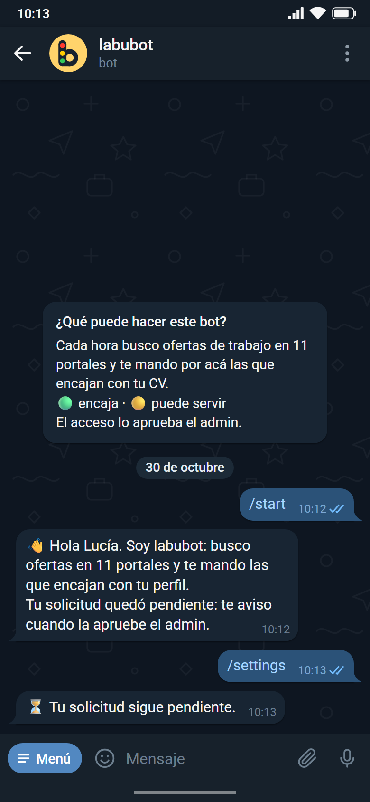
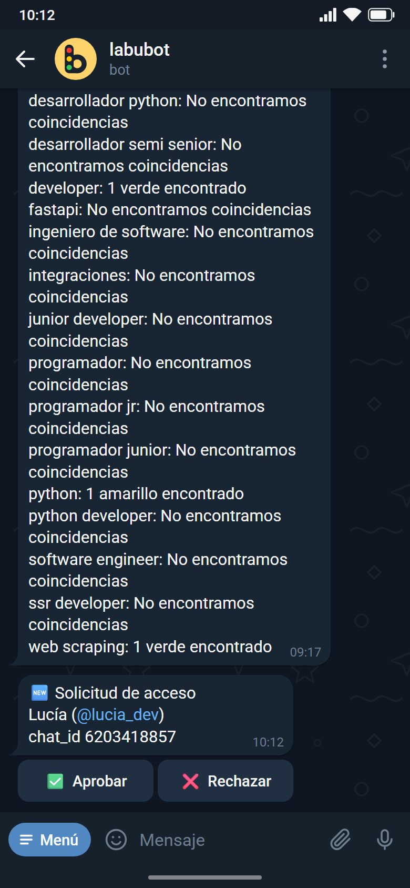
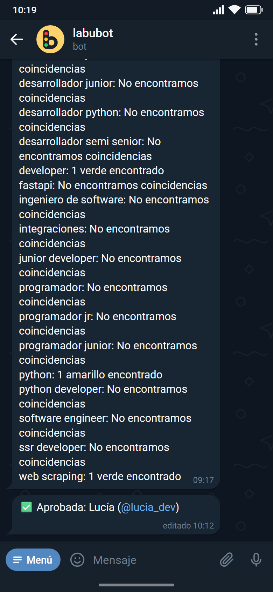
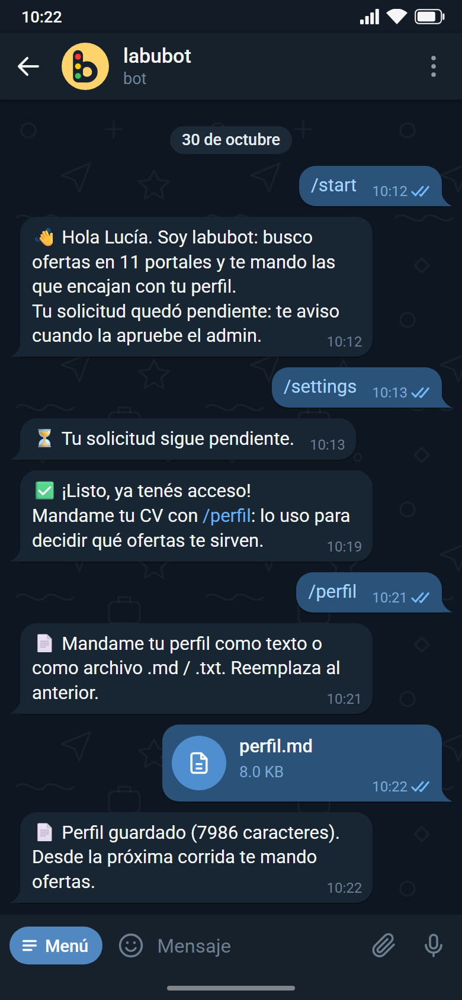
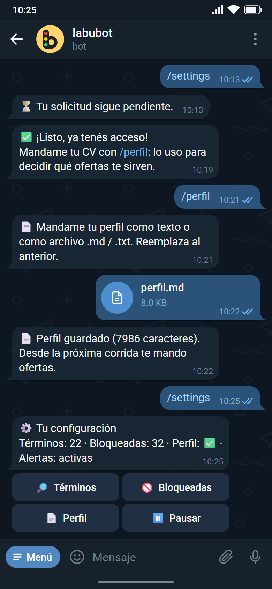
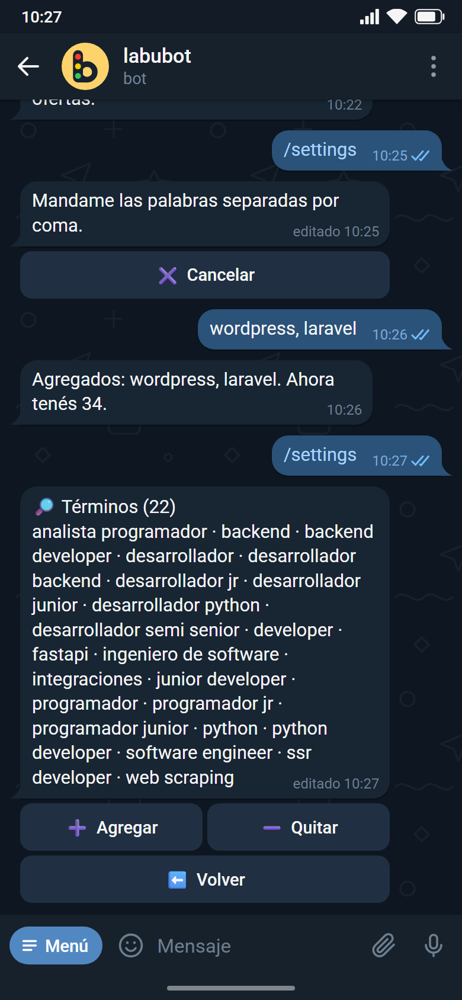
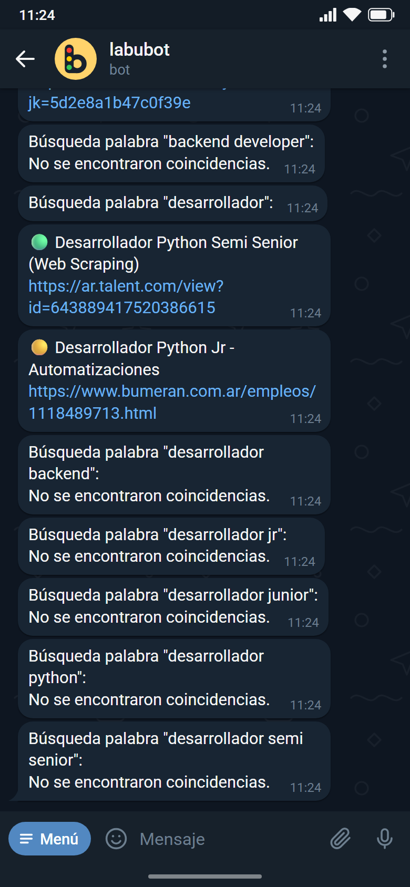
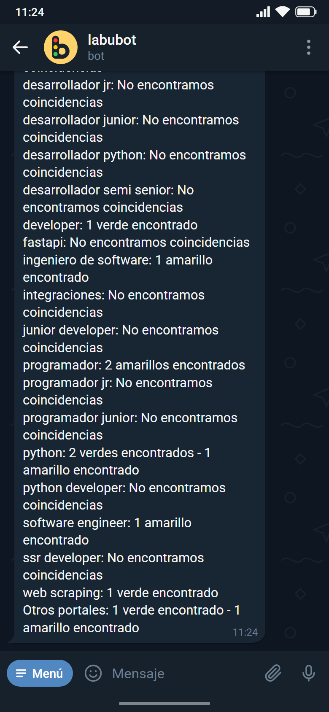
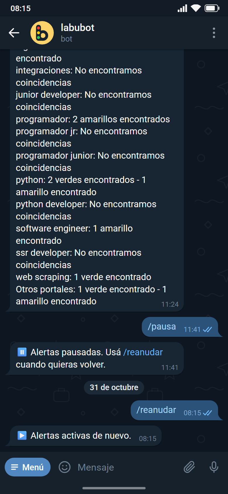
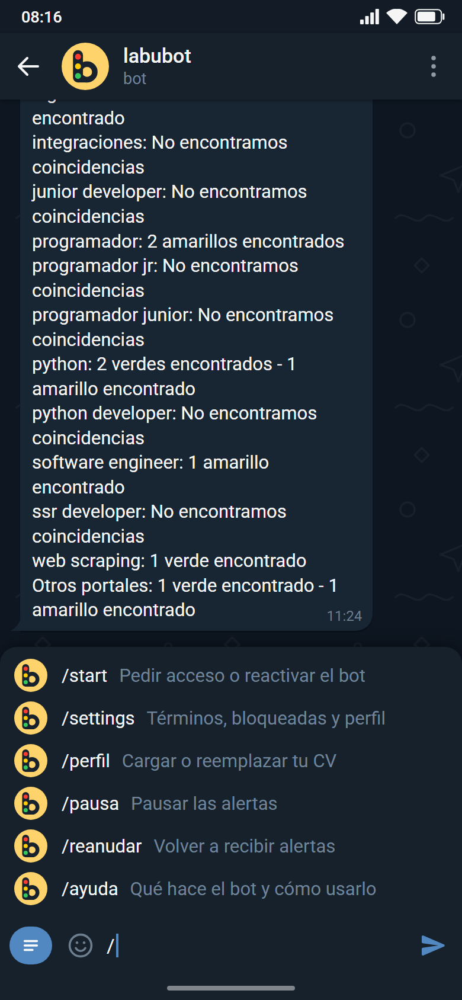

# labubot multiusuario por Telegram

Antes de este cambio, labubot buscaba cada hora en 11 portales (hoy son 12), evaluaba
las ofertas contra un único `perfil.md` y mandaba las 🟢 y 🟡 a un chat fijo. El bot no
recibía mensajes. Este cambio lo convierte en un bot con usuarios: cada uno pide acceso con `/start`, el
admin lo aprueba y desde el chat carga su CV, sus palabras clave y sus palabras bloqueadas.
Es un bot interno, de hasta 5 usuarios. La corrida va usuario por usuario, uno tras otro,
reusando lo que ya se buscó en esa corrida; cada descripción se baja una sola vez y el LLM
se llama una vez por usuario y oferta. Llega un bloque por palabra clave, con sus 🟢🟡 o
con "No se encontraron coincidencias", y al final el resumen de la corrida con lo que
encontró cada palabra. Corre en un VPS Linux
(proveedor a definir) con dos procesos, `api` (webhook) y `worker` (cada hora), que
comparten `labubot.db`.

**Estado (07/11/2026):** implementado F1 a F3 (base, corrida por usuario y bot) y los
archivos de despliegue de F4, en la rama `multiusuario`. Falta lo que necesita el VPS
o el teléfono: la prueba de IP (T0.3), el despliegue ([`despliegue.md`](despliegue.md))
y las pruebas a mano en Telegram de cada tarea. Lo que se apartó del diseño está en
[Implementación](#implementación).

## Decisiones

Están tomadas, pero el usuario puede revisarlas. El por qué de cada una está en [`diseno.md` §1](diseno.md#1-resumen-y-decisiones).

| | Decisión | Por qué | Revisable |
|---|---|---|---|
| D1 | Un VPS Linux, de un proveedor todavía a definir, con dominio propio. Telegram llama por webhook a Caddy (HTTPS), que pasa a uvicorn en `127.0.0.1:8000`. En la PC, un túnel `cloudflared` | Contestar a toda hora sin un proceso de polling, con el mismo código en la PC y en el VPS | Sí. El proveedor se elige después de la prueba de IP (T0.3; el plan de [`vps.md`](vps.md) §7 vale para cualquiera). Si LinkedIn o Indeed fallan, F4 se hace en la PC con el túnel. Sin dominio todavía, el VPS usa un túnel ngrok con dominio fijo en lugar de Caddy (I2) |
| D2 | Cada usuario tiene su perfil, sus términos y sus bloqueadas. ~~Al aprobarlo se le siembran `DEFAULT_TERMS` y `DEFAULT_BLOCKED_TITLE_WORDS`~~ Arranca con las listas vacías (I14) | El veredicto depende del CV, y qué buscar o descartar depende de cada uno | Es el núcleo del cambio. La semilla se puede cambiar y vale para los usuarios nuevos |
| D3 | `/start` deja al usuario en `pending` y el admin (`ADMIN_CHAT_ID`) aprueba o rechaza con botones | Cada usuario cuesta ~50 llamadas al LLM por hora, y las paga la cuenta del admin | Sí, pero abrir el bot sin aprobación deja el gasto sin control |
| D4 | Una ejecución por usuario, uno tras otro y sin hilos, cada uno con sus palabras, sus bloqueadas y su perfil. Una caché en memoria de la corrida (`searches[(portal, palabra)]`) evita repetir búsquedas; cada descripción se baja una vez (`offers`) y el LLM se llama una vez por (usuario, oferta) | En paralelo serían hasta 5 búsquedas a la vez a LinkedIn desde la misma IP; en serie entra en la hora porque el primero paga el scraping y los demás salen casi enteros de la caché | Sí. Si la corrida deja de entrar en la hora, el riesgo y las salidas están en [`diseno.md` §11](diseno.md#11-riesgos-y-trade-offs) |
| D5 | Sin Redis ni Celery: `api` y `worker` sobre SQLite en modo WAL. Huey con `SqliteHuey` queda para F5 | Una corrida por hora y pocos usuarios no justifican un broker | Sí. F5 entra solo si hace falta `/buscar` |
| D6 | Telegram a mano: FastAPI solo recibe, y todo lo que sale va por `Driver.post_json()` / `get()` | `python-telegram-bot` y `aiogram` traen su propio httpx y romperían la regla del `Driver` | Sí, si el bot llega a usar mucho más de la Bot API |
| D7 | Un bloque por palabra, en orden alfabético. Con 🟢🟡: `Búsqueda palabra "{term}":` y después un mensaje por oferta, `"{emoji} {title}\n{url}"`, verdes primero. Sin nada: `Búsqueda palabra "{term}":` + `No se encontraron coincidencias.` en un solo mensaje, sin sonido. "Otros portales" al final, solo si trajo algo. `PAUSE = 1` s antes de cada mensaje | Formato definido por el usuario (01/11/2026): cada búsqueda dice qué encontró, y cada oferta se sigue pudiendo reenviar sola, como hoy | Sí. Los links van sin vista previa (I4) |
| D8 | Un 403 al enviar lanza `LabubotForbiddenError`: el usuario pasa a `blocked` y la corrida sigue con los demás. Un `/start` lo vuelve a `active` | Quien bloqueó el bot no frena a los demás ni se le reintenta para siempre | Sí |
| D9 | `migrate.py`, una sola vez: el admin con `perfil.md` y las listas de la versión de un chat, y `vistas.txt` cargado como `deliveries` con `light` NULL | El admin no pierde su perfil ni vuelve a pagar las 1.564 urls que ya vio | Hasta que se corra |
| D10 | Solo chats privados (`chat.id == from.id`); los grupos se ignoran | `chat_id` es la clave del usuario, y en un grupo se mezclarían perfiles | Sí, pero cambia la clave de `users` |
| D11 | Al final de la corrida de cada usuario, siempre, `Resumen corrida (inicio - fin):` con una línea por palabra: `python: 1 verde encontrado - 2 amarillos encontrados` o `developer: No encontramos coincidencias`. Va sin sonido, igual que los bloques vacíos | Saber que la corrida anduvo y qué rinde cada palabra. Con 22 palabras son ~23 mensajes por corrida aunque no haya nada: solo suenan las ofertas | Sí. Si molesta el volumen, los bloques vacíos pueden ir solo dentro del resumen |
| D12 | Indeed y Workable buscan palabra por palabra. La palabra de cada oferta es la primera del usuario cuya búsqueda la trajo; en los portales sin búsqueda, la primera contenida en el título, y si no hay, 🗂 Otros portales | Con el `OR` de todos los términos no se sabe qué palabra trajo cada oferta | Sí. Si dan 429, se vuelve al `OR` y se atribuye por título |

## Mapa de la documentación

| Documento | Qué tiene |
|---|---|
| [`diseno.md`](diseno.md) | Cómo queda el código: procesos, árbol, módulos con firmas, fragmentos, `.env`, Bot API, despliegue, migración, riesgos y un anexo con los cambios respecto del contrato |
| [`tareas.md`](tareas.md) | El plan: 42 tareas de F0 a F6, cada una con su aceptación y sus dependencias |
| [`plan.pdf`](plan.pdf) | Resumen del plan para leer de corrido: orden, tiempos estimados y por dónde arrancar |
| [`vps.md`](vps.md) | Evaluación de proveedores (el elegido todavía no está decidido) y el plan para probar la IP de cualquier VPS antes de comprometerse |
| [`despliegue.md`](despliegue.md) | El paso a paso en el VPS: servidor, `.env`, base, systemd, túnel ngrok, webhook, backups y logs |
| [`bdd.html`](bdd.html) | Diagrama ER, cada columna explicada, índices y consultas con su plan real |
| [`schema.sql`](schema.sql) | El DDL de referencia de `labubot.db` |
| [`conexion.html`](conexion.html) | El camino Telegram → Caddy → `api` → `labubot.db`, y qué habla el `worker` con quién |
| [`ciclo-usuario.html`](ciclo-usuario.html) | El ciclo de vida de `users.status` |
| [`casos-de-uso.html`](casos-de-uso.html) | El diagrama UML de UC01 a UC11 y una ficha por caso |
| [`secuencia-alta.html`](secuencia-alta.html) | Secuencia del alta: `/start`, aprobación del admin y `/perfil` |
| [`secuencia-config.html`](secuencia-config.html) | Secuencia para agregar palabras bloqueadas desde `/settings` |
| [`secuencia-corrida.html`](secuencia-corrida.html) | Secuencia de la corrida horaria por usuario: caché, envío por palabra, resumen silencioso y el caso del 403 |
| [`capturas/index.html`](capturas/index.html) | Galería de maquetas del bot en el teléfono |
| [`logo/index.html`](logo/index.html) | Las tres propuestas de logo, comparadas a 160, 56 y 40 px, y la elegida |

Los `.html` no tienen dependencias: se abren en el navegador, porque GitHub no los
muestra. Los `*.architecture.json`, `*.lifecycle.json` y `*.sequence.json` son la
fuente de los diagramas de archify. Los `*.visual-check.*` son sus capturas de
verificación. Las maquetas se generan desde [`capturas/src/`](capturas/src/), con `build.mjs` y `capturar.sh`.

## Así se ve en Telegram

Lucía es una usuaria ficticia. Las pantallas usan el tema oscuro de Android.

| 01 · Alta pendiente | 02a · Solicitud al admin | 02b · Solicitud aprobada |
|---|---|---|
|  |  |  |
| `/start` la deja en `pending` con `WELCOME_PENDING`; hasta que la aprueben, todo contesta `STILL_PENDING`. | Al admin le llega `ADMIN_REQUEST` con los botones `approve:{chat_id}` y `reject:{chat_id}`. | El admin toca Aprobar: el mismo mensaje se edita, sin botones, y Lucía pasa a `active`. |
| **03 · Carga del perfil** | **04 · Panel `/settings`** | **05 · Palabras bloqueadas** |
|  |  |  |
| Le llega `APPROVED`. Con `/perfil` manda su CV como `.md` y el bot lo baja con `getFile`. | Un solo mensaje con los contadores y cuatro botones; al navegar se edita. | 🚫 Bloqueadas edita el panel para mostrar la lista, sembrada con la semilla por defecto. |
| **06 · Agregar bloqueadas** | **07 · Términos de búsqueda** | **08a · Ofertas por palabra** |
|  |  |  |
| ➕ Agregar pide las palabras: con «wordpress, laravel» pasa de 32 a 34. | 🔎 Términos muestra sus palabras, en orden alfabético: la corrida las busca de a una y cada oferta queda en la primera que la trajo. | Un bloque por palabra: `Búsqueda palabra "…":` con sus ofertas (verdes primero), o con "No se encontraron coincidencias." en un solo mensaje sin sonido. |
| **08b · Fin de la corrida** | **08c · Resumen de la corrida** | **09 · Pausar y reanudar** |
|  |  |  |
| Los últimos bloques, "Otros portales:" (solo porque trajo algo) y el comienzo de `Resumen corrida (11:19 - 11:24):`. | El resto del resumen: una línea por palabra, con "N verdes / amarillos encontrados" o "No encontramos coincidencias". Llega siempre y sin sonido. | `/pausa` la deja en `paused` y las corridas la saltean; `/reanudar` la vuelve a `active`. |
| **10 · Menú de comandos** | **11 · Usuarios (admin)** | |
|  |  | |
| Los comandos de `setMyCommands`. `/usuarios` aparece solo en el chat del admin. | `/usuarios` en el chat del admin: cada usuario con su @, su estado y su `chat_id`. | |

## Logo

labubot = «laburo» + «bot». El logo es la **D, un robot con casco de obra** (pedido
del usuario el 07/11): casco amarillo, ojos verdes como el 🟢 de las ofertas que
encajan y orejas rojas, sobre azul pizarra para que el círculo se despegue del modo
oscuro de Telegram. Salió de un concurso de tres variantes juzgadas a 640 px y a
40 px recortadas en círculo, que es como Telegram muestra el avatar. La anterior,
la **C, «b» con semáforo**, quedó en [`logo/propuesta-c.svg`](logo/propuesta-c.svg),
y las primeras tres propuestas en [`logo/index.html`](logo/index.html).

Está cargado en el bot real (`@fr_labu_bot`), con el nombre "labubot", por la Bot
API (`setMyProfilePhoto`, con la foto en JPG, y `setMyName`). También se puede con
@BotFather → `/setuserpic` → [`logo/labubot-640.png`](logo/labubot-640.png).

## Base de datos

Cinco tablas en `labubot.db` (WAL, `foreign_keys=ON`). Hay versión oscura en
[`bdd.dark.png`](bdd.dark.png), y el detalle de cada columna está en [`bdd.html`](bdd.html).

## Implementación

Lo que el código hace distinto de `diseno.md` y `tareas.md`, o que esos documentos no decían:

| | Qué | Por qué |
|---|---|---|
| I1 | 12 portales: SuTrabajo (sumado el 04/11, después del diseño) va en `WITHOUT_SEARCH`, con los otros cuatro sin búsqueda. `WELCOME_PENDING` y `/ayuda` dicen "12 portales" | Es un portal sin búsqueda más; su url es la del aviso original, así que deduplica contra LinkedIn |
| I2 | El túnel del VPS es **ngrok** con el dominio fijo gratis (la unidad `labubot-ngrok` y su `ngrok.yml`, en `despliegue.md`); Caddy queda como alternativa con dominio propio | Todavía no hay dominio. Cloudflare sin dominio solo da quick tunnels, que cambian de URL en cada reinicio |
| I3 | `api.py` no publica `/docs`, `/redoc` ni `/openapi.json` | Detrás de ngrok no hay Caddy que filtre por ruta: todo lo de la app queda público |
| I4 | Todo `sendMessage` va con `link_preview_options = {"is_disabled": true}` | Es como se ven las capturas (08a); con una tarjeta por oferta el chat se llena. Se vuelve atrás borrando esa clave en `Telegram.send_message` |
| I5 | `offers.url` lleva `NOT NULL` | SQLite acepta NULL en una `TEXT PRIMARY KEY` |
| I6 | `Users.active()` y `all()` desempatan por `chat_id` | Dos altas en el mismo segundo tienen el mismo `created_at` |
| I7 | `Deliveries.pending(chat_id)` trae las pendientes de un usuario, sin el JOIN a `users`, y no hay índice parcial `deliveries_pending` | `_run_user` corre por usuario: pedir las de todos para filtrar en Python sobraba, y con `chat_id` SQLite usa la clave `(chat_id, url)` |
| I8 | Los textos de los botones, `NO_USERNAME`, `EMPTY_LIST` ("—", una lista vacía del panel) y `PROFILE_EXTENSIONS` también son constantes de `src/telegram/constants.py` | El resto de los textos ya vive ahí |
| I9 | `/settings@<bot>` se atiende como `/settings` | Es el formato de comando de Telegram |
| I10 | Sin carpeta `deploy/`: las unidades de systemd, el `ngrok.yml`, la rotación de logs y el Caddyfile alternativo están escritos en [`despliegue.md`](despliegue.md) y se crean en el VPS con `sudo tee` | Son archivos que se copian una sola vez al servidor; el código no los usa |
| I11 | `Offers.get` devuelve la fila (`description`, `portal`) y `Offers.add` hace `INSERT OR REPLACE`. Si la descripción guardada es de SuTrabajo y la oferta llega por su portal de origen, se baja el original y la reemplaza. La `Offer` que se clasifica y se manda lleva el título del listado de ese usuario | SuTrabajo usa la url del aviso original: con la caché compartida, un usuario posterior que la encontraba por LinkedIn recibía la versión reescrita (que pierde dónde se acepta remoto), y el filtro de bloqueadas miraba un título distinto del que se mandaba. El diseño suponía que "una misma url no llega de dos portales" |
| I12 | El webhook compara el secreto en bytes | `secrets.compare_digest` con un `str` no ASCII lanza: un header así daba 500 en vez de 403 |
| I13 | `/template` (pedido del usuario, 07/11): manda la plantilla del CV en dos mensajes, la explicación y la plantilla sola para copiarla. `APPROVED`, `ASK_PROFILE` y `HELP` lo nombran, y el menú tiene un comando más que en `capturas/10` | Para que cada usuario arme un CV con las secciones que usa el prompt (seniority, idiomas, modalidad, "Lo que NO quiero") |
| I14 | Sin `src/config/search.py` ni `Users.seed_defaults` (pedido del usuario, 07/11): los usuarios nuevos arrancan con términos y bloqueadas vacíos y `APPROVED` les pide cargarlos en `/settings`. Las 22 y 32 de la versión de un chat viven en `migrate.py` (`ADMIN_TERMS`, `ADMIN_BLOCKED_WORDS`), que se las carga al admin | Son configuración de cada usuario: no corresponde una lista en el código |
| I15 | Revisión KISS (pedido del usuario, 07/11): `Classifier.classify(offer)` devuelve el color de una oferta (sin lista ni dict por url); `Telegram.send_message` no devuelve el `message_id` (nadie lo usaba); `ASK_TERMS` y `ASK_BLOCKED` son los textos completos (sin `ASK_LIST`); el resumen usa `SUMMARY_GREEN`/`SUMMARY_GREENS` y `SUMMARY_YELLOW`/`SUMMARY_YELLOWS` (sin tuplas ni `_count_text`); `portals` es un dict literal; "Otros portales" se decide una vez, en `keywords`; sin `src/telegram/__init__.py`, sin el TypedDict `Update` (no se usaba) y sin try/finally en `migrate.py` y `set_webhook.py`, que corren una vez | Menos código y nada que haya que descifrar; el comportamiento es el mismo |
| I16 | Segunda revisión (pedido del usuario, 07/11): `connect()` y `Telegram.set_webhook()` leen `DB_PATH`, `WEBHOOK_URL` y `WEBHOOK_SECRET` de settings, sin parámetros; sin las columnas `users.approved_at` y `offers.fetched_at`, que se escribían y nadie leía (en una base ya creada, `ALTER TABLE users DROP COLUMN approved_at` y `ALTER TABLE offers DROP COLUMN fetched_at`; `bdd.html` todavía las dibuja); `on_callback` usa un solo `chat_id` y `_approve_or_reject` (antes `_decide`) recibe lo que ya calculó; `RESULTS_DIR`, `WITHOUT_SEARCH` y `HUB` pasan a `src/constants/run.py`, y `START_ONLY`, `INPUT_SEPARATOR` y `SUMMARY_SEPARATOR` a `src/telegram/constants.py`; en `main.py`, `_search_user` pasa a `_search_terms`, y `found`, `job`, `groups` y `rows` a `listings`, `listing`, `matches` y `verdicts`; las funciones auxiliares van al final de cada archivo | Parámetros que siempre recibían lo mismo, columnas sin lectura, constantes fuera de su archivo y nombres que no decían qué son |
| I17 | `/perfil` y el botón 📄 Perfil, si ya hay un CV, lo muestran (`PROFILE_CURRENT` y el CV en mensajes de hasta 4096 unidades UTF-16, partidos por renglones, con una pausa entre uno y otro) y terminan con un botón ✏️ Reemplazar (`profile:replace`): recién al tocarlo el bot espera el nuevo. Sin CV, lo piden como antes. `PROFILE_SAVED` ya no muestra la cantidad de caracteres (pedido del usuario, 07/11) | Poder leer el CV; si el bot quedara esperando el reemplazo, el próximo texto que se escriba pisaría el CV |
| I18 | `/start` de un usuario activo con CV pide una búsqueda: el webhook la anota en la tabla `search_requests` y el worker (`daemon.py`) la toma cada 5 s. Reemplaza a F5 (Huey y `/buscar`) (pedido del usuario, 07/11) | Que no haya que esperar a la hora siguiente, sin sumar Huey ni otra dependencia |
| I19 | El worker corre la búsqueda de cada usuario en su propio hilo (`main(chat_id)`), al arrancar, cada hora y con cada `/start`; un mismo usuario nunca corre dos veces a la vez. Reemplaza a D4 (uno tras otro con caché compartida): `python main.py` a mano sigue corriendo a todos en serie con la caché. Los resultados llevan segundos y el `chat_id` en el nombre (pedido del usuario, 07/11) | Que cada usuario reciba lo suyo a su ritmo, sin esperar a los demás. El costo: búsquedas en paralelo desde la misma IP (más 429 de LinkedIn) y sin caché entre usuarios; si los 429 se vuelven seguidos, la salida es un tope de hilos |
| I20 | `/clear` borra los mensajes del chat (los del bot y los del usuario: en un privado el bot puede borrar los dos) de las últimas 48 h, de a 100 con `deleteMessages`, del más nuevo al más viejo; los ids de un chat son correlativos, así que no hace falta guardarlos. Los comandos y el `callback_data` de los botones son enums (`Command`, `Callback`) (pedidos del usuario, 07/11) | Dejar el chat limpio; Telegram no deja borrar lo que tiene más de 48 h |
| I21 | `/permitido <términos>` y `/bloquear <palabras>` suman a las listas sin pasar por `/settings`, separadas por coma como en el panel; sin palabras, contestan cómo se usan. Como todo cambio de listas, rige desde la próxima búsqueda de ese usuario (probado con un cambio a mitad de corrida). `/pausa` con las alertas ya pausadas y `/reanudar` con las alertas activas lo avisan en lugar de repetir la acción (pedidos del usuario, 07/11) | Más rápido que entrar al panel; que el bot diga en qué estado estás |

Quedan resueltas las preguntas abiertas de la versión anterior de esta página: la vista
previa del link (I4), `offers.url` (I5), el 403 del `APPROVED` a un pending (la solicitud
del admin ya quedó editada y el error queda en el log; el usuario sigue `active` y vuelve
con su próximo mensaje) y el contrato (`ASK_TERMS`/`ASK_BLOCKED` concordados y `settings_keyboard(user)`
sin `counts`, como dice el anexo de [`diseno.md`](diseno.md)).

## Próximo paso

1. **Pruebas a mano en Telegram**, con un bot de prueba y `prueba.db`: las aceptaciones
   de T2.3 a T3.12 de [`tareas.md`](tareas.md) que miran el teléfono (sonido, botones,
   archivos, el 403 al bloquear el bot).
2. **T2.7:** `python migrate.py` contra `labubot.db` y el daemon local con la base.
3. **VPS:** la prueba de IP de [`vps.md`](vps.md) §7 y, si pasa, [`despliegue.md`](despliegue.md).
