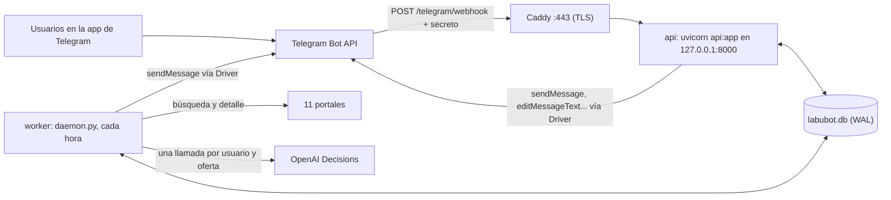

# Diseño: labubot multiusuario por Telegram

Cómo va a quedar el código cuando labubot deje de mandarle ofertas a un chat fijo
y pase a ser un bot con usuarios, cada uno con su perfil, sus términos y sus
palabras bloqueadas. Describe el estado final de F1 a F4; lo de F5 (Huey y
`/buscar`) está marcado como opcional.

Los nombres de tablas, columnas, comandos, `callback_data`, estados, módulos y
variables son los del contrato de diseño. Donde este documento se aparta del
contrato o inventa algo que el contrato no dice, lo avisa con **(fuera del contrato)**.

**Revisión del 31/10/2026.** El bot es interno: como mucho 5 usuarios. Cambian
cuatro cosas, que pisan al contrato donde se contradicen: la corrida pasa a ser
**por usuario, uno tras otro** y con una caché de búsquedas en memoria (D4);
cada oferta se agrupa bajo **la palabra clave que la trajo**, en un bloque por
palabra que, si no trajo 🟢🟡, avisa sin sonido que no hubo coincidencias (D7);
al final, siempre, un **resumen silencioso** con lo que trajo cada palabra
(D11); e Indeed y Workable pasan a buscar **palabra por palabra** (D12).
`deliveries` suma la columna `term` y el bot estrena logo (sección 8). El
formato de los mensajes de D7 y D11 es el que definió el usuario el 01/11/2026.

| Documento | Qué tiene |
|---|---|
| [`bdd.html`](bdd.html) | Diagrama de la base: tablas, claves y relaciones |
| [`schema.sql`](schema.sql) | El esquema SQL de referencia |
| [`conexion.html`](conexion.html) | Cómo llega un mensaje: Telegram → Caddy → api → `labubot.db` |
| [`ciclo-usuario.html`](ciclo-usuario.html) | Ciclo de vida de `users.status` |
| [`casos-de-uso.html`](casos-de-uso.html) | UC01 a UC11 |
| [`secuencia-alta.html`](secuencia-alta.html) | Secuencia del alta: `/start`, aprobación del admin, `/perfil` |
| [`secuencia-config.html`](secuencia-config.html) | Secuencia de editar palabras bloqueadas desde `/settings` |
| [`secuencia-corrida.html`](secuencia-corrida.html) | Secuencia de la corrida horaria por usuario: caché, envío por palabra y resumen silencioso |
| [`capturas/`](capturas/index.html) | Cómo se ve el bot en el teléfono, pantalla por pantalla |
| [`logo/`](logo/) | El logo del bot: las propuestas y la elegida, que va de avatar con `/setuserpic` |
| [`tareas.md`](tareas.md) | El plan de implementación, F0 a F6, con aceptación por tarea |
| [`vps.md`](vps.md) | Evaluación de proveedores (todavía sin elegir) y el plan de prueba de la IP, que vale para cualquiera |

---

## 1. Resumen y decisiones

**Hoy.** Una corrida por hora (`daemon.py`) busca en 11 portales con las listas
de `src/config/search.py`, saltea lo que está en `vistas.txt`, descarta títulos
con palabras bloqueadas, baja la descripción, la clasifica con OpenAI contra
`perfil.md` y manda 🟢 y 🟡 a un único chat (`TELEGRAM_CHAT_ID`). El bot no
recibe nada.

**Después.** Dos procesos sobre un SQLite compartido:

- **api** recibe los mensajes de Telegram por webhook. Con eso cada persona pide
  acceso, carga su CV y edita sus términos y sus palabras bloqueadas.
- **worker** hace la corrida de hoy una vez por usuario activo, uno tras otro:
  cada uno con sus palabras clave, sus bloqueadas y su perfil. Lo que un usuario
  anterior ya buscó en esa corrida se reusa sin pedirlo de nuevo, y cada
  descripción se baja una sola vez para siempre. Cada usuario recibe un bloque
  por palabra clave, con sus 🟢🟡 o, sin sonido, "No se encontraron
  coincidencias.", y al final un resumen sin sonido con lo que trajo cada una.

Es un bot interno, de hasta 5 usuarios. `vistas.txt` y `perfil.md` pasan a la
base (`deliveries` y `users.profile`).

| | Decisión | Por qué |
|---|---|---|
| D1 | VPS Linux con dominio propio. Telegram llama por webhook HTTPS a Caddy (TLS automático), que pasa a uvicorn en `127.0.0.1:8000`. En la PC, un túnel `cloudflared` al uvicorn local | El bot tiene que contestar a toda hora; con webhook no hay un proceso más haciendo polling, y el mismo código corre en la PC y en el VPS |
| D2 | Cada usuario tiene su perfil, sus términos y sus palabras bloqueadas; al aprobarlo se le cargan `DEFAULT_TERMS` y `DEFAULT_BLOCKED_TITLE_WORDS` | El veredicto depende del CV, y qué buscar o descartar también depende de cada uno |
| D3 | `/start` deja al usuario en `pending` y el admin (`ADMIN_CHAT_ID`) aprueba o rechaza con botones. El `/start` del admin lo activa directo | Cada usuario cuesta ~50 llamadas al LLM por hora, que paga la cuenta del admin |
| D4 | Una ejecución por usuario, secuencial y sin hilos: `main()` recorre `Users.active()` por orden de alta y a cada uno le corre la búsqueda completa con sus palabras (`Users.terms`, en orden alfabético), sus bloqueadas y su perfil. Una caché en memoria de la corrida, `searches[(portal, palabra)] = {url: título}`, evita repetir lo que ya buscó un usuario anterior, y los portales sin búsqueda se piden una sola vez por corrida, con clave `(portal, "")`; las descripciones siguen en `offers`, una bajada por url para siempre. A cada usuario le llegan solo ofertas de sus palabras (más los portales sin búsqueda, D12) | Son como mucho 5 usuarios. En paralelo serían hasta 5 búsquedas a la vez a LinkedIn desde la misma IP, que ya contesta 429 en el 11 % a 18 % de los pedidos con una sola. En serie entra en la hora: el primero paga el scraping (10 a 25 min, 28/10) y los demás salen casi enteros de la caché; cada uno suma ~50 llamadas al LLM. Reemplaza a la "unión de términos" y a "toda oferta es candidata para todo usuario" |
| D5 | Sin Redis ni Celery. Dos procesos, `api` y `worker`, sobre `labubot.db` en modo WAL (la "Fase 1" del contrato). F5 (opcional; la "Fase 2" del contrato): Huey con `SqliteHuey` y un solo worker en lugar de `schedule`, dentro de `daemon.py` | Una corrida por hora y pocos usuarios no justifican un broker; WAL deja leer a uno mientras el otro escribe |
| D6 | Telegram a mano: FastAPI solo recibe; todo lo que sale a la Bot API pasa por `Driver.post_json()` / `get()` | `python-telegram-bot` y `aiogram` traen su propio httpx y romperían la regla del `Driver`; el código usa seis métodos JSON de la Bot API y una descarga |
| D7 | Por usuario, después de clasificar sus ofertas nuevas: un bloque por cada una de sus palabras, en orden alfabético y como están guardadas (en minúsculas). Si la palabra tiene 🟢🟡 en esta corrida, un encabezado `KEYWORD_HEADER` (`'Búsqueda palabra "{term}":'`) y después un mensaje por oferta, `OFFER` (`"{emoji} {title}\n{url}"`), primero las verdes y después las amarillas, con sonido. Si no tiene, un solo mensaje sin sonido (`disable_notification`): el encabezado y, en el renglón de abajo, `NO_MATCHES` (`"No se encontraron coincidencias."`). "Otros portales" va al final y solo si tiene 🟢🟡: `OTHER_PORTALS_HEADER` (`"Otros portales:"`) y sus ofertas; vacío no se manda, porque no es una búsqueda del usuario. Las pendientes de corridas anteriores entran en su grupo según `deliveries.term`. `PAUSE = 1` s antes de cada mensaje. Formato definido por el usuario el 01/11/2026 | Se lee de un vistazo qué palabra trae qué y cuáles no trajeron nada, y cada oferta se sigue pudiendo abrir, reenviar o borrar sola, como hoy. Solo suena lo que trae ofertas. La pausa respeta el tope de un mensaje por segundo por chat |
| D8 | Si Telegram contesta 403 al enviar, el `Driver` lanza `LabubotForbiddenError` y la corrida pasa a ese usuario a `blocked` y sigue con los demás. Un `/start` lo vuelve a `active` | Un usuario que bloqueó el bot no puede frenar la corrida de los demás ni recibir reintentos para siempre |
| D9 | `migrate.py` se corre una vez: crea al admin con `perfil.md` y las semillas, e importa `vistas.txt` como `deliveries` del admin con `light` NULL | El admin no pierde su perfil ni vuelve a pagar las 1.564 urls que ya vio |
| D10 | Solo chats privados (`chat.type == "private"`), donde `chat.id == from.id`; los grupos se ignoran | Un chat es una persona: `chat_id` sirve de clave del usuario y nadie mezcla perfiles en un grupo |
| D11 | Al final de la corrida de cada usuario, siempre, un resumen con `disable_notification = true`: `SUMMARY_TITLE` (`"Resumen corrida ({start} - {end}):"`, en `HH:MM` de hora local: `start` cuando arrancó la corrida de ese usuario, `end` cuando sale el resumen) y una línea por palabra, en el orden de los bloques: `"python: 1 verde encontrado - 1 amarillo encontrado"` (solo la parte que tenga: `"django: 2 amarillos encontrados"`) o `"developer: No encontramos coincidencias"`. "Otros portales" suma su línea al final solo si trajo 🟢🟡. Una coincidencia es una 🟢🟡 que se le manda en esta corrida bajo esa palabra, pendientes incluidas; las rojas y las ya vistas no cuentan. Formato definido por el usuario el 01/11/2026 | El usuario sabe que la corrida anduvo, cuándo empezó y terminó la suya y qué le rindió cada palabra, sin que le suene el celular cada hora |
| D12 | Indeed y Workable buscan palabra por palabra, como LinkedIn, Computrabajo, GetOnBoard, Himalayas y Talent. La palabra de una oferta es la primera del usuario (en orden alfabético) cuya búsqueda la trajo. En los portales sin búsqueda (Bumeran, EmpleosIT, Jobicy, WeWorkRemotely) es la primera palabra del usuario contenida en el título, en minúsculas; si no hay ninguna, va a "Otros portales" (`term` NULL). Cada oferta aparece una sola vez por usuario, bajo su primera palabra | Con un solo `OR` de todos los términos no se sabe qué palabra trajo cada oferta. Cuesta hasta 22 pedidos más por portal y corrida, acotados por la caché de D4; si dan 429, se vuelve al `OR` y se atribuye por título, como en los portales sin búsqueda |

---

## 2. Procesos



| Proceso | Cómo arranca | Qué hace | Con quién habla |
|---|---|---|---|
| **api** | `uvicorn api:app --host 127.0.0.1 --port 8000` (unidad `labubot-api`) | Recibe cada update, valida el secreto, lo atiende (alta, aprobación, `/settings`, `/perfil`, pausa) y contesta `200`. No scrapea ni llama al LLM: cada update son uno a tres pedidos a Telegram | Telegram (entra por Caddy, sale por el `Driver`), `labubot.db` |
| **worker** | `python daemon.py` (unidad `labubot-worker`) | Corre `main()` al arrancar y cada hora, como hoy; `main()` atiende a los usuarios activos de a uno. F5: `huey_consumer daemon.huey -w 1` | Portales y Telegram (por el `Driver`), OpenAI (por el SDK), `labubot.db` |
| **labubot.db** | Lo crea `connect()` la primera vez | SQLite en modo WAL, en la carpeta del repo, junto a sus `-wal` y `-shm` | — |
| **Caddy** (solo en el VPS) | Servicio `caddy` del paquete | Saca y renueva el certificado, y pasa a uvicorn solo `/telegram/webhook`; el resto contesta 404 | Telegram, api |
| `migrate.py`, `set_webhook.py` | A mano, una vez | Migración inicial; registro del webhook y del menú de comandos | `labubot.db`; Telegram |

**Quién lee y escribe cada tabla:**

| Tabla | api | worker | `migrate.py` |
|---|---|---|---|
| `users` | lee y escribe: alta, `status`, `profile`, `state` | lee `active()`; escribe `status = 'blocked'` | crea al admin |
| `user_terms`, `user_blocked_words` | lee y escribe (panel, semilla al aprobar) | lee | carga la semilla del admin |
| `offers` | — | lee y escribe | — |
| `deliveries` | — | lee y escribe, con la palabra que trajo cada oferta (`term`) | importa `vistas.txt` (`term` NULL) |

**Cómo conviven sobre el mismo archivo.** En modo WAL los lectores no bloquean al
escritor ni al revés; escribe uno a la vez. Las dos partes hacen transacciones
cortas (un `commit()` por escritura) y `sqlite3.connect()` espera hasta 5 s si
el otro tiene el lock, así que un choque se resuelve solo. La api abre una
conexión por update y la cierra al contestar; el worker, una por corrida.

**Lo que ve la corrida.** `main()` lee los usuarios activos al empezar, con su
perfil: un `/pausa` o un perfil nuevo a mitad de una corrida rigen desde la
siguiente. Las palabras y las bloqueadas de cada uno se leen cuando le llega el
turno, así que una palabra agregada mientras corría el usuario anterior ya entra.

---

## 3. Árbol de carpetas

`[nuevo]` se crea · `[cambia]` existe y se modifica · `[se borra]` desaparece
(si se muda, dice adónde) · `[igual]` no se toca. Lo que está fuera de git va
marcado como tal.

```text
labubot/
├── api.py                          [nuevo]    FastAPI: app + router del webhook
├── daemon.py                       [igual]    main() al arrancar y cada hora (F5: Huey reemplaza a schedule acá mismo)
├── main.py                         [cambia]   la corrida: un usuario tras otro, con caché de búsquedas
├── migrate.py                      [nuevo]    migración única: labubot.db desde perfil.md, vistas.txt y search.py
├── set_webhook.py                  [nuevo]    registra webhook y comandos en Telegram, una vez por deploy
├── pyproject.toml, poetry.lock     [cambia]   + fastapi, uvicorn (F5: + huey, − schedule)
├── .env.example                    [cambia]   + ADMIN_CHAT_ID, WEBHOOK_URL, WEBHOOK_SECRET, DB_PATH; − TELEGRAM_CHAT_ID
├── .gitignore                      [cambia]   + *.db* (labubot.db, sus -wal/-shm, prueba.db, huey.db)
├── README.md                       [cambia]   F6
├── CLAUDE.md                       [cambia]   F6, ver sección 10
├── labubot.db (+ -wal, -shm)       [nuevo]    fuera de git
├── perfil.md                       [igual]    fuera de git; después de migrar no se lee, queda de respaldo
├── vistas.txt                      [igual]    fuera de git; después de migrar no se lee, queda de respaldo
├── vistas.json                     [igual]    fuera de git; no se toca
├── logs/app.log                    [igual]    lo escriben los dos procesos
├── resultados/                     [igual]    el .csv suma las columnas chat_id y term
├── deploy/                         [nuevo]
│   ├── Caddyfile
│   ├── labubot-api.service
│   └── labubot-worker.service
├── docs/
│   ├── arquitectura.*              [cambia]   F6: Caddy, api, worker, labubot.db
│   ├── pipeline.*                  [cambia]   F6: corrida por usuario, caché de búsquedas, offers, deliveries
│   ├── rate-limits.*               [igual]
│   └── telegram/                   [nuevo]    este diseño; logo/ tiene el avatar del bot
└── src/
    ├── classifier/openai.py        [cambia]   solo el docstring de cv: Classifier(cv) ya recibe el CV por parámetro
    ├── config/
    │   ├── settings.py             [cambia]   + admin_chat_id, webhook_url, webhook_secret, db_path; − telegram_chat_id
    │   └── search.py               [cambia]   TERMS → DEFAULT_TERMS, BLOCKED_TITLE_WORDS → DEFAULT_BLOCKED_TITLE_WORDS
    ├── constants/
    │   ├── http.py                 [igual]
    │   ├── openai.py               [igual]
    │   ├── prompt.py               [igual]
    │   └── telegram.py             [se borra] → src/telegram/constants.py
    ├── db/
    │   ├── schema.sql              [nuevo]    las cinco tablas y el índice, con IF NOT EXISTS
    │   ├── database.py             [nuevo]    connect()
    │   ├── users.py                [nuevo]    Users
    │   ├── offers.py               [nuevo]    Offers, Deliveries
    │   └── seen.py                 [se borra] SeenUrls: lo reemplaza deliveries
    ├── driver/http.py              [cambia]   403 → LabubotForbiddenError
    ├── enums/
    │   ├── traffic_light.py        [igual]
    │   ├── user_status.py          [nuevo]    UserStatus
    │   └── chat_state.py           [nuevo]    ChatState
    ├── exceptions/exceptions.py    [cambia]   + LabubotForbiddenError
    ├── notifier/telegram.py        [se borra] → src/telegram/bot.py
    ├── portals/                    [igual]    salvo indeed y workable; 11 carpetas: __init__.py, constants.py, portal.py y su *_extractor.py
    │   ├── bumeran/  computrabajo/  empleosit/  getonbrd/  himalayas/
    │   ├── jobicy/  linkedin/  talent/  weworkremotely/
    │   ├── indeed/portal.py        [cambia]   search(keywords): una palabra; entre comillas si tiene espacios
    │   └── workable/portal.py      [cambia]   ídem
    ├── schemas/
    │   ├── job.py                  [cambia]   Offer y Found (url de un listado, con su palabra y su portal)
    │   ├── telegram.py             [nuevo]    TelegramUser, Chat, Document, Message, CallbackQuery, Update
    │   └── user.py                 [nuevo]    User
    └── telegram/                   [nuevo]    todo lo de la Bot API, como una carpeta de portal
        ├── __init__.py
        ├── bot.py                  Telegram: lo que sale hacia la Bot API
        ├── webhook.py              router: lo que entra desde la Bot API
        ├── handlers.py             on_message, on_callback
        ├── keyboards.py            los inline keyboards
        └── constants.py            URLs, PAUSE, EMOJIS, comandos y textos
```

`src/telegram/` sigue la regla de "una carpeta por sitio externo": todo lo de
Telegram vive ahí (qué pedir, qué recibir, sus URLs y sus textos), igual que
`src/portals/linkedin/` tiene todo lo de LinkedIn. Para hablar con la Bot API usa
el `Driver`, que sigue sin saber con quién habla.

---

## 4. Módulo por módulo

Las firmas son las públicas. Acá va solo la línea de resumen de cada docstring;
en el código lleva además `Args` / `Returns` / `Raises`, como el resto del repo.

### Raíz

**`api.py`** [nuevo] · Arma la app y nada más; uvicorn la levanta con `api:app`.

```python
app = FastAPI()
app.include_router(router)  # el de src/telegram/webhook.py
```

**`main.py`** [cambia] · La corrida, un usuario tras otro (los pasos y el
código, en la sección 5.5).

```python
def main() -> None:
    """Una corrida: a cada usuario activo, uno tras otro, le busca y le manda 🟢🟡."""
```

Sus ayudantes privados:

| Función | Qué hace |
|---|---|
| `_run_user(conn, telegram, portals, searches, user) -> list[list]` | La corrida completa de un usuario: anota a qué hora arranca, busca, clasifica lo nuevo, manda por palabra y el resumen. Atrapa el 403 de ese usuario |
| `_search_user(portals, searches, terms) -> dict[str, Found]` | Las ofertas de sus palabras, `url → Found`, cada una con la primera palabra que la trajo; lo que falta en la caché `searches` lo pide y lo agrega |
| `_send_by_keyword(telegram, deliveries, chat_id, keywords, groups) -> int` | Un bloque por palabra (D7): el encabezado y un mensaje por oferta, verdes primero, con `mark_sent` por cada una; o, sin sonido, el encabezado con `NO_MATCHES`. "Otros portales", al final y solo si trajo algo |
| `_send_summary(telegram, chat_id, keywords, groups, started) -> None` | El resumen de D11: siempre y sin sonido |
| `_count_text(templates, count) -> str` | "1 verde encontrado" o "3 verdes encontrados": el singular o el plural de `SUMMARY_GREENS` / `SUMMARY_YELLOWS` |
| `_word_in_title(title, words) -> str \| None` | La primera palabra de la lista que aparece en el título: la bloqueada que lo descarta o la palabra clave de un portal sin búsqueda. Es el loop de `BLOCKED_TITLE_WORDS` que hoy está dentro de `main()` |
| `_save_results(rows, started) -> None` | El `.json` y el `.csv` de la corrida |

Hoy `main()` no tiene ayudantes: la búsqueda, el filtro por título, la
clasificación y el envío son loops dentro de ella. Las pendientes no tienen un
reenvío aparte: viajan con su grupo. Se van `SeenUrls`, `SEEN_PATH` y
`PROFILE_PATH`, y el `OR` de Indeed y Workable (`any_term`).
`WITHOUT_SEARCH = ("Bumeran", "EmpleosIT", "Jobicy", "WeWorkRemotely")` nombra
los portales sin búsqueda **(fuera del contrato)**.

F5: `main(chat_ids: list[int] | None = None)`; con `chat_ids`, el mismo loop
sobre esos usuarios solos, con la caché vacía (para `/buscar`).

**`daemon.py`** [igual] · `run()` y `daemon()` como hoy: `main()` al arrancar y
`schedule.every().hour`. En F5 (T5.1) Huey reemplaza a `schedule` en este mismo
archivo: deja el `while True` y define `huey = SqliteHuey(filename="huey.db")`;
`run(chat_ids=None)` (log de inicio, duración y `logger.exception`) lo llaman
`hourly()`, con `@huey.periodic_task(crontab(minute="0"))`, y
`run_for(chat_id: int)`, con `@huey.task()`; `@huey.on_startup()` encola
`hourly()` para conservar la corrida al arrancar. El consumer corre con `-w 1`:
dos scrapes a la vez son el doble de 429 de LinkedIn. `handlers.py` importa
`run_for` desde `daemon` para `/buscar`.

**`migrate.py`** [nuevo] · La migración de la sección 9.

```python
def migrate() -> None:
    """Crea al admin con perfil.md y las semillas, e importa vistas.txt como sus deliveries."""
```

**`set_webhook.py`** [nuevo] · Se corre a mano una vez por deploy, o cada vez que
cambia la URL del túnel en la PC.

```python
def main() -> None:
    """Registra WEBHOOK_URL con su secreto y publica el menú de comandos."""
```

### `src/config/`

**`settings.py`** [cambia]

```python
class Settings(BaseSettings):
    location: str = "Argentina"
    hours: int = 24
    llm_api_key: str = ""
    telegram_token: str = ""
    admin_chat_id: int = 0          # nuevo: el chat del admin (D3)
    webhook_url: str = ""           # nuevo: https://.../telegram/webhook
    webhook_secret: str = ""        # nuevo: el secret_token de setWebhook
    db_path: str = "labubot.db"     # nuevo
    log_level: str = "INFO"

    model_config = SettingsConfigDict(env_file=".env")
```

Se va `telegram_chat_id`, también de la lista de variables del docstring de
`Settings`, que suma las cuatro nuevas. Ojo: `BaseSettings` rechaza claves de
más en el `.env`, así que hay que borrar también la línea `TELEGRAM_CHAT_ID` del
`.env` o no arranca nada (`Extra inputs are not permitted`). La configuración del log no
cambia: los dos procesos escriben en `logs/app.log`.

**`search.py`** [cambia] · `DEFAULT_TERMS: list[str]` (22) y
`DEFAULT_BLOCKED_TITLE_WORDS: list[str]` (32), con los valores de hoy. Ya no las
usa la corrida: son la semilla de cada usuario nuevo (`Users.seed_defaults`).

### `src/driver/http.py` [cambia]

Un caso más en `_send()`: `403 → LabubotForbiddenError(f"Respondió 403 al obtener {subject}")`,
antes del `raise` genérico, y sumado a los `Raises:` de `get()` y `post_json()`.
Es HTTP genérico: el `Driver` no sabe que en Telegram un 403 quiere decir
"el usuario bloqueó el bot".

- Reglas: sigue siendo el único que importa httpx y no entra nada de un portal
  ni de Telegram.
- Efecto en los portales: todos atrapan `LabubotError`, del que hereda la nueva,
  así que un 403 de un portal corta solo esa búsqueda, como hoy. LinkedIn además
  lo reintenta 10 veces (ver riesgos).

### `src/exceptions/exceptions.py` [cambia]

```python
class LabubotForbiddenError(LabubotError):
    """El sitio devolvió 403."""
```

### `src/enums/` [nuevo `user_status.py` y `chat_state.py`]

```python
class UserStatus(StrEnum):
    """En qué punto del alta está un usuario y si recibe ofertas."""

    PENDING = "pending"     # pidió acceso, espera al admin
    ACTIVE = "active"       # recibe ofertas, si cargó el perfil
    PAUSED = "paused"       # /pausa: no recibe
    REJECTED = "rejected"   # el admin lo rechazó; terminal
    BLOCKED = "blocked"     # bloqueó el bot: 403 al enviar


class ChatState(StrEnum):
    """Qué espera el bot del próximo mensaje de ese chat."""

    IDLE = ""
    AWAITING_PROFILE = "awaiting_profile"
    AWAITING_TERMS_ADD = "awaiting_terms_add"
    AWAITING_TERMS_REMOVE = "awaiting_terms_remove"
    AWAITING_BLOCKED_ADD = "awaiting_blocked_add"
    AWAITING_BLOCKED_REMOVE = "awaiting_blocked_remove"
```

Ciclo de `users.status` (dibujado en [`ciclo-usuario.html`](ciclo-usuario.html)):
nuevo `--/start-->` `pending` `--Aprobar-->` `active` `--/pausa-->` `paused`
`--/reanudar-->` `active`; `pending` `--Rechazar-->` `rejected` (terminal);
`active | paused` `--403 al enviar-->` `blocked` `--/start-->` `active`. El
admin: `/start` → `active` directo. Un usuario `active` sin perfil no recibe
ofertas hasta cargarlo con `/perfil`.

### `src/schemas/` [nuevo `telegram.py` y `user.py`; cambia `job.py`]

Solo TypedDicts, sin lógica.

`job.py` suma `Found`, lo que `_search_user` sabe de una oferta antes de bajar
su descripción. `Offer` no cambia: es lo que ve el clasificador y no sabe de
palabras ni de portales.

```python
class Found(TypedDict):
    """
    Una oferta de un listado, antes de bajar su descripción.
    title: Título de la oferta.
    term: La palabra clave que la trajo; None = "Otros portales".
    portal: Nombre de la clase del portal, para pedirle la descripción a esa instancia.
    """

    title: str
    term: str | None
    portal: str
```

```python
class User(TypedDict):
    """Una fila de users."""

    chat_id: int
    username: str | None
    first_name: str
    status: str            # un UserStatus
    profile: str           # '' = todavía no cargó el CV
    state: str             # un ChatState
    created_at: str
    approved_at: str | None
```

`telegram.py` tiene solo los campos del Update que se usan. `from` es palabra
reservada, así que `Message` y `CallbackQuery` van con la sintaxis funcional:

```python
class TelegramUser(TypedDict):
    id: int
    first_name: str
    username: NotRequired[str]


class Chat(TypedDict):
    id: int
    type: str              # "private", "group", "supergroup" o "channel"


class Document(TypedDict):
    file_id: str
    file_name: NotRequired[str]


Message = TypedDict(
    "Message",
    {
        "message_id": int,
        "from": TelegramUser,
        "chat": Chat,
        "text": NotRequired[str],
        "document": NotRequired[Document],
    },
)

CallbackQuery = TypedDict(
    "CallbackQuery",
    {"id": str, "from": TelegramUser, "message": Message, "data": str},
)


class Update(TypedDict):
    update_id: int
    message: NotRequired[Message]
    callback_query: NotRequired[CallbackQuery]
```

### `src/db/` [cambia]

Lo que se recuerda entre corridas, ahora en SQLite. Cada clase recibe la
conexión ya abierta (la abre quien la usa: el endpoint del webhook, `main()` o
`migrate.py`) y cada método que escribe hace su `commit()`.

**`schema.sql`** [nuevo] · Las tablas y el índice de [`schema.sql`](schema.sql)
con `CREATE TABLE IF NOT EXISTS` / `CREATE INDEX IF NOT EXISTS`, para poder
correrlo en cada conexión. Los `PRAGMA` van en `connect()`.

`deliveries` lleva, después de `url`, la palabra clave que trajo la oferta. No
suma índice: se lee por `(chat_id, url)`, que ya es la clave, y en `pending()`.

```sql
CREATE TABLE IF NOT EXISTS deliveries (
  chat_id       INTEGER NOT NULL REFERENCES users(chat_id) ON DELETE CASCADE,
  url           TEXT NOT NULL,
  term          TEXT,          -- NULL = "Otros portales" o importada de vistas.txt
  light         TEXT,          -- green | yellow | red; NULL = importada de vistas.txt
  classified_at TEXT NOT NULL,
  sent_at       TEXT,          -- NULL si es roja, importada o si el envío falló
  PRIMARY KEY (chat_id, url)
);
```

**`database.py`** [nuevo]

```python
def connect(path: str) -> sqlite3.Connection:
    """Abre la base en modo WAL, con claves foráneas, filas por nombre y las tablas creadas."""
```

**`users.py`** [nuevo]

```python
class Users:
    def __init__(self, conn: sqlite3.Connection) -> None: ...

    def get(self, chat_id: int) -> User | None:
        """El usuario, o None si nunca escribió."""

    def register(self, chat_id: int, username: str | None, first_name: str) -> None:
        """Lo da de alta en pending, o le actualiza nombre y @ si ya existe."""

    def set_status(self, chat_id: int, status: UserStatus) -> None:
        """Cambia el estado; la primera vez que pasa a active anota approved_at."""

    def set_profile(self, chat_id: int, profile: str) -> None:
        """Reemplaza el CV."""

    def set_state(self, chat_id: int, state: ChatState) -> None:
        """Anota qué espera el bot del próximo mensaje."""

    def active(self) -> list[User]:
        """Los que reciben ofertas: status active y perfil cargado."""

    def all(self) -> list[User]:
        """Todos, por orden de alta (para /usuarios)."""

    def terms(self, chat_id: int) -> list[str]:
        """Sus términos de búsqueda, en orden alfabético."""

    def add_terms(self, chat_id: int, terms: list[str]) -> list[str]:
        """Suma términos en minúsculas y sin espacios de más; devuelve los que no tenía."""

    def remove_terms(self, chat_id: int, terms: list[str]) -> list[str]:
        """Quita términos; devuelve los que tenía."""

    def blocked_words(self, chat_id: int) -> list[str]:
        """Sus palabras bloqueadas, en orden alfabético."""

    def add_blocked_words(self, chat_id: int, words: list[str]) -> list[str]:
        """Suma palabras bloqueadas; devuelve las que no tenía."""

    def remove_blocked_words(self, chat_id: int, words: list[str]) -> list[str]:
        """Quita palabras bloqueadas; devuelve las que tenía."""

    def seed_defaults(self, chat_id: int) -> None:
        """Le carga DEFAULT_TERMS y DEFAULT_BLOCKED_TITLE_WORDS."""
```

Que `add_*` y `remove_*` devuelvan lo que de verdad cambió es lo que permite
contestar "Agregados: wordpress" cuando el usuario mandó `php, wordpress` y `php`
ya estaba. [`capturas/06-agregar-bloqueadas.png`](capturas/06-agregar-bloqueadas.png)
muestra el caso simple: `wordpress, laravel` → "Agregados: wordpress, laravel.
Ahora tenés 34.". Sale del `rowcount` de cada `INSERT OR IGNORE` o `DELETE`.
Si no cambió nada, la lista vuelve vacía y el handler contesta "ninguno" (5.3).

**`offers.py`** [nuevo]

```python
class Offers:
    def __init__(self, conn: sqlite3.Connection) -> None: ...

    def get(self, url: str) -> Offer | None:
        """La oferta con su descripción, o None si nunca se bajó."""

    def add(self, offer: Offer, portal: str) -> None:
        """Guarda la oferta; con descripción '' si el portal no la dio, así no se vuelve a pedir."""


class Deliveries:
    def __init__(self, conn: sqlite3.Connection) -> None: ...

    def exists(self, chat_id: int, url: str) -> bool:
        """Dice si esa oferta ya se evaluó (o se importó) para ese usuario."""

    def add(
        self, chat_id: int, url: str, light: TrafficLight | None, term: str | None
    ) -> None:
        """Anota el veredicto y la palabra que la trajo; light None = importada de vistas.txt."""

    def mark_sent(self, chat_id: int, url: str) -> None:
        """Anota que el mensaje llegó a Telegram."""

    def pending(self) -> list[sqlite3.Row]:
        """Verdes y amarillas sin enviar de usuarios active, con chat_id, url, term, title y light."""
```

`term` es la palabra clave que trajo la oferta; NULL es "Otros portales" (un
portal sin búsqueda cuyo título no tiene ninguna de sus palabras) o una url
importada de `vistas.txt`, que se graba con `add(admin, url, None, None)`.

`pending()` saca el `title` de `offers` por JOIN: toda entrega verde o amarilla
tiene su fila en `offers`, porque para clasificarla hubo que bajar la
descripción. Con `term`, cada pendiente vuelve a su grupo en el envío por palabra.
Devuelve `sqlite3.Row` y no un TypedDict nuevo **(fuera del contrato)**: lo usa
un solo loop de `_run_user`, que se queda con las filas de su `chat_id`.

`seen.py` [se borra] cuando `main()` deja de usarlo (F2).

- Reglas: `src/db/` sigue siendo "lo que se recuerda entre corridas"; no sabe de
  Telegram ni de portales, solo guarda y devuelve.

### `src/classifier/openai.py` [cambia: solo un docstring]

`Classifier(cv: str)` ya recibe el CV por parámetro y `classify(offers)` ya
devuelve `{url: TrafficLight}` con una llamada a Decisions por oferta. En el
código cambia solo el docstring de `cv`, que hoy dice "tal como está en
perfil.md". Lo demás que cambia es quién lo instancia: `_run_user`, uno por
usuario, con `user["profile"]`. Lo llama de a una oferta (`classify([offer])`)
para guardar cada veredicto apenas se paga. Sigue hablando con OpenAI por el
SDK, no por el `Driver`.

### `src/telegram/` [nuevo; reemplaza a `src/notifier/` y `src/constants/telegram.py`]

Todo lo de Telegram junto, como un portal: `bot.py` es lo que sale (el
equivalente de `portal.py`), `webhook.py` y `handlers.py` lo que entra, y
`keyboards.py` y `constants.py` lo propio del sitio. `__init__.py` exporta
`Telegram`, como los `__init__.py` de los portales.

**`bot.py`**

```python
class Telegram:
    """La Bot API por el Driver: un método por cada cosa que el bot hace hacia afuera."""

    def __init__(self, driver: Driver) -> None: ...

    def send_message(
        self,
        chat_id: int,
        text: str,
        keyboard: dict | None = None,
        silent: bool = False,
    ) -> int:
        """Manda un texto, con botones si vienen y sin sonido si silent; devuelve el message_id."""

    def edit_message(
        self, chat_id: int, message_id: int, text: str, keyboard: dict | None = None
    ) -> None:
        """Reemplaza el texto y los botones de un mensaje ya mandado."""

    def answer_callback(self, callback_id: str) -> None:
        """Le avisa a Telegram que el botón se atendió, para que deje de mostrar 'cargando'."""

    def send_offer(self, chat_id: int, offer: Offer, light: TrafficLight) -> None:
        """Manda una oferta con su emoji, después de esperar PAUSE."""

    def set_commands(self) -> None:
        """Publica el menú /: COMMANDS para todos y COMMANDS + ADMIN_COMMANDS en el chat del admin."""

    def set_webhook(self, url: str, secret: str) -> None:
        """Registra la URL del webhook con su secreto, solo para message y callback_query."""

    def download_file(self, file_id: str) -> str:
        """Baja un archivo que mandó el usuario y lo devuelve como texto UTF-8."""
```

Por dentro, un `_call(method, body)` arma `BOT_API_URL.format(token=..., method=...)`,
llama a `Driver.post_json()`, parsea el JSON y devuelve su `result`. Conserva el
chequeo de hoy: un token inválido da 404, el `Driver` devuelve vacío y `_call`
lanza `LabubotRequestError("Telegram no reconoce TELEGRAM_TOKEN")`. El `subject`
de cada pedido nombra el método ("el sendMessage de Telegram") y nunca la URL,
que lleva el token. `send_message` y `send_offer` pueden lanzar
`LabubotForbiddenError` (el usuario bloqueó el bot), `LabubotRateLimitError` (429)
y `LabubotRequestError`.

`silent=True` agrega `"disable_notification": true` al cuerpo del `sendMessage`;
con `False` el campo no va. Lo usan los bloques sin coincidencias (D7) y el
resumen (D11). `send_offer` sigue esperando `PAUSE` antes de mandar; los
encabezados, los bloques sin coincidencias y el resumen salen con
`send_message`, y la pausa la pone `main.py` antes de llamarlo **(fuera del
contrato)**: en la api, `send_message` contesta al toque.

**`webhook.py`**

```python
router = APIRouter()


@router.post("/telegram/webhook")
def webhook(
    update: dict[str, Any],
    x_telegram_bot_api_secret_token: Annotated[str, Header()] = "",
) -> dict[str, bool]:
    """Valida el secreto, atiende el update y contesta {"ok": True}."""
```

Es `def` y no `async def`: el `Driver` es sincrónico y FastAPI corre el endpoint
en su threadpool. `update` llega como `dict` sin validar: si FastAPI lo
rechazara con 422, Telegram reintentaría el mismo update. Hay un `Driver` y un
`Telegram` por proceso, creados al importar el módulo.

**`handlers.py`**

```python
def on_message(conn: sqlite3.Connection, telegram: Telegram, message: Message) -> None:
    """Contesta un mensaje privado: /start, un comando, o texto/archivo según users.state."""


def on_callback(
    conn: sqlite3.Connection, telegram: Telegram, callback: CallbackQuery
) -> None:
    """Atiende un botón: el panel, pedir una lista, pausa, o aprobar/rechazar."""
```

Reglas de despacho:

- Sin fila en `users`, o con `status` `pending`, `rejected` o `blocked`, todo
  mensaje se atiende como `/start`: pending → "⏳ Tu solicitud sigue pendiente.",
  rejected → "No tenés acceso a este bot.", blocked → vuelve a `active`.
- Un comando a mitad de un estado lo cancela (`state = ''`) y se atiende.
  `/start` también: `_start` deja `state = ''`.
- Un texto o un archivo se interpreta según `users.state`; sin estado, `UNKNOWN`.
  En `awaiting_profile`, un mensaje que no es texto ni un documento `.md` o `.txt`
  (una foto, un sticker, un `.pdf`) vuelve a pedir `ASK_PROFILE` y el estado sigue.
- `on_callback` llama a `answer_callback` siempre, antes que nada. `approve:` y
  `reject:` solo si `from.id == ADMIN_CHAT_ID` y la solicitud sigue `pending`
  (un botón viejo no aprueba dos veces).

| `callback_data` | Qué hace |
|---|---|
| `terms`, `blocked` | Edita el panel a la lista (ítems separados por `" · "`) con `list_keyboard(kind)` |
| `terms:add`, `terms:remove`, `blocked:add`, `blocked:remove` | `state = awaiting_*` y edita el mensaje a `ASK_LIST` con `cancel_keyboard()` |
| `profile` | `state = awaiting_profile` y edita el mensaje a `ASK_PROFILE` con `cancel_keyboard()` |
| `pause`, `resume` | `status = paused` / `active` y redibuja el panel |
| `menu`, `cancel` | `state = ''` y vuelve al panel |
| `approve:{chat_id}` | `active` + `seed_defaults`; el mensaje del admin pasa a "✅ Aprobada: …", sin botones, y después `APPROVED` al usuario (así un 403 del usuario no deja la solicitud sin editar) |
| `reject:{chat_id}` | `rejected`; el mensaje del admin pasa a "❌ Rechazada: …". Al usuario no se le avisa: se entera con su próximo mensaje **(fuera del contrato: no hay texto para eso)** |

**`keyboards.py`** · Cada función devuelve el `reply_markup`
(`{"inline_keyboard": [[...]]}`).

```python
def settings_keyboard(user: User) -> dict:
    """Los cuatro botones del panel; Pausar o Reanudar según user['status']."""


def list_keyboard(kind: str) -> dict:
    """Agregar, Quitar y Volver de la lista 'terms' o 'blocked'."""


def cancel_keyboard() -> dict:
    """Un solo botón: ✖ Cancelar."""


def approval_keyboard(chat_id: int) -> dict:
    """✅ Aprobar y ❌ Rechazar para la solicitud de ese chat."""
```

El contrato dice `settings_keyboard(user, counts)`, pero los conteos van en el
texto del panel y no en los botones (ver [`capturas/04-settings.png`](capturas/04-settings.png)),
así que la firma queda sin `counts` **(fuera del contrato)**. El `callback_data`
más largo es `approve:` más un id de Telegram (hasta 16 dígitos): 24 bytes de 64.

**`constants.py`** · Lo que hoy está en `src/constants/telegram.py`, más los
comandos y los textos, como plantillas `.format`.

| Nombre | Valor |
|---|---|
| `BOT_API_URL` | `"https://api.telegram.org/bot{token}/{method}"` (reemplaza a `SEND_MESSAGE_URL`) |
| `FILE_URL` | `"https://api.telegram.org/file/bot{token}/{file_path}"` |
| `PAUSE` | `1.0` |
| `EMOJIS` | `{TrafficLight.GREEN: "🟢", TrafficLight.YELLOW: "🟡"}` |
| `COMMANDS` | `start` "Pedir acceso o reactivar el bot", `settings` "Términos, bloqueadas y perfil", `perfil` "Cargar o reemplazar tu CV", `pausa` "Pausar las alertas", `reanudar` "Volver a recibir alertas", `ayuda` "Qué hace el bot y cómo usarlo" (los de [`capturas/10-menu-comandos.png`](capturas/10-menu-comandos.png)). F5: + `buscar` |
| `ADMIN_COMMANDS` | `usuarios` "Usuarios y su estado" **(fuera del contrato: la descripción)** |
| `WELCOME_PENDING` … `UNKNOWN`, `OFFER` | Los textos canónicos del contrato, tal cual, salvo `ASK_LIST` (abajo) |
| `SETTINGS_PANEL` | `"⚙️ Tu configuración\nTérminos: {terms} · Bloqueadas: {blocked} · Perfil: {profile_mark} · Alertas: {alerts}"`, con `profile_mark` ✅ o ❌ y `alerts` "activas" o "pausadas" |
| `TERMS_LIST`, `BLOCKED_LIST` | `"🔎 Términos ({count})\n{items}"`, `"🚫 Bloqueadas ({count})\n{items}"` **(fuera del contrato; como en las capturas)** |
| `ADMIN_APPROVED`, `ADMIN_REJECTED` | `"✅ Aprobada: {first_name} (@{username})"`, `"❌ Rechazada: {first_name} (@{username})"` |
| `USERS_HEADER`, `USER_LINE`, `STATUS_LABELS` | `/usuarios` **(fuera del contrato)**: `"👥 Usuarios ({count})"` y una `"{first_name}{username}\n{status} · {chat_id}"` por usuario, separadas por un renglón en blanco. `username` es `" @usuario"` o `""` si no tiene; `status` sale de `STATUS_LABELS` (`active` "✅ activo", `paused` "⏸ pausado", `pending` "⏳ pendiente", `rejected` "❌ rechazado", `blocked` "🚫 bloqueó el bot"). En dos renglones para que no se parta en el celular ([`capturas/11-admin-usuarios.png`](capturas/11-admin-usuarios.png)) |
| `HELP` | El texto de `/ayuda`: qué hace el bot y la lista de comandos **(fuera del contrato)** |
| `KEYWORD_HEADER` | `'Búsqueda palabra "{term}":'`: el encabezado del bloque de cada palabra (D7), con la palabra como está guardada (en minúsculas) |
| `NO_MATCHES` | `"No se encontraron coincidencias."`: va en el mismo mensaje que el encabezado, en el renglón de abajo, cuando la palabra no trajo 🟢🟡; ese mensaje sale sin sonido |
| `OTHER_PORTALS_HEADER` | `"Otros portales:"`: el encabezado de las ofertas sin palabra (`term` None), que va al final y solo si hay alguna |
| `OTHER_PORTALS` | `"Otros portales"`: cómo aparece ese grupo en las líneas del resumen **(fuera del pedido del 01/11: no nombra la constante)** |
| `SUMMARY_TITLE` | `"Resumen corrida ({start} - {end}):"`, en hora local `HH:MM`: `start`, cuando arrancó la corrida de ese usuario; `end`, cuando sale el resumen (D11) |
| `SUMMARY_LINE` | `"{term}: {counts}"`: una por palabra con 🟢🟡, con `counts` = las verdes, las amarillas o las dos separadas por `" - "` **(fuera del pedido del 01/11: una plantilla en lugar de tres)** |
| `SUMMARY_GREENS`, `SUMMARY_YELLOWS` | `("{count} verde encontrado", "{count} verdes encontrados")` y `("{count} amarillo encontrado", "{count} amarillos encontrados")`: singular y plural |
| `SUMMARY_EMPTY` | `"{term}: No encontramos coincidencias"`: la línea de una palabra sin 🟢🟡 |

`ASK_LIST`: con el texto del contrato (`"Mandame los {what} separados por coma."`)
el de palabras saldría "Mandame los palabras separados". Queda
`"Mandame {what} por coma."` con `what` = `"los términos separados"` o
`"las palabras separadas"`; el de términos da exactamente el texto del contrato.
Cuando el usuario no tiene @, `username` se completa con `-` **(fuera del contrato)**.

- Reglas: nada de `python-telegram-bot` ni `aiogram`; todo lo que sale pasa por
  `Driver.post_json()` / `get()`; FastAPI solo recibe. Español en los textos,
  inglés en los nombres y en las claves JSON de la Bot API.

### `src/portals/` [igual, salvo `indeed/` y `workable/`]

Nueve carpetas no cambian: `portal.py` con `search()` y `description(url)`,
`constants.py` y su extractor (`html_extractor.py`, `json_extractor.py` o
`xml_extractor.py`). Cambia de dónde salen los términos: antes `TERMS`, ahora
las palabras de cada usuario, de a una. Hay una instancia de cada portal por
corrida, compartida por todos los usuarios: Indeed y Workable guardan la
descripción al buscar (`self.descriptions`), así que una búsqueda que sale de la
caché igual tiene su descripción a mano. `LOCATION`, `HOURS` y el filtro de AMBA
de Bumeran y Computrabajo siguen siendo globales, iguales para todos.

**`indeed/portal.py` y `workable/portal.py`** [cambia] (D12) · `search(keywords)`
recibe una sola palabra, como los otros cinco con búsqueda. Si tiene espacios,
la manda entre comillas, que es lo que hoy hace `main.py` al armar el `OR`: así
cada palabra trae lo mismo que hoy aportaba al `OR` y, en principio, la unión de
las búsquedas da lo mismo que la consulta de hoy. Las comillas pasan al portal
porque son cómo pide una frase ese sitio, no algo de la corrida **(fuera del
contrato)**. Cambia el docstring de `keywords`, que hoy dice "Términos unidos con
OR".

---

## 5. Fragmentos de código

Ilustrativos, en el estilo del repo: f-strings, `logger` por módulo, loops
explícitos, docstrings con `Args` / `Returns` / `Raises` y sin manejo de errores
de más. Se probaron en un prototipo aparte, con una base temporal: el webhook y
los handlers con el `TestClient` de FastAPI, y la corrida (reescrita el 31/10 y
con el formato de mensajes del 01/11, sección 5.5) con portales, clasificador y
Telegram falsos, incluido un 403 a mitad de la corrida. Pasan `ruff check` y `ruff format --check` con el
`pyproject.toml` del repo.

### 5.1 `connect()` · `src/db/database.py`

```python
"""Conexión a labubot.db, la base que comparten la api y el worker."""

import sqlite3
from pathlib import Path

SCHEMA_PATH = Path(__file__).with_name("schema.sql")


def connect(path: str) -> sqlite3.Connection:
    """
    Abre la base y crea las tablas que falten.
    Args:
        path: Ruta del archivo SQLite, la de DB_PATH.
    Returns:
        sqlite3.Connection: Con las filas como sqlite3.Row, por nombre de columna.
    """
    conn = sqlite3.connect(path)
    conn.row_factory = sqlite3.Row
    conn.execute("PRAGMA journal_mode=WAL")
    # Vienen apagadas en cada conexión nueva, aunque la base sea la misma.
    conn.execute("PRAGMA foreign_keys=ON")
    conn.executescript(SCHEMA_PATH.read_text(encoding="utf-8"))
    return conn
```

`journal_mode=WAL` queda grabado en el archivo; `foreign_keys` no, por eso va en
cada conexión (sin él, borrar un usuario no borra sus términos ni sus entregas).
`sqlite3.connect()` espera hasta 5 s (`timeout` por defecto) si el otro proceso
está escribiendo.

### 5.2 `Users.active()` · `src/db/users.py`

```python
    def active(self) -> list[User]:
        """
        Los usuarios a los que la corrida les busca ofertas.
        Returns:
            list[User]: Los que están en active y ya cargaron el perfil, por
            orden de alta.
        """
        rows = self.conn.execute(
            "SELECT * FROM users WHERE status = ? AND profile != '' "
            "ORDER BY created_at",
            (UserStatus.ACTIVE,),
        ).fetchall()
        users = []
        for row in rows:
            users.append(User(**row))
        return users
```

`User(**row)` funciona porque `sqlite3.Row` se desempaqueta por nombre de
columna; `UserStatus.ACTIVE` viaja como `"active"` porque es un `StrEnum`.

### 5.3 Despacho de `on_message` por `ChatState` · `src/telegram/handlers.py`

```python
# Con estos estados, cualquier mensaje se contesta como un /start.
START_ONLY = (UserStatus.PENDING, UserStatus.REJECTED, UserStatus.BLOCKED)


def on_message(conn: sqlite3.Connection, telegram: Telegram, message: Message) -> None:
    """
    Contesta un mensaje privado según el comando o lo que espera el bot.
    Args:
        conn: La conexión que abrió el webhook para este update.
        telegram: El cliente de la Bot API.
        message: El mensaje, tal como vino en el update.
    """
    users = Users(conn)
    chat_id = message["chat"]["id"]
    text = message.get("text", "").strip()
    user = users.get(chat_id)

    if text.startswith("/start") or user is None or user["status"] in START_ONLY:
        _start(users, telegram, message, user)
        return
    if text.startswith("/"):
        users.set_state(chat_id, ChatState.IDLE)
        _command(users, telegram, user, text.split()[0])
        return

    match user["state"]:
        case ChatState.AWAITING_PROFILE:
            _save_profile(users, telegram, message)
            return
        case ChatState.AWAITING_TERMS_ADD:
            items = users.add_terms(chat_id, text.split(","))
            count = len(users.terms(chat_id))
            template = ADDED
        case ChatState.AWAITING_TERMS_REMOVE:
            items = users.remove_terms(chat_id, text.split(","))
            count = len(users.terms(chat_id))
            template = REMOVED
        case ChatState.AWAITING_BLOCKED_ADD:
            items = users.add_blocked_words(chat_id, text.split(","))
            count = len(users.blocked_words(chat_id))
            template = ADDED
        case ChatState.AWAITING_BLOCKED_REMOVE:
            items = users.remove_blocked_words(chat_id, text.split(","))
            count = len(users.blocked_words(chat_id))
            template = REMOVED
        case _:
            telegram.send_message(chat_id, UNKNOWN)
            return
    users.set_state(chat_id, ChatState.IDLE)
    # Vacía si ya los tenía (o, al quitar, si no los tenía).
    reply = template.format(items=", ".join(items) or "ninguno", count=count)
    telegram.send_message(chat_id, reply)
```

- `_start(users, telegram, message, user)` siempre llama a `register` (alta en
  `pending`, o actualiza nombre y @) y a `set_state(chat_id, IDLE)`, así un
  `/start` a mitad de un "Mandame…" no deja el estado colgado. Contesta según
  cómo estaba `user`: nuevo → `WELCOME_PENDING` + `ADMIN_REQUEST` con
  `approval_keyboard` al admin; el admin
  nuevo → `active` + `seed_defaults` + `APPROVED`; `pending` → `STILL_PENDING`;
  `rejected` → `REJECTED`; `blocked` → `active` + `BACK_AGAIN`; `active` o
  `paused` → `BACK_AGAIN` sin tocar nada. `seed_defaults` solo en el alta: en un
  `/start` posterior le devolvería lo que el usuario quitó.
- `_command` atiende `/settings`, `/perfil`, `/pausa`, `/reanudar`, `/ayuda` y
  `/usuarios` (este último solo si `chat_id == ADMIN_CHAT_ID`; a otro le contesta
  `UNKNOWN`).
- `_save_profile` guarda el texto tal cual, o baja el documento con
  `download_file` si termina en `.md` o `.txt`; después `set_profile`, `IDLE` y
  `PROFILE_SAVED` con `len(profile)`. Sin texto ni documento `.md` / `.txt`
  contesta `ASK_PROFILE` otra vez y no toca nada: si no, una foto o un sticker
  dejarían el perfil en `''` y al usuario fuera de `active()` sin aviso.
- Un CV pegado como texto de más de 4096 caracteres llega partido en varios
  mensajes: el primero queda de perfil y los demás contestan `UNKNOWN`. Por eso
  `ASK_PROFILE` ofrece el archivo, y `PROFILE_SAVED` muestra los caracteres para
  que se note.
- Los `add_*` / `remove_*` de `Users` limpian cada ítem (`strip`, minúsculas,
  sin vacíos), así que el handler solo parte por coma. Si no cambió nada
  (`php` cuando ya estaba), contesta "Agregados: ninguno. Ahora tenés 32."
  **(fuera del contrato: "ninguno")**.

### 5.4 El endpoint del webhook · `src/telegram/webhook.py`

```python
"""Webhook de Telegram: valida el secreto y despacha cada update a los handlers."""

import logging
import secrets
from typing import Annotated, Any

from fastapi import APIRouter, Header, HTTPException

from src.config.settings import settings
from src.db.database import connect
from src.driver.http import Driver
from src.telegram.bot import Telegram
from src.telegram.handlers import on_callback, on_message

logger = logging.getLogger(__name__)

router = APIRouter()
telegram = Telegram(Driver())


@router.post("/telegram/webhook")
def webhook(
    update: dict[str, Any],
    x_telegram_bot_api_secret_token: Annotated[str, Header()] = "",
) -> dict[str, bool]:
    """
    Recibe un update de Telegram y lo atiende antes de contestar.
    Args:
        update: El Update tal como lo manda Telegram, sin validar.
        x_telegram_bot_api_secret_token: El secret_token registrado con setWebhook.
    Returns:
        dict[str, bool]: Siempre {"ok": True}; con un error, Telegram reintentaría
        el mismo update.
    Raises:
        HTTPException: 403 si el secreto falta o no coincide.
    """
    if not settings.webhook_secret or not secrets.compare_digest(
        x_telegram_bot_api_secret_token, settings.webhook_secret
    ):
        raise HTTPException(status_code=403)

    conn = connect(settings.db_path)
    try:
        if "message" in update and update["message"]["chat"]["type"] == "private":
            on_message(conn, telegram, update["message"])
        if "callback_query" in update:
            on_callback(conn, telegram, update["callback_query"])
    except Exception:
        logger.exception(f"Falló el update {update['update_id']}")
    finally:
        conn.close()
    return {"ok": True}
```

- Sin `WEBHOOK_SECRET` cargado no se acepta nada: así un `.env` incompleto no deja
  el endpoint abierto.
- El `except Exception` es el único manejo de errores "de más" y es a propósito:
  si un handler falla (un 400 de Telegram, un bug), el error queda en el log y
  Telegram recibe 200 igual. Con un 500, reintentaría ese mismo update.
- Los callbacks no se filtran por tipo de chat: el bot solo manda botones en
  chats privados, así que solo de ahí pueden venir.

### 5.5 La corrida, usuario por usuario · `main.py`

Los pasos (D4, D7, D11 y D12):

1. `started = datetime.now()` y `conn = connect(settings.db_path)`; si
   `Users.active()` está vacío, termina.
2. Una instancia de cada uno de los 11 portales, en `portals` por nombre de
   clase, y la caché vacía `searches`. Las dos duran lo que dura la corrida.
3. Por cada usuario activo, por orden de alta, `_run_user`:
   1. Anota a qué hora arranca la suya (`started`, para el resumen) y lee sus
      palabras (en orden alfabético) y sus bloqueadas.
   2. `_search_user`: en los siete portales con búsqueda, palabra por palabra,
      `searches[(portal, palabra)]` o, si falta, `portal.search(palabra)`. En los
      cuatro sin búsqueda, `searches[(portal, "")]` o `portal.search()`: una vez
      por corrida. Cada url queda una sola vez, con la primera palabra que la
      trajo; en los sin búsqueda, con la primera contenida en el título, o con
      `None` ("Otros portales").
   3. Sus pendientes de corridas anteriores (`Deliveries.pending()`, las filas
      de su `chat_id`) arrancan cada grupo según su `term`.
   4. Por cada url: si ya tiene entrega, se saltea (ya vista); si el título
      tiene una de sus bloqueadas, también (por título). La descripción sale de
      `Offers.get(url)` o, si no está, de `portal.description(url)` +
      `Offers.add(...)`; si es vacía, se saltea. Si no, `classify([offer])`,
      `Deliveries.add(chat_id, url, light, term)` y, si no es roja, a su grupo.
   5. `keywords`: sus palabras más la de alguna pendiente que ya quitó, en orden
      alfabético.
   6. `_send_by_keyword` (D7): por cada palabra de `keywords`, su encabezado y
      sus 🟢🟡, o el encabezado con `NO_MATCHES` sin sonido; después "Otros
      portales", si trajo algo. `_send_summary` (D11): siempre, sin sonido. Un
      403 en cualquiera de los dos pasa al usuario a `blocked`, y la corrida
      sigue con el próximo.
4. `resultados/AAAA-MM-DD_HHMM.json` con las ofertas clasificadas en la corrida,
   una vez cada una, y `.csv` con `chat_id, term, light, title, url` de todo lo
   clasificado.

Es `main.py` entero salvo los imports y `_save_results`. Los imports son los de
hoy (`SeenUrls` y `src.config.search` se van; `Telegram` viene de
`src.telegram.bot`) más `sqlite3`, `time`, `typing.Any`, `settings`, `connect`,
`Users`, `Offers`, `Deliveries`, `UserStatus`, `LabubotForbiddenError`, `Found`,
`User`, `PAUSE` y las constantes `KEYWORD_HEADER`, `NO_MATCHES`,
`OTHER_PORTALS`, `OTHER_PORTALS_HEADER` y `SUMMARY_*` de
`src/telegram/constants.py`.

```python
RESULTS_DIR = Path("resultados")
# Sin búsqueda: traen todo lo reciente y la palabra sale del título.
WITHOUT_SEARCH = ("Bumeran", "EmpleosIT", "Jobicy", "WeWorkRemotely")

logger = logging.getLogger(__name__)


def main() -> None:
    """Una corrida: a cada usuario activo, uno tras otro, le busca y le manda 🟢🟡."""
    started = datetime.now()
    conn = connect(settings.db_path)
    driver = Driver()
    try:
        active = Users(conn).active()
        if not active:
            logger.info("No hay usuarios activos")
            return

        portals: dict[str, Any] = {}
        for portal in (
            LinkedIn(driver),
            Computrabajo(driver),
            GetOnBoard(driver),
            Himalayas(driver),
            Talent(driver),
            Indeed(driver),
            Workable(driver),
            Bumeran(driver),
            EmpleosIT(driver),
            Jobicy(driver),
            WeWorkRemotely(driver),
        ):
            portals[type(portal).__name__] = portal
        # (portal, palabra) -> {url: título}: lo que un usuario anterior ya buscó.
        searches: dict[tuple[str, str], dict[str, str]] = {}
        telegram = Telegram(driver)

        rows = []
        for user in active:
            rows.extend(_run_user(conn, telegram, portals, searches, user))
        _save_results(rows, started)
    finally:
        driver.close()
        conn.close()


def _run_user(
    conn: sqlite3.Connection,
    telegram: Telegram,
    portals: dict[str, Any],
    searches: dict[tuple[str, str], dict[str, str]],
    user: User,
) -> list[list]:
    """
    Busca las palabras de un usuario, clasifica lo nuevo y le manda 🟢🟡 y el resumen.
    Args:
        conn: La conexión de la corrida.
        telegram: El cliente de la Bot API.
        portals: Los 11 portales de la corrida, por nombre de clase.
        searches: Lo ya buscado en esta corrida, por (portal, palabra).
        user: El usuario, tal como estaba al arrancar la corrida.
    Returns:
        list[list]: chat_id, palabra, color y oferta de cada clasificación.
    """
    started = datetime.now()
    users = Users(conn)
    deliveries = Deliveries(conn)
    cache = Offers(conn)
    chat_id = user["chat_id"]
    terms = users.terms(chat_id)
    blocked = users.blocked_words(chat_id)
    found = _search_user(portals, searches, terms)

    # Las 🟢🟡 por palabra (None = otros portales), empezando por las pendientes.
    groups: dict[str | None, list[tuple[Offer, TrafficLight]]] = {}
    for row in deliveries.pending():
        if row["chat_id"] != chat_id:
            continue
        offer = Offer(title=row["title"], description="", url=row["url"])
        groups.setdefault(row["term"], []).append((offer, TrafficLight(row["light"])))

    rows = []
    colors: Counter[TrafficLight] = Counter()
    already_seen = by_title = empty = 0
    classifier = Classifier(user["profile"])
    for url, job in found.items():
        if deliveries.exists(chat_id, url):
            already_seen += 1
            continue
        if _word_in_title(job["title"], blocked):
            by_title += 1
            continue
        offer = cache.get(url)
        if offer is None:
            description = portals[job["portal"]].description(url)
            offer = Offer(title=job["title"], description=description, url=url)
            cache.add(offer, job["portal"])
        if not offer["description"]:
            empty += 1
            continue
        light = classifier.classify([offer])[url]
        deliveries.add(chat_id, url, light, job["term"])
        rows.append([chat_id, job["term"], light, offer])
        colors[light] += 1
        if light != TrafficLight.RED:
            groups.setdefault(job["term"], []).append((offer, light))
    logger.info(
        f"{user['first_name']}: {len(rows)} ofertas nuevas; salteadas: "
        f"{already_seen} ya vistas, {by_title} por título, {empty} sin descripción"
    )
    logger.info(
        f"{user['first_name']}: clasificadas {colors[TrafficLight.GREEN]} verdes, "
        f"{colors[TrafficLight.YELLOW]} amarillas, {colors[TrafficLight.RED]} rojas"
    )

    # Una pendiente de una palabra que ya quitó sale igual, en su lugar alfabético.
    keywords = list(terms)
    for term in groups:
        if term is not None and term not in keywords:
            keywords.append(term)
    keywords.sort()

    try:
        sent = _send_by_keyword(telegram, deliveries, chat_id, keywords, groups)
        _send_summary(telegram, chat_id, keywords, groups, started)
    except LabubotForbiddenError:
        logger.warning(f"El chat {chat_id} bloqueó el bot: pasa a blocked")
        users.set_status(chat_id, UserStatus.BLOCKED)
        return rows
    logger.info(f"{user['first_name']}: {sent} enviadas a Telegram")
    return rows


def _search_user(
    portals: dict[str, Any],
    searches: dict[tuple[str, str], dict[str, str]],
    terms: list[str],
) -> dict[str, Found]:
    """
    Junta las ofertas de las palabras de un usuario, con la que trajo cada una.
    Args:
        portals: Los 11 portales de la corrida, por nombre de clase.
        searches: Lo ya buscado en esta corrida, por (portal, palabra); lo que
            falta se pide acá y se agrega.
        terms: Las palabras del usuario, en orden alfabético.
    Returns:
        dict[str, Found]: url : oferta, una sola vez, con la primera palabra
        que la trajo.
    """
    found: dict[str, Found] = {}
    for name, portal in portals.items():
        if name in WITHOUT_SEARCH:
            continue
        for term in terms:
            key = (name, term)
            if key not in searches:
                searches[key] = portal.search(term)
                logger.debug(f"{name} '{term}': {len(searches[key])} ofertas")
            for url, title in searches[key].items():
                if url not in found:
                    found[url] = Found(title=title, term=term, portal=name)

    for name in WITHOUT_SEARCH:
        key = (name, "")
        if key not in searches:
            searches[key] = portals[name].search()
            logger.debug(f"{name}: {len(searches[key])} ofertas")
        for url, title in searches[key].items():
            if url not in found:
                term = _word_in_title(title, terms)
                found[url] = Found(title=title, term=term, portal=name)
    return found


def _send_by_keyword(
    telegram: Telegram,
    deliveries: Deliveries,
    chat_id: int,
    keywords: list[str],
    groups: dict[str | None, list[tuple[Offer, TrafficLight]]],
) -> int:
    """
    Manda un bloque por palabra: el encabezado y sus 🟢🟡, o que no hubo coincidencias.
    Args:
        telegram: El cliente de la Bot API.
        deliveries: Las entregas, para anotar cada envío.
        chat_id: El chat del usuario.
        keywords: Sus palabras, en orden alfabético.
        groups: Las ofertas verdes y amarillas por palabra; None = otros portales.
    Returns:
        int: Cuántas ofertas se mandaron.
    Raises:
        LabubotForbiddenError: Si el usuario bloqueó el bot.
    """
    sent = 0
    keys: list[str | None] = [*keywords, None]
    for term in keys:
        # Otros portales no es una búsqueda del usuario: sin ofertas, no se avisa.
        if term is None and None not in groups:
            continue
        header = OTHER_PORTALS_HEADER
        if term is not None:
            header = KEYWORD_HEADER.format(term=term)
        time.sleep(PAUSE)
        if term not in groups:
            telegram.send_message(chat_id, f"{header}\n{NO_MATCHES}", silent=True)
            continue
        telegram.send_message(chat_id, header)
        for color in (TrafficLight.GREEN, TrafficLight.YELLOW):
            for offer, light in groups[term]:
                if light != color:
                    continue
                telegram.send_offer(chat_id, offer, light)
                deliveries.mark_sent(chat_id, offer["url"])
                sent += 1
    return sent


def _send_summary(
    telegram: Telegram,
    chat_id: int,
    keywords: list[str],
    groups: dict[str | None, list[tuple[Offer, TrafficLight]]],
    started: datetime,
) -> None:
    """
    Manda sin sonido cuántas 🟢 y 🟡 trajo cada palabra en esta corrida.
    Args:
        telegram: El cliente de la Bot API.
        chat_id: El chat del usuario.
        keywords: Sus palabras, en orden alfabético.
        groups: Las 🟢🟡 que se le mandaron, por palabra; None = otros portales.
        started: Cuándo arrancó la corrida de este usuario.
    Raises:
        LabubotForbiddenError: Si el usuario bloqueó el bot.
    """
    lines = []
    keys: list[str | None] = [*keywords, None]
    for term in keys:
        if term is None and None not in groups:
            continue
        label = OTHER_PORTALS
        if term is not None:
            label = term
        if term not in groups:
            lines.append(SUMMARY_EMPTY.format(term=label))
            continue
        greens = yellows = 0
        for _offer, light in groups[term]:
            if light == TrafficLight.GREEN:
                greens += 1
            else:
                yellows += 1
        counts = []
        if greens:
            counts.append(_count_text(SUMMARY_GREENS, greens))
        if yellows:
            counts.append(_count_text(SUMMARY_YELLOWS, yellows))
        lines.append(SUMMARY_LINE.format(term=label, counts=" - ".join(counts)))

    time.sleep(PAUSE)
    end = datetime.now()
    title = SUMMARY_TITLE.format(start=f"{started:%H:%M}", end=f"{end:%H:%M}")
    telegram.send_message(chat_id, "\n".join([title, *lines]), silent=True)


def _count_text(templates: tuple[str, str], count: int) -> str:
    """
    La cantidad con la plantilla en singular o en plural.
    Args:
        templates: El singular y el plural, como SUMMARY_GREENS.
        count: La cantidad, mayor que cero.
    Returns:
        str: Por ejemplo "1 verde encontrado" o "3 verdes encontrados".
    """
    singular, plural = templates
    if count == 1:
        return singular.format(count=count)
    return plural.format(count=count)


def _word_in_title(title: str, words: list[str]) -> str | None:
    """
    La primera de las palabras que aparece en el título.
    Args:
        title: Título de la oferta.
        words: Palabras en minúsculas: las bloqueadas o las de búsqueda de un usuario.
    Returns:
        str | None: La palabra, o None si no aparece ninguna.
    """
    for word in words:
        if word in title.lower():
            return word
    return None
```

- **La caché** tiene por clave el nombre de la clase y la palabra. Un usuario
  con las mismas palabras que uno anterior no pide ningún listado; con una
  palabra que nadie tenía, solo esa, en los siete portales. Las descripciones no
  dependen de ella: `offers` las guarda para siempre, y Indeed y Workable las
  traen al buscar y las guarda su instancia, que es la misma para todos.
- **La palabra de cada oferta.** `found` se llena portal por portal y, dentro de
  cada uno, palabra por palabra en orden alfabético; `if url not in found` deja
  la primera. Una misma url no llega de dos portales: cada uno tiene su dominio.
- **Clasifica todo y después manda.** Para agrupar hay que tener el grupo
  completo, así que el primer mensaje de cada usuario llega cuando terminó de
  clasificar lo suyo: ~35 s para las ~50 de una hora normal. Antes, cada oferta
  salía apenas se clasificaba.
- **`Deliveries.add` antes de mandar**, como antes: si la corrida se corta, lo
  ya pagado no se vuelve a clasificar, y lo que no llegó a Telegram queda con
  `sent_at` NULL y su `term`, y en la próxima corrida entra en su grupo.
- **El 403 lo atrapa `_run_user`**: el usuario pasa a `blocked`, sus filas del
  `.csv` quedan y la corrida sigue con el próximo. Lo que se le clasificó en esa
  corrida queda pendiente y le llega con su grupo si vuelve con `/start`. A
  diferencia del diseño anterior, en la corrida que descubre el bloqueo ya se
  pagaron todas sus clasificaciones (antes el 403 cortaba en la primera verde):
  ~50 llamadas, una vez. Como cada corrida le manda al menos sus bloques y el
  resumen, el bloqueo se descubre en la primera corrida después de bloquear.
- Un 429 de Telegram o un error de OpenAI cortan la corrida entera, como hoy: los
  usuarios que faltaban esperan a la hora siguiente, y lo guardado en la base
  hasta ahí no se pierde. Lo que sí se pierde son el `.json` y el `.csv` de esa
  corrida, que se escriben al final (`deliveries` y `offers` tienen lo mismo).
- **La pausa.** `send_offer` espera `PAUSE` adentro; antes de cada encabezado,
  de cada bloque sin coincidencias y del resumen, la pone `time.sleep(PAUSE)`.
  Queda una pausa antes de cada mensaje, como hoy.
- **Qué suena.** Solo los encabezados de las palabras con 🟢🟡 y sus ofertas.
  Los bloques sin coincidencias y el resumen van con `silent=True`: son la mayor
  parte de los mensajes de una hora normal (ver "Volumen de mensajes" en la
  sección 11).
- **Coincidencia** es una 🟢🟡 que se le manda en esta corrida bajo esa palabra:
  las nuevas y las pendientes de corridas anteriores que entran por su `term`.
  Las rojas, las ya vistas, las bloqueadas por título y las que vinieron sin
  descripción no cuentan. El resumen cuenta lo mismo que se mandó: sale de
  `groups`, sin otro contador.
- **El orden** es el mismo en los bloques y en el resumen: las palabras en
  orden alfabético y "Otros portales" al final, solo si trajo 🟢🟡. Vacío no se
  manda ni aparece en el resumen: no es una búsqueda del usuario.
- **Una pendiente de una palabra que ya quitó** (la quitó con `/settings`
  entre una corrida que no le pudo mandar y la siguiente) entra igual en
  `keywords` y sale con su bloque en su lugar alfabético, también en el
  resumen. Si se recorrieran solo sus palabras, esa pendiente no saldría nunca
  **(fuera del pedido del 01/11)**.
- **Las horas del resumen** son las de ese usuario: `started` se toma al entrar
  a `_run_user` y el fin, con `datetime.now()` justo antes de mandar el
  resumen. En una hora real, algo como `14:00 - 14:21` para el primero, que
  paga el scraping, y `14:21 - 14:23` para el siguiente, que sale casi entero
  de la caché.
- **`_save_results(rows, started)`** escribe `resultados/{started:%Y-%m-%d_%H%M}.json`
  con cada oferta clasificada una sola vez (título, descripción y url, como hoy) y
  el `.csv` con `chat_id, term, light, title, url`. El `.json` de hoy tiene las
  ofertas que entran al clasificador: ahora es lo mismo, sumado entre usuarios
  **(fuera del contrato)**.
- **Logs:** por usuario, los tres de hoy con su nombre adelante: `"Ana: 12
  ofertas nuevas; salteadas: 230 ya vistas, 41 por título, 0 sin descripción"`,
  `"Ana: clasificadas 2 verdes, 3 amarillas, 7 rojas"` (sin la ruta del `.csv`,
  que se escribe al final) y `"Ana: 5 enviadas a Telegram"`; en DEBUG, un
  renglón por cada búsqueda que de verdad se pidió. El `"Corrida terminada en X
  min"` de `daemon.py` sigue igual.
- Una url sin descripción queda en `offers` con `''`: en las corridas
  siguientes vuelve a aparecer, pero se saltea sin pedir nada.

Así le llega una corrida a un usuario con las palabras `backend`, `python` y
`web scraping`, que antes tenía también `django` (salida del prototipo, con las
urls acortadas; cada pedido a un portal tarda 30 s en el reloj falso):

```text
Búsqueda palabra "backend":
🟢 Backend Python                   ← pendiente de la corrida anterior, con term = backend
u/pend
🟢 Python Backend Dev               ← la trajeron backend y python: queda en la primera
u/l1
🟡 Backend Java
u/l3
🟡 Backend Ruby                     ← WeWorkRemotely (sin búsqueda): backend está en el título
u/r1
Búsqueda palabra "django":          ← pendiente de una palabra que ya quitó
🟡 Django backend
u/dj
Búsqueda palabra "python":
🟢 Python Developer                 ← Indeed, buscando python
u/i1
🟢 Desarrollador Python             ← Bumeran (sin búsqueda): python está en el título
u/b1
🟢 Data scientist python
u/j1
Búsqueda palabra "web scraping":    ← sin sonido, un solo mensaje
No se encontraron coincidencias.
Resumen corrida (14:00 - 14:12):    ← sin sonido
backend: 2 verdes encontrados - 2 amarillos encontrados
django: 1 amarillo encontrado
python: 3 verdes encontrados
web scraping: No encontramos coincidencias
```

"Otros portales" no aparece: lo único suyo sin palabra fue una roja. A otro
usuario, con `data` y `python`, la misma "Backend Ruby" le llega sin palabra
(ninguna de las suyas está en el título), así que su corrida termina:

```text
Otros portales:
🟡 Backend Ruby
u/r1
Resumen corrida (14:12 - 14:16):    ← arrancó cuando terminó el anterior
data: 1 verde encontrado
python: 5 verdes encontrados
Otros portales: 1 amarillo encontrado
```

Y el resumen del ejemplo del pedido del 01/11 (salida de `_send_summary` en el
prototipo; las líneas van en orden alfabético, como los bloques):

```text
Resumen corrida (14:00 - 14:21):
developer: No encontramos coincidencias
django: 2 amarillos encontrados
python: 1 verde encontrado - 1 amarillo encontrado
```

**Cómo se probó** (31/10, y otra vez el 01/11 con el formato nuevo, en un
prototipo aparte, con `labubot.db` temporal y el `.venv` del repo): cuatro
usuarios (uno sin perfil, uno con el bot bloqueado), portales, clasificador y
Telegram falsos, un reloj falso, una url importada de `vistas.txt`, una
pendiente de una corrida anterior y otra de una palabra que el usuario ya no
tiene. Dio: ningún par (portal, palabra) pedido dos veces aunque los tres
usuarios con perfil comparten `python`; cada descripción bajada una sola vez; la
misma oferta con palabras distintas para cada usuario (`backend` para uno,
`python` para otro; `data` antes que `python` en un título de Jobicy); el
bloqueado en `blocked` sin frenar a los demás, y sus pendientes enviados con su
grupo cuando volvió (`python: 7 verdes encontrados`); una segunda corrida sin
nada nuevo sin llamadas al LLM, con un bloque sin sonido por palabra y el
resumen, todo en "No encontramos coincidencias". En las tres corridas, todo
mensaje con `NO_MATCHES` y todo resumen salió con `silent=True`, y nada más; el
último mensaje de cada usuario fue su resumen, con su hora de arranque y la de
fin. El resumen del pedido sale letra por letra. El código de arriba, copiado
tal cual al prototipo, pasa `ruff check` y `ruff format --check` con el
`pyproject.toml` del repo.

---

## 6. Configuración

### `.env.example` nuevo

```dotenv
LOCATION=Argentina
HOURS=24

# OpenAI -> platform.openai.com/api-keys
LLM_API_KEY=

# Telegram -> token de @BotFather (en la PC, el del bot de prueba)
TELEGRAM_TOKEN=

# Tu chat id: aprueba las altas y ve /usuarios. Mandale un mensaje al bot y
# miralo en api.telegram.org/bot<token>/getUpdates (con el webhook apagado)
ADMIN_CHAT_ID=

# URL pública que llama Telegram: el dominio en el VPS, la del túnel en la PC
WEBHOOK_URL=https://labubot.ejemplo.com/telegram/webhook
# Viaja en cada update -> python -c "import secrets; print(secrets.token_hex(32))"
WEBHOOK_SECRET=

# SQLite que comparten la api y el worker
DB_PATH=labubot.db

# INFO o DEBUG (suma cada término, título bloqueado y oferta clasificada)
LOG_LEVEL=INFO
```

| Variable | Default | La usan |
|---|---|---|
| `LOCATION`, `HOURS` | `Argentina`, `24` | worker (portales) |
| `LLM_API_KEY` | `""` | worker (`Classifier`) |
| `TELEGRAM_TOKEN` | `""` | api, worker, `set_webhook.py` |
| `ADMIN_CHAT_ID` | `0` | api (aprobación, `/usuarios`), `set_webhook.py` (menú del admin), `migrate.py` |
| `WEBHOOK_URL` | `""` | `set_webhook.py` |
| `WEBHOOK_SECRET` | `""` | api (valida), `set_webhook.py` (registra). Vacío = el webhook rechaza todo |
| `DB_PATH` | `labubot.db` | api, worker, `migrate.py` |
| `LOG_LEVEL` | `INFO` | todos |
| ~~`TELEGRAM_CHAT_ID`~~ | — | se va: su valor pasa a `ADMIN_CHAT_ID` |

`getUpdates` no anda mientras hay un webhook registrado (Telegram contesta 409):
para sacar el `chat_id` hay que hacerlo antes de `set_webhook.py` o después de
un `deleteWebhook`. El `.env` del VPS va con `chmod 600`.

### Dependencias

| Qué | Cuándo | Cómo |
|---|---|---|
| `fastapi` | F3 | `poetry add fastapi` (sin `[standard]`: no hace falta nada de lo que suma) |
| `uvicorn` | F3 | `poetry add uvicorn` (sin `[standard]`: con un update por vez, `uvloop` y `httptools` no cambian nada) |
| `huey` | F5, opcional | `poetry add huey` y `poetry remove schedule` |
| `sqlite3` | — | Biblioteca estándar de Python (SQLite 3.50 en el Python 3.14 de hoy). No suma dependencia |

Las versiones medidas en [`vps.md`](vps.md) son FastAPI 0.162 y uvicorn 0.54.
FastAPI trae `pydantic` 2, el mismo que ya usa `pydantic-settings`. Nada de esto
importa httpx en el código de la app: la regla del `Driver` sigue en pie.

Fuera de Python:

- En el VPS: Python 3.14 (Ubuntu 24.04 trae 3.12; se instala con `uv python install 3.14`
  o desde deadsnakes), Poetry, Caddy (desde su repo apt oficial) y el CLI `sqlite3`
  para los backups.
- En la PC: `cloudflared` (`winget install --id Cloudflare.cloudflared`).

---

## 7. Bot API

URL base: `https://api.telegram.org/bot{token}/{method}`. Todo sale por el
`Driver`; lo único que entra es el webhook.

| Método | Para qué | Quién lo llama |
|---|---|---|
| `sendMessage` | Los textos del bot (bienvenida, panel, confirmaciones, avisos al admin), el encabezado de cada palabra, cada oferta 🟢🟡, los bloques sin coincidencias y el resumen de D11; estos dos últimos con `disable_notification = true` | api: los handlers, con `Telegram.send_message`. worker: `_send_by_keyword`, con `send_message` (encabezados; sin coincidencias, con `silent=True`) y `send_offer`; `_send_summary`, con `send_message(..., silent=True)` |
| `editMessageText` | Navegar el panel `/settings` editando el mismo mensaje; pedir una lista; dejar la solicitud del admin como "✅ Aprobada" / "❌ Rechazada" | api: `on_callback`, con `Telegram.edit_message` |
| `answerCallbackQuery` | Que el botón deje de mostrar "cargando" | api: `on_callback`, siempre, con `Telegram.answer_callback` |
| `getFile` | El `file_path` del documento del perfil | api: `_save_profile`, con `Telegram.download_file` |
| `GET https://api.telegram.org/file/bot{token}/{file_path}` | Bajar el `.md` / `.txt` (Telegram deja bajar hasta 20 MB) | `Telegram.download_file`, con `Driver.get()` |
| `setMyCommands` | El menú `/`: `COMMANDS` para todos; `COMMANDS` + `ADMIN_COMMANDS` con `scope = {"type": "chat", "chat_id": ADMIN_CHAT_ID}` | `set_webhook.py`, con `Telegram.set_commands` |
| `setWebhook` | `url`, `secret_token`, `allowed_updates = ["message", "callback_query"]`, `drop_pending_updates = true` | `set_webhook.py`, con `Telegram.set_webhook` |
| `deleteWebhook` | Apagar el webhook del bot de prueba al terminar de desarrollar | A mano, desde el navegador |
| `getWebhookInfo` | Diagnóstico: URL registrada, updates en cola, último error | A mano, desde el navegador |

**`disable_notification`.** Campo opcional de `sendMessage` (booleano, por
defecto `false`). Con `true` el mensaje llega igual al chat y suma a los no
leídos, pero la notificación sale sin sonido. Lo llevan los bloques de las
palabras sin coincidencias y el resumen de cada corrida; las ofertas y los
encabezados de las palabras con 🟢🟡 van sin el campo, con sonido, como hoy.

**Lo que entra.** Telegram hace `POST https://<dominio>/telegram/webhook` con el
Update en JSON y el header `X-Telegram-Bot-Api-Secret-Token`. Si el endpoint no
contesta 2xx, Telegram reintenta ese update; los que no puede entregar los guarda
hasta 24 h.

**Cómo llegan los errores de Telegram a través del `Driver`:**

| Status | Excepción | Cuándo pasa | Qué se hace |
|---|---|---|---|
| 400 | `LabubotRequestError` | Un botón de navegación tocado dos veces ("message is not modified"), un callback viejo | El webhook lo deja en el log y contesta 200 |
| 403 | `LabubotForbiddenError` | El usuario bloqueó el bot | En la corrida: `status = 'blocked'` (D8). En el webhook (raro: si escribió, no lo bloqueó), queda en el log |
| 404 | — (el `Driver` devuelve `""`) | Token inválido | `_call` lanza `LabubotRequestError("Telegram no reconoce TELEGRAM_TOKEN")` |
| 429 | `LabubotRateLimitError` | Más de un mensaje por segundo en un chat o ~30 por segundo en total | Con `PAUSE` y envíos de a uno no debería pasar; si pasa, corta la corrida y lo no enviado sale en la próxima |

Topes que importan: 4096 caracteres por mensaje (por eso el perfil también entra
como archivo: `perfil.md` tiene 7.922 caracteres; los 8.058 del contrato son sus
bytes en UTF-8), 64 bytes de `callback_data`, un mensaje por segundo por chat.

---

## 8. Despliegue en el VPS

El paso a paso con su aceptación está en [`tareas.md`](tareas.md) (T0.2 y F4); la
elección del VPS y su riesgo, en [`vps.md`](vps.md). Acá, cómo queda armado.

### Servidor

Ubuntu 24.04; usuario `labubot` con clave SSH y sin login de root ni por
contraseña; `ufw` con 22, 80 y 443; zona horaria de Argentina (los logs y los
nombres de `resultados/` usan la hora local); el repo en `/home/labubot/labubot`
con su `.venv` adentro (`poetry config virtualenvs.in-project true`). DNS: un
registro `A` de `labubot.ejemplo.com` a la IP del VPS (si el DNS es de Cloudflare,
sin proxy, para que Caddy saque el certificado).

### `deploy/Caddyfile`

```caddy
labubot.ejemplo.com {
	handle /telegram/webhook {
		reverse_proxy 127.0.0.1:8000
	}
	handle {
		respond 404
	}
}
```

Va a `/etc/caddy/Caddyfile` y se aplica con `sudo systemctl reload caddy`. Caddy
saca y renueva el certificado de Let's Encrypt solo; por eso el 80 queda
abierto. Lo que no es el webhook (incluidos los `/docs` de FastAPI) no sale a
internet.

### `deploy/labubot-api.service`

```ini
[Unit]
Description=labubot api: webhook de Telegram
After=network-online.target
Wants=network-online.target

[Service]
User=labubot
WorkingDirectory=/home/labubot/labubot
ExecStart=/home/labubot/labubot/.venv/bin/uvicorn api:app --host 127.0.0.1 --port 8000
Restart=always
RestartSec=5

[Install]
WantedBy=multi-user.target
```

### `deploy/labubot-worker.service`

```ini
[Unit]
Description=labubot worker: corrida horaria
After=network-online.target
Wants=network-online.target

[Service]
User=labubot
WorkingDirectory=/home/labubot/labubot
ExecStart=/home/labubot/labubot/.venv/bin/python daemon.py
Restart=always
RestartSec=30

[Install]
WantedBy=multi-user.target
```

F5: `ExecStart=/home/labubot/labubot/.venv/bin/huey_consumer daemon.huey -w 1`.

`WorkingDirectory` importa: `labubot.db`, `logs/` y `resultados/` van por ruta
relativa. Instalación:

```bash
sudo cp deploy/labubot-api.service deploy/labubot-worker.service /etc/systemd/system/
sudo systemctl daemon-reload
sudo systemctl enable --now labubot-api labubot-worker
```

Reiniciar el worker dispara una corrida (el daemon corre `main()` al arrancar) y
corta la que estuviera en curso. No se pierde nada: cada veredicto ya está
guardado y lo que no se mandó sale en la próxima.

### `setWebhook`

```bash
.venv/bin/python set_webhook.py
```

Una vez por deploy (o cuando cambia la URL o los comandos). Registra
`WEBHOOK_URL` con `WEBHOOK_SECRET`, `allowed_updates = ["message", "callback_query"]`
y `drop_pending_updates = true`, y publica los dos menús de comandos. Se
comprueba en `https://api.telegram.org/bot<TOKEN>/getWebhookInfo`: la `url`
correcta, `pending_update_count` en 0 y sin `last_error_message`. Como no
imprime nada (la regla es `logging`, no `print`), el resultado queda en
`logs/app.log`.

### Avatar del bot

labubot es "laburo" + "bot". El logo vive en [`logo/`](logo/): la versión elegida
es `logo/labubot-640.png` (fuente: `logo/labubot.svg`), que también es el avatar
del bot en las capturas. Se carga una sola vez, a mano: en @BotFather,
`/setuserpic`, elegir el bot y mandarle el PNG de 640×640. No pasa por el código
ni por `set_webhook.py`.

### Backups

- **Diario, con `sqlite3 .backup`.** En el crontab de `labubot`:
  `0 4 * * * sqlite3 /home/labubot/labubot/labubot.db ".backup /home/labubot/backups/labubot-$(date +\%F).db" && find /home/labubot/backups -name 'labubot-*.db' -mtime +14 -delete`.
  `.backup` saca una copia consistente con la base en uso; un `cp` del `.db` podría
  dejar afuera lo que todavía está en el `-wal`. En cron el `%` va escapado.
- **Fuera del VPS.** Cada tanto, `scp labubot@<IP>:backups/labubot-<fecha>.db .`
  a la PC. Un backup que vive en la misma máquina no sirve si se cae el VPS.
- **Snapshot del proveedor** (si el plan lo incluye) antes de cambios grandes:
  actualizar Ubuntu, migrar el esquema, cambiar de Python. Vuelve atrás la
  máquina entera, pero vive en el mismo proveedor: no reemplaza al backup de afuera.
- **El `.env`** se guarda aparte (gestor de contraseñas), no con los backups.
- **Restaurar:** `sudo systemctl stop labubot-api labubot-worker`, copiar el
  backup como `labubot.db`, borrar `labubot.db-wal` y `labubot.db-shm` si
  quedaron, y volver a arrancar.

### Logs

`logs/app.log` (la app; lo escriben los dos procesos, como hoy el daemon),
`journalctl -u labubot-api -u labubot-worker -f` (arranques, caídas y el acceso
de uvicorn) y `journalctl -u caddy` (certificados). Rotación semanal con
`logrotate` y `copytruncate`, porque el `FileHandler` tiene el archivo abierto.

### Desarrollo en Windows con `cloudflared`

Mismo código, sin modo long polling: la PC recibe el webhook por un túnel.

1. **Un bot de prueba** (otro token de @BotFather). Un bot tiene un solo webhook:
   si la PC registrara el del bot real, el VPS dejaría de recibir.
2. `.env` de la PC: `TELEGRAM_TOKEN` del bot de prueba, tu `ADMIN_CHAT_ID`,
   `DB_PATH=prueba.db` y cualquier `WEBHOOK_SECRET`.
3. Terminal 1: `.venv/Scripts/python.exe -m uvicorn api:app --port 8000 --reload`.
4. Terminal 2: `cloudflared tunnel --url http://localhost:8000`. Da una URL
   `https://<algo>.trycloudflare.com`, distinta cada vez que se levanta.
5. `WEBHOOK_URL=https://<algo>.trycloudflare.com/telegram/webhook` en el `.env` y
   `.venv/Scripts/python.exe set_webhook.py`.
6. El worker, a mano: `.venv/Scripts/python.exe main.py` hace una corrida.
7. Al terminar, `https://api.telegram.org/bot<TOKEN>/deleteWebhook` en el navegador.

Si la prueba de IP de [`vps.md`](vps.md) sale mal, este mismo esquema sirve de
producción en la PC de casa (IP residencial), con un túnel con nombre
(`cloudflared tunnel create`) en lugar del rápido, que no garantiza estar arriba.
Eso pide tener el dominio en Cloudflare.

---

## 9. Migración (`migrate.py`)

Se corre una sola vez, en la PC, al final de F2 (T1.7 la escribe y la ensaya;
T2.7 la corre en serio). Después, al VPS se lleva `labubot.db` ya migrada; no se
vuelve a correr allá.

1. **Respaldo** fuera del repo de `perfil.md`, `vistas.txt` y `.env`. `perfil.md`
   no está en git: `git show HEAD:perfil.md` no lo recupera.
2. **`.env`**: `ADMIN_CHAT_ID` = el `TELEGRAM_CHAT_ID` de hoy (es tu chat privado
   con el bot, un número positivo) y `DB_PATH=labubot.db`.
3. **Ensayo** contra una base aparte: `rm -f prueba.db* && DB_PATH=prueba.db python migrate.py`
   (en Git Bash; la variable pisa al `.env`) y los conteos del paso 6. Acá y en el
   paso 5, `python` es el del `.venv` (`.venv/Scripts/python.exe`), como en
   [`tareas.md`](tareas.md): el del sistema tiene un `openai` viejo.
4. **Parar el daemon de hoy** justo después de una corrida, así `vistas.txt` está
   al día.
5. **`python migrate.py`**. Lo que hace, en orden:
   1. `conn = connect(settings.db_path)`: crea las tablas.
   2. `Users.register(settings.admin_chat_id, None, "admin")`. El nombre es
      provisorio: el primer `/start` del admin lo reemplaza por el suyo y su @.
   3. `Users.set_status(admin, UserStatus.ACTIVE)`, que anota `approved_at`.
   4. `Users.set_profile(admin, Path("perfil.md").read_text(encoding="utf-8"))`.
   5. `Users.seed_defaults(admin)`: 22 términos y 32 palabras bloqueadas.
   6. Por cada línea de `vistas.txt`, `Deliveries.add(admin, url, None, None)`:
      con `light` NULL, `pending()` no la ve (pide verde o amarilla) y la corrida
      la saltea porque el admin ya tiene entrega para esa url. `term` también va
      NULL: no se sabe qué palabra la trajo.
   7. Loguea cuántas urls importó. No toca `vistas.txt`, `vistas.json` ni `perfil.md`.
6. **Verificar:**

   ```bash
   sqlite3 labubot.db "SELECT status, length(profile) FROM users"           # active|7922
   sqlite3 labubot.db "SELECT count(*) FROM deliveries WHERE light IS NULL" # 1564, las líneas de vistas.txt
   sqlite3 labubot.db "SELECT count(*) FROM user_terms"                     # 22
   sqlite3 labubot.db "SELECT count(*) FROM user_blocked_words"             # 32
   ```

7. **Arrancar el daemon** con el `main.py` nuevo. La primera corrida cuenta como
   "ya vistas" lo que estaba en `vistas.txt` y clasifica del orden de 50
   ofertas, no ~445.
8. **Limpieza:** `src/db/seen.py` se borra; `vistas.txt`, `vistas.json` y
   `perfil.md` quedan en disco como respaldo, sin uso.

Volver a correrla no duplica filas (todo es upsert u `OR IGNORE`), pero pisa el
perfil con `perfil.md`, le devuelve al admin las semillas que haya quitado
desde el bot y le vuelve a poner `first_name = 'admin'` y el @ en NULL hasta su
próximo `/start`. Una vez que el bot está en uso, no se corre más.

---

## 10. Cambios a `CLAUDE.md`

Se hacen en F6 (T6.2), cuando el código ya es así. La sección "Arquitectura"
queda:

```markdown
## Arquitectura

Dos procesos sobre `labubot.db` (SQLite en modo WAL): `api.py` recibe a Telegram
por webhook (FastAPI + uvicorn) y `daemon.py` corre `main()` cada hora: una
búsqueda por usuario activo, uno tras otro, con una caché de búsquedas en memoria.

- `src/driver/` es el ÚNICO que toca httpx. `Driver.get()` y `Driver.post_json()`
  reciben una URL y devuelven lo que vuelve (429, 403 y otros errores como
  excepciones `Labubot*`). Nada específico de un portal, de Telegram ni de un
  proveedor de LLM entra acá.
- `src/portals/` una carpeta por portal, con TODO lo de ese sitio adentro:
  `portal.py` (qué pedir, recibe el `Driver` inyectado), su extractor
  (`html_extractor.py`, `json_extractor.py` o `xml_extractor.py`) y
  `constants.py` (URLs, paginación, selectores). Sumar un portal es crear una
  carpeta, no tocar tres.
- `src/telegram/` todo lo de la Bot API, como un portal: `bot.py` (lo que sale,
  siempre por el `Driver`), `webhook.py` y `handlers.py` (lo que entra: FastAPI
  solo recibe), `keyboards.py` y `constants.py` (URLs, comandos y textos). Nada
  de python-telegram-bot ni aiogram.
- `src/classifier/` sabe qué preguntarle al LLM: arma el prompt con el perfil de
  cada usuario y hace una llamada a Decisions por oferta. Habla con OpenAI por el
  SDK oficial (`openai`), no por el `Driver`.
- `src/db/` lo que se recuerda entre corridas, en `labubot.db`: `connect()`,
  `Users` (estado, perfil, términos y bloqueadas), `Offers` (una descripción por
  url) y `Deliveries` (qué se evaluó y se mandó a cada usuario, y con qué palabra).
- `src/schemas/` los TypedDicts del dominio (`Offer`, `Found`, `User`) y del
  Update de Telegram, sin lógica.
- `src/enums/` `TrafficLight`, `UserStatus` y `ChatState`.
- `src/exceptions/` `LabubotError` y sus hijas: `LabubotRequestError`,
  `LabubotRateLimitError` (429) y `LabubotForbiddenError` (403; en Telegram, el
  usuario bloqueó el bot).
- `src/constants/` lo configurable y lo medido que NO es de un sitio externo
  (`http.py` transporte, `openai.py` ese modelo, `prompt.py` la pregunta). Lo de
  cada portal y lo de Telegram va en su carpeta.
- `src/config/` `settings.py` (el `.env` y el log) y `search.py` (la semilla de
  términos y bloqueadas de cada usuario nuevo).
- En la raíz, además: `migrate.py` (se corrió una vez) y `set_webhook.py` (una vez
  por deploy). `deploy/` tiene el Caddyfile y las dos unidades systemd.

**Solo HTTP.** Nada de Playwright, Selenium ni navegador headless.
```

Además:

- **La primera línea** dice que las ofertas se evalúan "contra `perfil.md`": pasa a
  ser "contra el perfil de cada usuario del bot".
- **"Comandos"** suma los de desarrollo:
  `python -m uvicorn api:app --port 8000 --reload` y
  `cloudflared tunnel --url http://localhost:8000`.
- **Cosas que ya hoy no coinciden con el código** y conviene corregir de paso:
  los portales no tienen `parser.py` sino `*_extractor.py`; `src/parsers/` no
  existe (el veredicto se lee en `src/classifier/openai.py`); el clasificador no
  lotea, hace una llamada por oferta; `src/constants/prompt.py`, `src/enums/` y
  `src/exceptions/` no estaban nombrados. `src/notifier/` desaparece.

---

## 11. Riesgos y trade-offs

### Costo del LLM con 5 usuarios

Cada usuario activo agrega su propia pasada del clasificador sobre lo nuevo de
cada hora. Es lo único que se multiplica por usuario: los listados salen de la
caché y las descripciones, de `offers`.

| | Hoy (un usuario) | Por cada usuario más | Con 5 usuarios |
|---|---|---|---|
| Llamadas por corrida normal | ~51 (30/10, 17 h) | ~50 | ~250 |
| Llamadas por día | 885 a 1.275 (28/10 y 21/10, en `resultados/`) | lo mismo | ~4.400 a 6.400 |
| Costo por día | ~U$S 0,18 a 0,26 | lo mismo | ~U$S 0,90 a 1,30 |
| Costo por mes | ~U$S 5 a 8 | lo mismo | ~U$S 27 a 39 |
| Primera corrida de un usuario nuevo | — | ~445 llamadas (todo lo de las últimas 24 h), ~U$S 0,09 | — |
| Tiempo del LLM por corrida | ~34 s para 51; ~3,5 min para 445 | ~35 s más por hora | ~3 min |

El costo sale de lo medido el 7/10 con `gpt-5.6-luna` (U$S 0,02 cada 100
ofertas); el 28/10 cada oferta llevaba ~3.800 tokens de entrada con `perfil.md`. El código usa
`gpt-6-luna`, que no está medido: hay que repetir la cuenta con la factura de
OpenAI del primer mes. Del orden de **U$S 5 a 8 por mes por usuario**, y como
mucho unos **U$S 40 por mes con los 5**.

- Lo frenan: la aprobación del admin (D3), las palabras bloqueadas de cada uno
  (filtran antes del LLM), `/pausa` y, desde D4, que a cada usuario le lleguen
  solo ofertas de sus palabras.
- **Se fue el trade-off de la unión.** Con la búsqueda compartida, las palabras
  de A le traían ofertas a B, y B pagaba llamadas por ofertas que iban a salir
  rojas. Ahora cada uno paga solo lo suyo. Lo que sigue llegando a todos es lo
  de los cuatro portales sin búsqueda (va a "Otros portales" si el título no
  tiene ninguna de sus palabras): se clasifica igual, como hoy, porque un aviso
  titulado "Developer" a secas puede decir Python recién en la descripción.
- **El prompt supone la forma de `perfil.md`.** Las reglas de
  `src/constants/prompt.py` nombran secciones del perfil ("Lo que NO quiero", el
  nivel de inglés, dónde acepta presencial). Un CV suelto, sin eso, clasifica
  peor. Conviene ofrecer `perfil.md` como modelo (por ejemplo, en `/ayuda`).
- **El tope de OpenAI queda lejos:** de a una oferta y de a un usuario, son
  ~100 pedidos por minuto como mucho, contra 500 de Tier 1.

### Tiempo de la corrida en serie (D4)

Los usuarios no corren en paralelo: el último de la lista recibe sus ofertas
cuando terminaron todos los de antes.

| Tramo | Cuánto |
|---|---|
| El primer usuario: scraping completo + su LLM + sus mensajes | 10 a 25 min (28/10, casi todo LinkedIn), más lo que sumen Indeed y Workable palabra por palabra (sin medir) + ~35 s de LLM + ~25 a 30 s de mensajes |
| Cada usuario siguiente con palabras parecidas (al aprobarlo se le siembran las mismas 22) | ~1 min: casi todo sale de la caché; paga su LLM y sus mensajes (1 s cada uno: un bloque por palabra, las ofertas y el resumen; con 22 palabras, ~25 a 30 s aunque no haya nada) |
| 5 usuarios con palabras parecidas | ~15 a 30 min en total: entra en la hora |
| Una palabra que nadie más tiene | lo que hoy cuesta un término en los cinco portales que ya buscan de a uno, del orden de 0,5 a 1 min (22 términos, 10 a 25 min), más un pedido en Indeed y otro en Workable |
| La primera corrida de un usuario nuevo | ~3,5 a 5 min más, solo de LLM (~445 ofertas), que esperan los que vienen después |

- **El peor caso** son 5 usuarios con palabras muy distintas: 5 scrapings casi
  enteros, más de una hora. `schedule` cuenta la hora desde que termina la
  corrida anterior (el 28/10: terminó a las 13:59 y la siguiente arrancó a las
  14:59), así que las corridas no se enciman: se espacian y las ofertas llegan
  más tarde. Si pasa, la salida es un tope de palabras por usuario.
- El orden es el de alta: el admin, que fue el primero, siempre recibe antes.
- **Qué mirar:** "Corrida terminada en X min" de `daemon.py` y, por usuario, la
  hora de su "N enviadas a Telegram" en `logs/app.log`. En el chat, el
  `Resumen corrida (inicio - fin)` de cada uno dice lo mismo sin abrir el log.

### La caché y los 429 de LinkedIn

- Con la caché, se pide una búsqueda por cada palabra distinta entre todos los
  usuarios, como con la búsqueda compartida del diseño anterior: una palabra que
  tienen tres usuarios se busca una vez por corrida. Mientras se
  solapen (todas de desarrollo y sembradas con la misma semilla), los pedidos
  quedan casi como hoy.
- LinkedIn trae ~60 % del volumen y contesta 429 en el 11 % a 18 % de los
  pedidos; se recupera con reintentos cada 3 s. Cada palabra nueva suma pedidos
  ahí. Por eso no hay hilos: en paralelo serían hasta 5 búsquedas a la vez desde
  la misma IP.
- F5 (`/buscar`) suma corridas a pedido: por eso Huey con un solo worker. Cada
  `/buscar` arranca con la caché vacía y repite el scraping entero de ese
  usuario (10 a 25 min con las 22 palabras de la semilla).

### Indeed y Workable palabra por palabra (D12)

- Hoy hacen una consulta con `OR` cada uno: Indeed trae 49 a 69 ofertas en una
  página de 100 y Workable, 3 a 13 (28/10 y 30/10). Con D12 es una consulta por
  palabra distinta: hasta 22 pedidos más por portal y corrida con la semilla (más
  páginas si alguna palabra pasa de 100 resultados en Indeed), acotados por la
  caché.
- No hay datos de cómo toman 22 consultas seguidas. En `logs/app.log` (28/10 al
  30/10) no hay ningún "Búsqueda cortada" de ninguno de los dos, pero hoy reciben
  una sola. **Qué mirar:** "Búsqueda cortada" con un 429 de
  `src.portals.indeed.portal` o `src.portals.workable.portal`.
- **Si dan 429:** se vuelve al `OR` para esos dos y la palabra se atribuye por
  título, como en los portales sin búsqueda: lo que no tenga ninguna va a "Otros
  portales".
- A cambio desaparece un riesgo del diseño anterior: la consulta con `OR` crecía
  con la unión de términos de todos y no se sabía dónde estaba su límite.

### Volumen de mensajes (D7 y D11)

Cada palabra manda su bloque aunque no traiga nada, y el resumen sale siempre.
Con las 22 palabras de la semilla son ~23 mensajes por corrida y por usuario en
una hora sin ninguna 🟢🟡 (22 bloques y el resumen), y cada oferta suma uno más:
unos 550 por día por usuario sin contar las ofertas. Con `PAUSE` antes de cada
uno, son ~25 a 30 s de pausas por usuario y por corrida, que esperan los que
vienen después (está en la tabla de tiempos de arriba).

- **Mitigación:** los bloques vacíos y el resumen van con
  `disable_notification`. Solo suenan las ofertas y el encabezado de su
  palabra: el celular suena lo mismo que con el formato anterior. Lo que crece
  es el chat y el contador de no leídos. En el prototipo, una corrida sin nada
  nuevo mandó un bloque sin sonido por palabra y el resumen, todo en "No
  encontramos coincidencias".
- **Tope de Telegram:** un mensaje por segundo por chat; con `PAUSE` y envíos
  de a uno no se llega. Cinco usuarios no se suman, porque cada uno es otro chat
  y van en serie.
- **Si molesta:** la salida simple es no mandar los bloques vacíos y dejar esas
  palabras solo dentro del resumen, que ya las lista con "No encontramos
  coincidencias": de ~23 mensajes por hora sin nada se pasa a uno. Es un `if`
  en `_send_by_keyword`; no entra en este cambio.

### IP de datacenter vs. residencial

Es el riesgo que decide el VPS (detalle y fuentes en [`vps.md`](vps.md)):

- LinkedIn trae ~60 % del volumen y no pasa por Cloudflare: tiene su propia
  defensa contra bots, que contesta 999. Otro ~19 % viene de 7 portales detrás de
  Cloudflare. Si LinkedIn bloquea la IP del VPS se pierde ~60 % del volumen.
- El proveedor todavía no está elegido, y no cambia el fondo: en las fuentes de
  reputación que cita `vps.md` ninguna red de los candidatos sale mucho mejor que
  otra. El riesgo es tener una IP de datacenter, cualquiera sea el proveedor.
- No hay datos de nadie que lo haya medido. Por eso T0.3 corre la misma búsqueda
  a la misma hora desde la PC y desde el VPS antes de seguir, y el VPS se contrata
  por un mes, no por 24.
- **Plan B:** la PC de casa como servidor, con un túnel `cloudflared` con nombre.
  Es la misma IP residencial de hoy y el mismo código (el modo de desarrollo ya
  es así, D1). Contra: depende de que la PC esté prendida (Telegram guarda los
  updates 24 h).
- Un bloqueo se nota caro: `LinkedIn._get` reintenta cualquier `LabubotError` 10
  veces con 3 s de pausa, así que un 403 o un 999 sostenidos cuestan ~27 s por
  pedido antes de cortar ese término. Con `LabubotForbiddenError` en el `Driver`
  se podría dejar de reintentar el 403, pero eso no entra en este cambio.

### SQLite con dos procesos

- WAL permite que la api lea mientras el worker escribe; escribe uno a la vez.
  Las escrituras son cortas (un `commit()` por fila) y `sqlite3.connect()` espera
  hasta 5 s el lock, así que "database is locked" solo aparecería con una
  transacción larga, y no hay ninguna.
- La base tiene que estar en un disco local (nada de carpetas de red) y viaja con
  sus `-wal` y `-shm`: para copiarla, `.backup` o los dos procesos parados.
- `PRAGMA foreign_keys` es por conexión: `connect()` lo prende, pero el CLI
  `sqlite3` no. Para borrar un usuario a mano hay que prenderlo antes, o sus
  términos y entregas quedan huérfanos.
- La corrida trabaja sobre la foto del arranque: un `/pausa` o un perfil nuevo a
  mitad de una corrida rigen desde la siguiente. Las palabras y las bloqueadas
  de cada usuario se leen al llegar su turno.
- Crecimiento: `offers` suma ~3,4 KB por oferta, hasta ~1,3 GB por año si nunca
  se purga; `deliveries`, ~100 bytes por fila y por usuario (`term` suma unos
  pocos bytes). Sobra disco; una
  purga de lo viejo se puede agregar cuando haga falta.

### Otros

- **Privacidad.** `labubot.db` y sus backups tienen los CV de otras personas. El
  VPS entra solo con clave SSH, el `.env` va con `chmod 600` y los logs no
  guardan perfiles (en DEBUG, solo títulos). El token del bot va en las URLs de
  la Bot API: el log de httpx ya está en WARNING y el `subject` de los errores
  nombra el método, nunca la URL.
- **Globales para todos.** `LOCATION`, `HOURS` y el filtro de AMBA de Bumeran y
  Computrabajo son de la corrida, no de cada usuario: alguien de Córdoba no
  recibiría presenciales de Córdoba de esos dos portales. Hacerlos por usuario
  sumaría el lugar a la clave de la caché y multiplicaría los pedidos; con un
  bot interno de hasta 5 usuarios no se justifica.
- **Deploys.** `drop_pending_updates = true` en cada `set_webhook.py` descarta los
  updates que Telegram tenía en cola sin entregar (por ejemplo, mientras el VPS
  estaba caído o el webhook sin registrar): el usuario tiene que mandarlo de nuevo. A cambio, nadie recibe respuestas viejas en ráfaga.
- **Un solo admin.** Si no está, las solicitudes esperan en `pending`.

---

## Anexo: lo que este diseño agrega o cambia del contrato

| | Qué | Por qué |
|---|---|---|
| 1 | `settings_keyboard(user)`, sin `counts` | Los conteos van en el texto del panel, no en los botones |
| 2 | `ASK_LIST = "Mandame {what} por coma."` con `what` = "los términos separados" / "las palabras separadas" | Con el texto del contrato, el de palabras sale "los palabras separados" |
| 3 | Textos nuevos: `SETTINGS_PANEL` con ✅/❌ y "activas"/"pausadas", `TERMS_LIST`, `BLOCKED_LIST`, `USER_LINE`, `HELP` y la descripción de `/usuarios` | El contrato no los da; los de lista y panel salen de las capturas |
| 4 | Sin @, `username` se muestra como `-` | Telegram no siempre lo manda y la plantilla lleva `(@{username})` |
| 5 | Al rechazar, el usuario no recibe nada: se entera en su próximo mensaje | No hay texto canónico para eso |
| 6 | Cualquier mensaje de alguien sin fila, `pending`, `rejected` o `blocked` se atiende como `/start` (un `blocked` que escribe vuelve a `active`) | Si escribe, no tiene el bot bloqueado; y así hay un solo camino de alta |
| 7 | `approve:` / `reject:` solo si la solicitud sigue `pending` | Un botón viejo no puede aprobar dos veces ni reactivar a un rechazado |
| 8 | El botón 📄 Perfil edita el mensaje a `ASK_PROFILE` con ✖ Cancelar | Igual que Agregar y Quitar |
| 9 | `/usuarios` desde otro chat contesta `UNKNOWN` | No delata que el comando existe |
| 10 | `Users.add_*` / `remove_*` devuelven lo que cambió (`list[str]`) | Para contestar "Agregados: wordpress" cuando `php` ya estaba |
| 11 | `Deliveries.pending()` devuelve `list[sqlite3.Row]` (`chat_id`, `url`, `term`, `title`, `light`) | Un solo uso; no justifica un TypedDict |
| 12 | Con `WEBHOOK_SECRET` vacío, el webhook rechaza todo | Un `.env` incompleto no deja el endpoint abierto |
| 13 | Los callbacks no se filtran por tipo de chat | El bot solo manda botones en privados |
| 14 | `migrate.py` crea al admin con `first_name = 'admin'` | La columna es `NOT NULL` y el nombre real llega con su primer `/start` |
| 15 | ~~`main()` vuelve a leer `Users.active()` después del reintento~~. Desde el 31/10 no hay reintento aparte: las pendientes de cada usuario salen con su grupo, dentro de su `_run_user` | Un 403 en las pendientes es el mismo 403 del envío por palabra: el usuario pasa a `blocked` y la corrida sigue con el próximo |
| 16 | `ADDED` / `REMOVED` con `items = "ninguno"` cuando no cambió nada | Si no, sale "Agregados: . Ahora tenés 32." |
| 17 | `/start` deja `state = ''` | Si no, el mensaje siguiente se lee como la lista o el perfil que se esperaba antes |
| 18 | En `awaiting_profile`, algo que no es texto ni `.md` / `.txt` vuelve a pedir `ASK_PROFILE` | Una foto o un sticker dejarían el perfil vacío y al usuario fuera de la corrida sin aviso |
| 19 | Las descripciones de `COMMANDS` son las de [`capturas/10-menu-comandos.png`](capturas/10-menu-comandos.png) | El contrato nombra los comandos pero no su descripción |

### Cambios del 31/10/2026

Los pide la revisión del 31/10 y pisan al contrato: corrida por usuario en serie
con caché en memoria (D4), envío por palabra (D7), resumen silencioso (D11),
Indeed y Workable palabra por palabra (D12), `deliveries.term`,
`Deliveries.add(..., term)`, `pending()` con `term`, `Found` y
`Telegram.send_message(..., silent=False)`. Lo que sigue es lo que este documento
decide por su cuenta para llevarlos al código:

| | Qué | Por qué |
|---|---|---|
| 20 | Las comillas de las palabras con espacios pasan de `main.py` a `Indeed.search` y `Workable.search` | Es cómo pide una frase cada sitio; así `_search_user` trata igual a los siete portales con búsqueda |
| 21 | `WITHOUT_SEARCH`, en `main.py`, nombra los cuatro portales sin búsqueda; `portals` es un `dict` por nombre de clase, tipado `dict[str, Any]` | `Found.portal` es ese nombre, y no hay un tipo común de portal; un `Protocol` para esto sería una capa de más |
| 22 | `_word_in_title(title, words)` sirve para las dos cosas: la bloqueada que descarta y la palabra de un portal sin búsqueda | Es el mismo loop: la primera palabra de la lista contenida en el título en minúsculas |
| 23 | `_run_user` lee `Deliveries.pending()` entero y se queda con las filas de su `chat_id` | `pending()` no cambia de firma; con 5 usuarios son pocas filas |
| 24 | `_run_user` clasifica todo lo del usuario y después manda | Para agrupar por palabra hay que tener el grupo completo; el primer mensaje llega ~35 s después |
| 25 | El 403 lo atrapa `_run_user` alrededor del envío; las filas del `.csv` de ese usuario quedan | Si lo atrapara `main()`, se perderían del `.csv` las clasificaciones ya pagadas |
| 26 | La pausa antes de cada encabezado, de cada bloque sin coincidencias y del resumen la pone `main.py` con `time.sleep(PAUSE)`; `send_offer` sigue pausando adentro | `send_message` también lo usa la api, que tiene que contestar al toque |
| 27 | ~~El resumen ordena las palabras sin 🟢🟡 por cantidad de nuevas~~. Desde el 01/11 el resumen no tiene secciones ni cuenta nuevas: una línea por palabra, en el orden de los bloques | Lo reemplaza el formato del 01/11 (D11) |
| 28 | ~~`SUMMARY_OTHER_PORTALS = "otros portales"`~~. Desde el 01/11, `OTHER_PORTALS = "Otros portales"` (nº 33) | El nombre del grupo sin palabra en las líneas del resumen; el encabezado lleva su propio texto, `OTHER_PORTALS_HEADER` |
| 29 | El `.json` de `resultados/` tiene cada oferta clasificada en la corrida una sola vez, sumada entre usuarios; el `.csv` suma `term`: `chat_id, term, light, title, url` | El `.json` de hoy es lo que entra al clasificador; con varios usuarios, lo mismo sin repetir |
| 30 | Los logs de cada usuario son los tres de hoy con su nombre adelante: vuelve a decir "ya vistas" (el diseño anterior decía "sin candidatos") y "clasificadas" pierde la ruta del `.csv` | Con la corrida por usuario, cada número es otra vez lo que cuenta hoy; el `.csv` se escribe al final de la corrida |
| 31 | ~~El campo `{nuevas}` de la línea de las palabras con nuevas todas rojas~~. Desde el 01/11 esa línea no existe | Lo reemplaza el formato del 01/11 (D11) |

### Cambios del 01/11/2026

Formato de mensajes definido por el usuario el 01/11/2026. Pisa a D7 y D11 de
la revisión del 31/10 (y a C3 y C4 de [`tareas.md`](tareas.md)): antes, una
palabra sin 🟢🟡 no mandaba nada, los encabezados llevaban la cantidad de
ofertas y el resumen salía solo si alguna palabra se quedaba sin 🟢🟡,
separándolas entre las que habían traído nuevas, todas rojas, y las que no
habían traído nada nuevo. Esa distinción desaparece: ahora cada palabra manda
su bloque (sin sonido si está vacío) y el resumen sale siempre, con una línea
por palabra. El pedido fija los textos de `KEYWORD_HEADER`, `NO_MATCHES`,
`OTHER_PORTALS_HEADER`, `SUMMARY_TITLE`, `SUMMARY_GREENS`, `SUMMARY_YELLOWS` y
`SUMMARY_EMPTY`, qué suena y qué no, y las horas del resumen. Lo que sigue es lo
que este documento decide por su cuenta para llevarlo al código:

| | Qué | Por qué |
|---|---|---|
| 32 | `SUMMARY_LINE = "{term}: {counts}"`, con `counts` = las verdes, las amarillas o las dos unidas por `" - "` | Una plantilla en lugar de tres (las dos, solo verdes, solo amarillas); el texto que sale es el mismo |
| 33 | `OTHER_PORTALS = "Otros portales"` | El pedido da el encabezado del grupo sin palabra, pero no cómo aparece en el resumen |
| 34 | `SUMMARY_GREENS` y `SUMMARY_YELLOWS` son tuplas `(singular, plural)`, con `{count}` también en el singular, y las elige `_count_text(templates, count)` | Un solo `if` para las dos; con el número en las dos plantillas, se leen igual en `constants.py` |
| 35 | `_run_user` deja de recibir `hour`: toma su propio `started` al entrar, y `_send_summary` recibe ese `datetime` y toma el fin con `datetime.now()` justo antes de mandar | El pedido quiere la hora de arranque de ese usuario, no la de la corrida |
| 36 | `keywords` = sus palabras más las de sus pendientes que ya no tiene, en orden alfabético; `_send_by_keyword` y `_send_summary` la reciben en lugar de `terms` | Si se recorrieran solo sus palabras, la pendiente de una palabra quitada no saldría nunca |
| 37 | Se va `classified`, el `Counter` de clasificadas por palabra | El resumen ya no cuenta lo clasificado sino lo mandado, que está en `groups` |
