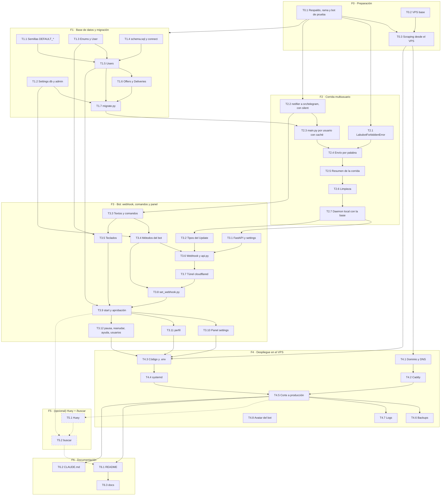

# Tareas: labubot multiusuario por Telegram

El plan para llevar labubot de un solo chat fijo a un bot con usuarios, cada uno
con su perfil, sus términos y sus palabras bloqueadas. Sigue el contrato de diseño
(tablas, comandos, `callback_data`, estados y módulos con esos nombres exactos).

Se lee junto con [`diseno.md`](diseno.md) (cómo queda el código), [`schema.sql`](schema.sql) (la base), [`casos-de-uso.html`](casos-de-uso.html),
los diagramas de secuencia de esta carpeta y [`vps.md`](vps.md) (evaluación de proveedores,
todavía sin elegir, y el plan de prueba de la IP que usa T0.3).

Incluye los cambios de diseño del 31/10, para un bot interno de como mucho 5 usuarios.
[`diseno.md`](diseno.md) ya los tiene (D4, D7, D11, D12 y el `main.py` de §5.5); si algo
no coincide, valen estos. C3 y C4 llevan el formato de mensajes que definió el usuario el
01/11/2026:

| | Cambio | Tareas |
|---|---|---|
| C1 | Una corrida por usuario, uno tras otro y sin hilos, con una caché en memoria de las búsquedas (`searches`): una palabra que ya buscó otro usuario en esa corrida no se vuelve a pedir (D4) | T2.3 |
| C2 | Cada oferta lleva su palabra clave (`Found.term`); Indeed y Workable buscan palabra por palabra (D12) | T2.3 |
| C3 | Envío por palabra, un bloque por cada palabra del usuario en orden alfabético: con 🟢🟡, el encabezado `Búsqueda palabra "{term}":` y un mensaje por oferta; sin, un solo mensaje sin sonido con el encabezado y `No se encontraron coincidencias.`. `Otros portales:` al final, solo si trajo 🟢🟡 (D7) | T2.2, T2.4 |
| C4 | Resumen de cada corrida, siempre y sin sonido (`disable_notification`): `Resumen corrida (inicio - fin):` y una línea por palabra con sus verdes y amarillas, o `No encontramos coincidencias` (D11) | T2.2, T2.5 |
| C5 | `deliveries.term` | T1.4, T1.6, T1.7 |
| C6 | Logo: avatar del bot con @BotFather | T4.8 |

## Cómo leer este plan

- Cada tarea: casilla, id, título, **tamaño** (`S` hasta 2 h, `M` medio día, `L` un día o más),
  archivos que toca, qué hacer, cómo se acepta y de qué depende.
- `python` es siempre el del `.venv` (`.venv/Scripts/python.exe` en la PC,
  `.venv/bin/python` en el VPS): el Python del sistema tiene un `openai` sin `decisions`.
  En Git Bash, `source .venv/Scripts/activate` antes de copiar los comandos de abajo.
- No hay `tests/`: la aceptación es un comando o algo que se ve en Telegram.
- Para mirar la base: `sqlite3 labubot.db "SELECT ..."` (en la PC ya está en el PATH;
  en el VPS lo instala T0.2).
- **Dónde se prueba.** En F1 y F2 las pruebas van contra `prueba.db` y el bot de prueba
  (T0.1), para no duplicar lo que manda el daemon de hoy:
  `DB_PATH=prueba.db TELEGRAM_TOKEN=<token del bot de prueba> python main.py`
  (en Git Bash; las variables de entorno pisan al `.env`). Se lanza apenas termina una corrida
  del daemon (`Corrida terminada` en `logs/app.log`): los dos escriben el mismo `logs/app.log`
  y le piden a LinkedIn. En F3 se prueba con el bot real y `labubot.db`: todavía nadie más
  lo usa. Después de F4, el desarrollo en la PC usa siempre el bot de prueba, porque el
  webhook del real apunta al VPS.
- **El daemon de hoy** sigue corriendo desde esta misma carpeta hasta T2.7, con el código
  que cargó al arrancar: lo que cambia en F1 y F2 no lo toca mientras no se lo reinicie.
  Cierre F1 lo reinicia a propósito; durante F2 no hay que reiniciarlo (el código está a medias).
- `<ADMIN>` es tu `chat_id` (`ADMIN_CHAT_ID`); `<id>` el de la segunda cuenta de Telegram
  con la que probás. En F2 entra a mano en `prueba.db` como segundo usuario (T2.3), para
  probar la caché y el envío por usuario; en F3 se da de alta en serio con `/start`.
- **Ventana del log de una corrida.** `main.py` corrido a mano no escribe "Arranca la
  corrida", así que para mirar solo lo de esa corrida: `L=$(wc -l < logs/app.log)` antes de
  lanzarla y después `tail -n +$((L+1)) logs/app.log | grep ...`. Para `deliveries`,
  `T=$(date -u +%Y-%m-%dT%H:%M:%S)` antes y `WHERE classified_at >= '$T'` (las fechas
  de la base son UTC y con `T`, como las escriben T1.5 y T1.6). Las líneas del log
  terminan en `\r\n`: en los `grep` de este plan no va `$`.
- Para borrar un usuario a mano: `sqlite3 labubot.db "PRAGMA foreign_keys=ON; DELETE FROM users WHERE chat_id = <id>"`.
  Sin el `PRAGMA`, el CLI no borra en cascada y sus términos y entregas quedan huérfanos
  (y vuelven si esa cuenta se registra de nuevo).

## Resumen de fases

Orden: **F0 → F1 → F2 → F3 → F4 → (F5) → F6**. De F0, F1 a F3 solo necesitan T0.1: el VPS
(T0.2) y la prueba de su IP (T0.3, dos días de reloj y poco trabajo) avanzan en paralelo, y
lo que concluyan frena recién a F4. T4.1 y T4.2 (dominio y Caddy) solo dependen de T0.3 y
se pueden adelantar.

| Fase | Qué deja hecho | Tareas | Termina cuando |
|---|---|---|---|
| F0 Preparación | Respaldo, rama, VPS base y prueba de scraping desde su IP | T0.1 – T0.3 | La prueba de la IP dio su veredicto: se sigue con el VPS o F4 pasa a la PC con un túnel cloudflared con nombre |
| F1 Base de datos y migración | Esquema, repos y `migrate.py`, probados contra `prueba.db`. La corrida de hoy no cambia | T1.1 – T1.7 | `prueba.db` migrada con los conteos correctos |
| F2 Corrida multiusuario | `main.py` sobre la base: una corrida por usuario con caché de búsquedas (C1), la palabra de cada oferta (C2), envío por palabra (C3) y resumen silencioso (C4). Sin bot: en `labubot.db` el admin es el único usuario | T2.1 – T2.7 | El daemon local corre con `labubot.db`, manda las ofertas agrupadas por palabra y ya no lee `vistas.txt` |
| F3 Bot: webhook, comandos y panel | Webhook, comandos, panel `/settings`, aprobación y `/perfil` | T3.1 – T3.12 | Una segunda cuenta se da de alta y recibe ofertas |
| F4 Despliegue en el VPS | VPS con Caddy, systemd, backups y logs; el avatar del bot | T4.1 – T4.8 | Producción en el VPS y la PC sin daemon |
| F5 (opcional) Huey + `/buscar` | Huey en lugar de `schedule` (la "Fase 2" de D5) y `/buscar` | T5.1 – T5.2 | `/buscar` encola una corrida |
| F6 Documentación | README, `CLAUDE.md` y `docs/` | T6.1 – T6.3 | La documentación describe lo que corre |

### Casos de uso y dónde se implementan

| Caso de uso | Tarea |
|---|---|
| UC01 Solicitar acceso, UC02 Aprobar / rechazar solicitud | T3.9 |
| UC03 Cargar o reemplazar perfil | T3.11 |
| UC04 Ver configuración, UC05 Agregar / quitar términos, UC06 Agregar / quitar palabras bloqueadas | T3.10 |
| UC07 Pausar / reanudar alertas, UC10 Listar usuarios | T3.12 (UC07 también con los botones del panel, T3.10) |
| UC08 Recibir ofertas 🟢🟡, UC09 Ejecutar corrida horaria | T2.3 – T2.5, T2.7 (con Huey: T5.1) |
| UC11 Buscar ahora | T5.2 |

## Dependencias



---

## F0 · Preparación

- [ ] **T0.1 · Respaldo, rama y bot de prueba** · `S`
  - **Archivos:** `perfil.md`, `vistas.txt`, `.env` (copias fuera del repo)
  - **Qué hacer:** Copiar los tres a una carpeta fuera del repo (ej. `C:\Users\LF\respaldo-labubot\AAAA-MM-DD\`):
    `perfil.md` y `vistas.txt` no están en git y `migrate.py` los va a leer. Crear la rama
    de trabajo desde `dev`: `git switch -c multiusuario`. Crear un bot de prueba con
    @BotFather, mandarle `/start` desde tu cuenta y guardar su token: lo usan T0.3, las
    pruebas de F1 y F2 y el desarrollo en la PC después de F4.
  - **Aceptación:** la carpeta de respaldo tiene los tres con el mismo tamaño que los
    originales (`perfil.md`: 8.058 bytes); `git branch --show-current` → `multiusuario`;
    `https://api.telegram.org/bot<token de prueba>/getMe` → `"ok":true`.
  - **Depende de:** —

- [ ] **T0.2 · VPS base** · `M`
  - **Archivos:** ninguno del repo (servidor)
  - **Qué hacer:** Contratar un VPS Linux con Ubuntu 24.04, de 1 a 2 GB de RAM alcanza, del
    proveedor que se elija (todavía no está decidido; [`vps.md`](vps.md) compara candidatos),
    con el plazo más corto que ofrezca, idealmente **1 mes**: un plazo largo conviene recién
    si T0.3 pasa ([`vps.md`](vps.md) §7). Anotar la fecha límite de baja que muestre el panel. Usuario `labubot` con `sudo` y clave SSH;
    `PermitRootLogin no` y `PasswordAuthentication no` en `/etc/ssh/sshd_config.d/00-labubot.conf`
    (en `sshd` gana el primer valor leído, y el `50-cloud-init.conf` de algunas imágenes deja la
    contraseña habilitada) y `sudo systemctl restart ssh`. Firewall: `sudo ufw allow OpenSSH`,
    `sudo ufw allow 80,443/tcp`, `sudo ufw enable`. Zona horaria
    `sudo timedatectl set-timezone America/Argentina/Buenos_Aires` (los logs y `resultados/`
    usan la hora local). `sudo apt update && sudo apt install -y git sqlite3 vnstat`. Como `labubot`: uv
    (`curl -LsSf https://astral.sh/uv/install.sh | sh`), Python 3.14 (`uv python install 3.14`)
    y Poetry (`uv tool install poetry`, `poetry config virtualenvs.in-project true`).
  - **Aceptación:** `sudo sshd -T | grep -E "^(permitrootlogin|passwordauthentication) "` → `no`
    las dos; `ssh labubot@<IP>` entra con la clave; `sudo ufw status` → `OpenSSH` y `80,443/tcp`
    en `ALLOW`; `timedatectl` muestra la zona de Argentina; `$(uv python find 3.14) -V` →
    `Python 3.14.x`.
  - **Depende de:** —

- [ ] **T0.3 · Prueba de scraping desde la IP del VPS** · `L` (dos días de reloj, poco trabajo)
  - **Archivos:** `prueba_ip.py` (descartable, el de [`vps.md`](vps.md) §7.3; no se commitea).
    El resto es el código de hoy, sin cambios.
  - **Qué hacer:** En el VPS: clonar el repo (rama `dev`; si es privado, con una deploy key
    de solo lectura) en `/home/labubot/labubot`,
    `poetry env use "$(uv python find 3.14)"`, `poetry install --only main` y un `.env` hecho
    desde el respaldo de T0.1, con `LOG_LEVEL=DEBUG` y el token del bot de prueba: el código de
    `dev` no conoce el `ADMIN_CHAT_ID` ni el `DB_PATH` que suma T1.2, y con una clave de más
    `Settings` no arranca. En la PC, un clon aparte para
    no mezclar logs: `git worktree add --detach ../labubot-prueba dev`, el mismo `.env` y
    `prueba_ip.py` (se corre con `../labubot/.venv/Scripts/python.exe prueba_ip.py`).
    - **Prueba A** (solo búsqueda y 20 descripciones por portal; sin LLM ni Telegram):
      lanzarla a la vez en las dos máquinas, tres veces por día durante dos días. En la PC,
      apenas termina una corrida del daemon (`Corrida terminada` en `logs/app.log`), para no
      sumarle sus pedidos. En el VPS, además, una por hora durante 24 h:
      `crontab -e` → `0 * * * * cd ~/labubot && .venv/bin/python prueba_ip.py`; mientras
      corre el cron, las manuales van a la media hora, para no pisarse con él.
    - **Prueba B:** una sola vez `.venv/bin/python main.py` en el VPS, con `perfil.md` y el
      `vistas.txt` de la PC copiados: solo clasifica lo nuevo (~50 llamadas al LLM) y valida
      la salida a OpenAI y a Telegram.

    Al terminar: borrar la línea del `crontab`, borrar `prueba_ip.py` del clon de la PC y
    `git worktree remove ../labubot-prueba` (con un archivo sin seguimiento adentro, se niega).
  - **Aceptación:** con los logs de las dos máquinas, los criterios de [`vps.md`](vps.md) §7.4:
    - `grep "prueba_ip" logs/app.log` → en cada repetición, LinkedIn e Indeed traen en el
      VPS al menos el 90 % de las ofertas que trae la PC, sin tendencia a la baja en las 24
      corridas horarias; al menos 18 de 20 con descripción donde la PC también las trae;
    - `grep -oE "Respondió (403|429|999|5..)" logs/app.log | sort | uniq -c` → en el VPS, no
      más del doble de 429 que en la PC, y nada de 403 o 999 sostenidos (más de 3 seguidos
      en la misma búsqueda);
    - la duración por portal (los segundos de cada línea de `prueba_ip`) no pasa del doble
      de la de la PC;
    - prueba B: le llegan 🟢🟡 al bot de prueba y el log del VPS cierra con `enviadas a Telegram`.

    Si no pasa por LinkedIn o Indeed: dar de baja el VPS antes de la fecha anotada en T0.2 (o
    probar otro proveedor con la misma prueba), y F4
    se hace en la PC con un túnel cloudflared con nombre (D1: mismo código, otra máquina).
    Si fallan solo portales chicos, anotarlos y seguir.
  - **Depende de:** T0.1, T0.2

- [ ] **Cierre F0** · `python -m ruff check . && python -m ruff format --check .` (sin cambios
  de código, tiene que pasar igual). Prueba manual: con los números de T0.3 en la mano,
  decidir si se sigue con ese VPS (y si se pasa a un plazo más largo); `crontab -l` en el VPS ya
  no tiene `prueba_ip.py` y `git worktree list` en la PC muestra una sola carpeta.

## F1 · Base de datos y migración

Al terminar F1 el daemon de hoy sigue corriendo igual: nada de lo nuevo se usa todavía.

- [ ] **T1.1 · Semillas de búsqueda** · `S`
  - **Archivos:** `src/config/search.py`, `main.py`
  - **Qué hacer:** Renombrar `TERMS` → `DEFAULT_TERMS` y `BLOCKED_TITLE_WORDS` →
    `DEFAULT_BLOCKED_TITLE_WORDS`; el docstring del módulo pasa a decir que son la semilla
    de cada usuario nuevo. Actualizar el import de `main.py` para que la corrida siga igual hasta F2.
  - **Aceptación:** `grep -rnIE "\b(TERMS|BLOCKED_TITLE_WORDS)\b" main.py daemon.py src` sin
    resultados (`-I` saltea los `.pyc` viejos de `__pycache__`); `python -c "from src.config.search import DEFAULT_TERMS as T, DEFAULT_BLOCKED_TITLE_WORDS as B; print(len(T), len(B))"` → `22 32`.
  - **Depende de:** T0.1

- [ ] **T1.2 · Settings de la base y el admin** · `S`
  - **Archivos:** `src/config/settings.py`, `.env.example`, `.gitignore`
  - **Qué hacer:** Sumar `db_path: str = "labubot.db"` y `admin_chat_id: int = 0` a `Settings`
    (con su línea en el docstring) y a `.env.example`. `ADMIN_CHAT_ID` es el `TELEGRAM_CHAT_ID`
    de hoy si es tu chat privado con el bot (número positivo); cargarlo ya en tu `.env`, que
    `migrate.py` lo usa. Agregar `*.db*` al `.gitignore`: cubre `labubot.db`, la `prueba.db`
    de F1 y F2 (las dos con su `-wal` y `-shm`) y la `huey.db` de F5.
    `TELEGRAM_CHAT_ID` sigue hasta T2.6.
  - **Aceptación:** `python -c "from src.config.settings import settings; print(settings.db_path, settings.admin_chat_id)"`
    → `labubot.db <ADMIN>`; `git check-ignore labubot.db-wal prueba.db` devuelve las dos rutas.
  - **Depende de:** T0.1

- [ ] **T1.3 · Enums y TypedDict de usuario** · `S`
  - **Archivos:** `src/enums/user_status.py`, `src/enums/chat_state.py`, `src/schemas/user.py` (nuevos)
  - **Qué hacer:** `UserStatus(StrEnum)` y `ChatState(StrEnum)` con los valores del contrato,
    con el estilo de `traffic_light.py`. `User(TypedDict)` con las columnas de `users`
    (`username` y `approved_at` como `str | None`), sin lógica.
  - **Aceptación:** `python -c "from src.enums.chat_state import ChatState; from src.enums.user_status import UserStatus; from src.schemas.user import User; print(repr(ChatState.IDLE), UserStatus.BLOCKED)"`
    → `<ChatState.IDLE: ''> blocked`.
  - **Depende de:** T0.1

- [ ] **T1.4 · Esquema y conexión** · `S`
  - **Archivos:** `src/db/schema.sql`, `src/db/database.py` (nuevos)
  - **Qué hacer:** `schema.sql` con las tablas y el índice de [`schema.sql`](schema.sql), sin
    los `PRAGMA` (los hace `connect`) y con `CREATE TABLE IF NOT EXISTS` / `CREATE INDEX IF NOT EXISTS`
    para poder correrlo en cada conexión. `deliveries` va con la columna `term TEXT` después de
    `url` (C5): la palabra clave que trajo la oferta; NULL = "Otros portales" o importada de
    `vistas.txt`. Sin índice nuevo y sin `ALTER`: todavía no existe ninguna base.
    `connect(path) -> sqlite3.Connection`: abre, `PRAGMA journal_mode=WAL`,
    `PRAGMA foreign_keys=ON`, `row_factory = sqlite3.Row` y `executescript()` del esquema.
    Las fechas que escriben los repos (T1.5, T1.6) van como dice `schema.sql`, ISO 8601 en UTC:
    `datetime.now(UTC).isoformat(timespec="seconds")`. Con el `datetime('now')` de SQLite
    saldrían con espacio en lugar de `T`, y los `classified_at >= '$T'` de F2 darían mal.
  - **Aceptación:** `python -c "from src.db.database import connect; connect('prueba.db')"` dos
    veces sin error; `sqlite3 prueba.db ".tables"` muestra las cinco: `deliveries`, `offers`,
    `user_blocked_words`, `user_terms` y `users`; `sqlite3 prueba.db "PRAGMA journal_mode"` → `wal`;
    `sqlite3 prueba.db "PRAGMA table_info(deliveries)"` → `term` en la tercera fila (`2|term|TEXT|0||0`).
  - **Depende de:** T0.1

- [ ] **T1.5 · Repositorio de usuarios** · `M`
  - **Archivos:** `src/db/users.py` (nuevo)
  - **Qué hacer:** `class Users(conn)` con los métodos del contrato: `get`, `register`,
    `set_status`, `set_profile`, `set_state`, `active`, `terms`, `add_terms`, `remove_terms`,
    `blocked_words`, `add_blocked_words`, `remove_blocked_words`, `seed_defaults` y `all`.
    `register(chat_id, username, first_name)` da de alta con `status='pending'` y `created_at`,
    y si ya existe solo actualiza nombre y @.
    `set_status` completa `approved_at` la primera vez que pasa a `active`. `add_*`/`remove_*`
    reciben `list[str]`, guardan en minúsculas, sin espacios de más (`INSERT OR IGNORE`), y
    devuelven lo que cambió de verdad (para `ADDED` / `REMOVED`).
    `seed_defaults` carga las dos listas `DEFAULT_*`; `active()` = `status='active' AND profile != ''`,
    por orden de alta (`ORDER BY created_at`), que es el orden en que corren (C1). `terms` y
    `blocked_words` en orden alfabético (`ORDER BY`): de ese orden sale la palabra de cada
    oferta (C2). Cada método que escribe hace `commit()`.
  - **Aceptación:** sobre `prueba.db`: `register(1, "ana", "Ana")` + `seed_defaults(1)` →
    `len(terms(1)) == 22`, `terms(1)[0] == "analista programador"` y `len(blocked_words(1)) == 32`;
    `active()` vacío hasta `set_status(1, UserStatus.ACTIVE)` + `set_profile(1, "cv")`;
    `remove_terms(1, ["Python"])` deja 21.
  - **Depende de:** T1.1, T1.3, T1.4

- [ ] **T1.6 · Repositorios de ofertas y entregas** · `M`
  - **Archivos:** `src/db/offers.py` (nuevo)
  - **Qué hacer:** `Offers(conn)`: `get(url) -> Offer | None` y `add(offer, portal)` con `fetched_at`.
    `Deliveries(conn)`: `exists`, `add(chat_id, url, light, term)` (`INSERT OR IGNORE`; `light`
    y `term` pueden ser `None`), `mark_sent` y `pending()`: verdes y amarillas con
    `sent_at IS NULL` de usuarios `active`, con `chat_id`, `url`, `term`, `light` y el `title`
    sacado de `offers` por JOIN (el mensaje lo necesita; `term` arma el grupo de C3). Commit en
    cada escritura.
  - **Aceptación:** sobre `prueba.db`, con el usuario 1 de T1.5 (`active` y con perfil; sin él,
    la clave foránea de `deliveries` rechaza el `add`): una oferta en `offers` y su entrega
    verde con `term="python"` → `pending()` la devuelve con título y `term` `python`; después de
    `mark_sent`, vacío; `add(1, otra_url, None, None)` no aparece en `pending()` pero
    `exists(1, otra_url)` → `True`.
  - **Depende de:** T1.5

- [ ] **T1.7 · migrate.py** · `M`
  - **Archivos:** `migrate.py` (nuevo, en la raíz)
  - **Qué hacer:** Con `connect(settings.db_path)`: registra a `ADMIN_CHAT_ID` con
    `first_name='admin'` (su primer `/start` lo corrige), lo pasa a `active`, le pone
    `perfil.md` de perfil y `seed_defaults`. Cada línea de `vistas.txt` →
    `Deliveries.add(admin, url, None, None)` (sin color ni palabra). Loguea cuántas importó. No toca `vistas.txt` ni
    `vistas.json`. Se puede correr de nuevo: todo es upsert u `OR IGNORE`.
  - **Aceptación** (sobre una base nueva, sin tocar la real; hay que borrar la `prueba.db` de
    T1.5 y T1.6, que tiene al usuario 1 y sus entregas):
    `rm -f prueba.db* && DB_PATH=prueba.db python migrate.py` y
    - `sqlite3 prueba.db "SELECT status, length(profile) FROM users"` → `active|7922` (los
      caracteres de `perfil.md`);
    - `sqlite3 prueba.db "SELECT count(*) FROM deliveries WHERE light IS NULL AND term IS NULL"` igual a
      `python -c "print(len(open('vistas.txt', encoding='utf-8').read().splitlines()))"` (hoy 1.564);
    - 22 filas en `user_terms` y 32 en `user_blocked_words`; una segunda corrida no cambia los conteos.
  - **Depende de:** T1.2, T1.5, T1.6

- [ ] **Cierre F1** · `python -m ruff check . && python -m ruff format --check .`. Prueba manual:
  parar el daemon justo después de una corrida y volver a arrancar `python daemon.py`: su
  corrida de arranque, ya con el código de F1 (todavía la corrida de hoy, con los nombres de
  T1.1), anda igual que antes y cierra con `Corrida terminada`. `prueba.db` recién migrada da
  los conteos de T1.7.

## F2 · Corrida multiusuario

Sin bot todavía: en `labubot.db` el admin es el único usuario. Las pruebas de `prueba.db`
suman a mano la segunda cuenta, para ver dos usuarios corriendo uno tras otro. Cada palabra
manda su bloque, con sus ofertas o con "No se encontraron coincidencias." sin sonido (C3), y
al final de cada usuario llega el resumen silencioso (C4).

- [ ] **T2.1 · 403 en el Driver** · `S`
  - **Archivos:** `src/exceptions/exceptions.py`, `src/driver/http.py`
  - **Qué hacer:** `LabubotForbiddenError(LabubotError)`, "El sitio devolvió 403". En `Driver._send`,
    `403 → LabubotForbiddenError` antes del `raise` genérico, y sumarla a los `Raises:` de
    `get` y `post_json`. Genérico HTTP: nada de Telegram adentro. Los portales atrapan
    `LabubotError`, así que un 403 de un portal sigue cortando solo esa búsqueda.
  - **Aceptación:** `python -c "from src.driver.http import Driver; Driver().get('https://httpbin.org/status/403', 'prueba')"`
    → `LabubotForbiddenError: Respondió 403 al obtener prueba`; `grep -rn "except LabubotRequestError" src`
    sin resultados.
  - **Depende de:** T0.1

- [ ] **T2.2 · De `src/notifier` a `src/telegram`, con `silent`** · `M`
  - **Archivos:** `src/notifier/telegram.py` → `src/telegram/bot.py`, `src/constants/telegram.py` →
    `src/telegram/constants.py`, `src/telegram/__init__.py` (nuevo), `main.py`
  - **Qué hacer:** `git mv` de los dos y `rm -rf src/notifier` (queda su `__pycache__`).
    En `constants.py`, `SEND_MESSAGE_URL` pasa a
    `BOT_API_URL = "https://api.telegram.org/bot{token}/{method}"` y se suma
    `OFFER = "{emoji} {title}\n{url}"`.
    En `bot.py`, `send()` se reemplaza por
    `send_message(chat_id, text, keyboard=None, silent=False) -> int` (devuelve
    `result.message_id`; con `silent=True` el cuerpo suma `"disable_notification": true`, que
    no hace sonar el celular: lo usan los bloques sin coincidencias de T2.4 y el resumen de
    T2.5) y `send_offer(chat_id, offer, light)`
    (pausa `PAUSE` + `send_message`). Ya no lee `settings.telegram_chat_id`; el chequeo de
    404 = token inválido queda.
    En `main.py`, el import nuevo y `telegram.send_offer(settings.telegram_chat_id, offer, light)`
    en lugar de `send()`, para que siga andando hasta T2.3.
  - **Aceptación:** `TELEGRAM_TOKEN=<prueba> python -c "from src.driver.http import Driver; from src.telegram.bot import Telegram; print(Telegram(Driver()).send_message(<ADMIN>, 'prueba'))"`
    → llega "prueba" al bot de prueba y se imprime un número. Con el teléfono bloqueado, lo
    mismo con `send_message(<ADMIN>, 'prueba muda', silent=True)` → la notificación aparece
    pero no suena (la de "prueba" sí sonó). `src/notifier/` y
    `src/constants/telegram.py` ya no existen y `grep -rnIE "src\.(notifier|constants\.telegram)" main.py src`
    no da nada.
  - **Depende de:** T0.1

- [ ] **T2.3 · main.py por usuario, con caché de búsquedas (C1, C2)** · `L`
  - **Archivos:** `main.py`, `src/schemas/job.py` (`Found`), `src/portals/indeed/portal.py` y
    `src/portals/workable/portal.py` (`search` con una sola palabra), `src/classifier/openai.py`
    (solo el docstring de `cv`, que hoy dice `perfil.md`)
  - **Qué hacer:** el `main.py` de [`diseno.md`](diseno.md) §5.5, todavía sin el envío (T2.4)
    ni el resumen (T2.5):
    - `Found(TypedDict)` en `src/schemas/job.py`: `title: str`, `term: str | None` y
      `portal: str` (el nombre de la clase, para pedirle la descripción a esa misma instancia).
    - `Indeed.search(keywords)` y `Workable.search(keywords)` reciben una sola palabra y, si
      tiene espacios, la mandan entre comillas, que es lo que hoy hace `main.py` al armar el
      `OR`: así cada palabra trae lo mismo que aportaba a esa consulta. Cambia también el
      docstring de `keywords`. En `main.py` se va `any_term`.
    - `main()`: `started = datetime.now()`, `connect(settings.db_path)`, el `Driver`, los 11
      portales una sola vez en `portals` (un `dict` por nombre de clase), la caché vacía
      `searches: dict[tuple[str, str], dict[str, str]] = {}` y un `Telegram(driver)`. Recorre
      `Users.active()` por orden de alta (vacío: `No hay usuarios activos` y termina) y llama a
      `_run_user` por cada uno, uno tras otro, sin hilos.
    - `_search_user(portals, searches, terms) -> dict[str, Found]`, con `terms` en orden
      alfabético (como los da `Users.terms`):
      - Los siete con búsqueda (LinkedIn, Computrabajo, GetOnBoard, Himalayas, Talent, Indeed
        y Workable), palabra por palabra, con clave `(nombre, palabra)`: si no está en
        `searches`, `portal.search(term)` y se guarda; si está, se reusa sin pedir.
      - Los de `WITHOUT_SEARCH` (Bumeran, EmpleosIT, Jobicy y WeWorkRemotely), con clave
        `(nombre, "")`: se piden una sola vez por corrida.
      - Cada url entra una sola vez, con la primera palabra que la trajo: como `terms` va en
        orden alfabético, gana la primera. En los sin búsqueda, `term = _word_in_title(title, terms)`:
        la primera palabra contenida en el título en minúsculas, o `None` ("Otros portales").
        `_word_in_title` sirve también para las bloqueadas.
      - Log: el `logger.debug` de hoy por búsqueda (`LinkedIn 'python': 25 ofertas`; en los
        sin búsqueda, `Bumeran: 40 ofertas`), solo cuando se pide de verdad. Se van los
        `logger.info` por portal.
    - `_run_user(conn, telegram, portals, searches, user) -> list[list]`, con la firma de
      [`diseno.md`](diseno.md) §4 (`telegram` lo usan T2.4 y T2.5): sus `terms` y
      `blocked_words`, leídas al llegarle el turno; `_search_user`; por url: con entrega en
      `deliveries` → `ya vistas`; con una bloqueada suya en el título → `por título`; si no,
      descripción de `Offers.get(url)` o de `portals[found[url]["portal"]].description(url)` +
      `Offers.add` (vacía se guarda igual, así no se vuelve a pedir, y se saltea:
      `sin descripción`). Un `Classifier(user["profile"])` por usuario, llamado de a una oferta
      (`classify([offer])`), y `Deliveries.add(chat_id, url, light, found[url]["term"])` apenas
      vuelve, para que lo pagado quede guardado aunque la corrida se corte. Log por usuario,
      los dos de hoy con su nombre adelante:
      `{first_name}: N ofertas nuevas; salteadas: X ya vistas, Y por título, Z sin descripción`
      y `{first_name}: clasificadas N verdes, M amarillas, K rojas` (sin la ruta del `.csv`,
      que se escribe al final).
    - Todavía no manda nada: el envío es T2.4, que manda también lo que esta tarea deja
      pendiente. Se va el `send_offer` provisorio de T2.2.
    - `_save_results(rows, started)`, al final de `main()`, con las filas que devolvió cada
      `_run_user`: `resultados/AAAA-MM-DD_HHMM.json` con cada oferta clasificada una sola vez
      (título, descripción y url, como hoy) y el `.csv` con `chat_id, term, light, title, url`.
      Se van `SeenUrls`, `SEEN_PATH` y `PROFILE_PATH`.
    - Riesgo de C2: palabra por palabra son hasta 22 pedidos más por corrida en Indeed y en
      Workable (la caché los acota a las palabras distintas). Si empiezan a dar 429, volver al
      `OR` en esos dos y atribuir por título, como los portales sin búsqueda.
  - **Aceptación** (con `prueba.db` recién migrada y la segunda cuenta como segundo usuario,
    con las palabras `python` y `zzlabubot`, que no existe en ningún portal):

    ```bash
    rm -f prueba.db* && DB_PATH=prueba.db python migrate.py
    DB_PATH=prueba.db python -c "
    from src.config.settings import settings
    from src.db.database import connect
    from src.db.users import Users
    from src.enums.user_status import UserStatus
    users = Users(connect(settings.db_path))
    users.register(<id>, None, 'segunda')
    users.set_status(<id>, UserStatus.ACTIVE)
    users.set_profile(<id>, open('perfil.md', encoding='utf-8').read())
    print(users.add_terms(<id>, ['python', 'zzlabubot']))
    "
    L=$(wc -l < logs/app.log)
    LOG_LEVEL=DEBUG DB_PATH=prueba.db TELEGRAM_TOKEN=<prueba> python main.py
    ```

    Desde la segunda cuenta, además, `/start` al bot de prueba: sin webhook no contesta, pero
    desde ahí el bot le puede escribir (lo necesita T2.4).
    1. **Caché (C1):** con `tail -n +$((L+1)) logs/app.log | grep ...`, cada búsqueda pedida
       deja su línea de DEBUG:
       - `grep -c "LinkedIn 'python':"` → `1`, aunque los dos usuarios tienen `python`;
       - `grep -c "'zzlabubot':"` → `7`: lo único que pide la segunda, en los siete portales
         con búsqueda;
       - `grep -cE "main\.py:[0-9]+ - [A-Za-z]+ '"` → `161` (7 portales × 22 palabras del
         admin + los 7 de `zzlabubot`);
       - `grep -cE "main\.py:[0-9]+ - (Bumeran|EmpleosIT|Jobicy|WeWorkRemotely): "` → `4`: los
         sin búsqueda, una vez para los dos.
    2. **Indeed y Workable palabra por palabra:** `tail -n +$((L+1)) logs/app.log | grep -cE "main\.py:[0-9]+ - (Indeed|Workable) '"`
       → `46` (22 del admin + `zzlabubot`, en cada uno) y
       `tail -n +$((L+1)) logs/app.log | grep -cE "portals\.(indeed|workable)\.portal - WARNING"` → `0`.
    3. **Palabra de cada oferta (C2):**
       `sqlite3 prueba.db "SELECT coalesce(term, '(otros portales)'), count(*) FROM deliveries WHERE chat_id = <id> GROUP BY term"`
       → solo `python` y `(otros portales)`; `zzlabubot` no aparece. En los sin búsqueda, la
       palabra sale del título:
       `sqlite3 prueba.db "SELECT count(*) FROM deliveries d JOIN offers o USING (url) WHERE d.chat_id = <id> AND o.portal IN ('Bumeran', 'EmpleosIT', 'Jobicy', 'WeWorkRemotely') AND (d.term IS NULL) = (lower(o.title) LIKE '%python%')"`
       → `0`.
    4. **Solo lo nuevo:** la línea `admin: N ofertas nuevas; …` trae pocas (lo publicado desde
       la última corrida del daemon, no ~445) y el resto como `ya vistas`: nada de `vistas.txt`
       se vuelve a clasificar. La de `segunda: …` trae más: todo lo de las últimas 24 h de
       `python` y de los cuatro portales sin búsqueda (menos que las ~445 de las 22 palabras;
       centavos de dólar).
    5. **Conteos:** `sqlite3 prueba.db "SELECT chat_id, light, count(*) FROM deliveries WHERE light IS NOT NULL GROUP BY 1, 2"`
       coincide con la línea `clasificadas …` de cada usuario y con las filas del `.csv` nuevo
       (que empieza con `chat_id,term,light,title,url`). No llega nada a
       Telegram: `sqlite3 prueba.db "SELECT count(*) FROM deliveries WHERE sent_at IS NOT NULL"`
       → `0` (las 🟢🟡 quedan pendientes para T2.4).
    6. **La caché es de la corrida:** otra corrida enseguida, con `L` tomado de nuevo, da los
       mismos conteos del punto 1 (se vuelve a pedir todo) y clasifica solo lo publicado en
       el medio.
  - **Depende de:** T1.7, T2.2

- [ ] **T2.4 · Envío por palabra clave (C3)** · `M`
  - **Archivos:** `main.py`, `src/telegram/constants.py`
  - **Qué hacer:**
    - Constantes: `KEYWORD_HEADER = 'Búsqueda palabra "{term}":'`,
      `NO_MATCHES = "No se encontraron coincidencias."` y
      `OTHER_PORTALS_HEADER = "Otros portales:"`.
    - En `_run_user`, antes de recorrer sus urls, `groups: dict[str | None, list[tuple[Offer, TrafficLight]]]`
      arranca con sus pendientes de corridas anteriores: las filas de `Deliveries.pending()` con
      su `chat_id`, como `Offer(title=row["title"], description="", url=row["url"])` y
      `TrafficLight(row["light"])`, en el grupo de `row["term"]`. Cada 🟢🟡 nueva se suma al
      grupo de su `found[url]["term"]`.
    - Después de clasificar, `keywords`: sus `terms` más el `term` de alguna pendiente que ya
      no tenga (la quitó con `/settings`; `None` no entra), en orden alfabético. Sin eso, esa
      pendiente no saldría nunca.
    - `_send_by_keyword(telegram, deliveries, chat_id, keywords, groups) -> int`, después de
      clasificar todo lo suyo. Un bloque por palabra de `keywords`, con la palabra como está
      guardada (en minúsculas) y `time.sleep(PAUSE)` antes de cada mensaje:
      1. con 🟢🟡 en `groups`: el encabezado con `send_message` (con sonido) y después un
         `send_offer` + `mark_sent` por oferta (`OFFER`, igual que hoy), verdes primero y
         después amarillas;
      2. sin 🟢🟡: UN solo mensaje, `f"{header}\n{NO_MATCHES}"`, con
         `send_message(..., silent=True)`.

      Después, "Otros portales" (`None`): solo si tiene 🟢🟡, `OTHER_PORTALS_HEADER` y sus
      ofertas, como en 1. Vacío no manda nada: no es una búsqueda del usuario. Devuelve cuántas
      ofertas mandó.
    - 403: en `_run_user`, un `try` alrededor del envío; `LabubotForbiddenError` →
      `set_status(chat_id, UserStatus.BLOCKED)`, `El chat {chat_id} bloqueó el bot: pasa a blocked`
      (`logger.warning`) y devuelve sus filas, así `main()` sigue con el próximo usuario. Lo
      que no llegó queda con `sent_at` NULL y le llega con su grupo si vuelve con `/start`.
    - Log por usuario: `{first_name}: N enviadas a Telegram`.
  - **Aceptación** (sobre la `prueba.db` de T2.3, que dejó todo pendiente; con el teléfono de
    la segunda cuenta a mano y bloqueado):
    1. `DB_PATH=prueba.db TELEGRAM_TOKEN=<prueba> python main.py` → a tu cuenta le llega un
       bloque por cada una de sus 22 palabras, en orden alfabético. Las que tienen 🟢🟡:
       `Búsqueda palabra "<palabra>":` y después sus ofertas, 🟢 antes que 🟡. Las que no: un
       solo mensaje, `Búsqueda palabra "<palabra>":` y `No se encontraron coincidencias.` en el
       renglón de abajo. `Otros portales:` y sus ofertas van al final, solo si alguna oferta sin
       palabra salió 🟢🟡. Lo pendiente de T2.3 llega dentro del bloque de su palabra.
    2. **Bloques exactos:** a la segunda cuenta le llegan solo dos bloques de palabra:
       `Búsqueda palabra "python":` con sus ofertas, y un único mensaje
       `Búsqueda palabra "zzlabubot":` + `No se encontraron coincidencias.`. Después,
       `Otros portales:` solo si
       `sqlite3 prueba.db "SELECT coalesce(term, 'otros portales'), count(*) FROM deliveries WHERE chat_id = <id> AND light IN ('green', 'yellow') GROUP BY term"`
       trae la fila `otros portales`; cada conteo es el de ofertas de su bloque.
    3. **Sonido:** en el teléfono bloqueado de la segunda cuenta, el encabezado de `python` y
       sus ofertas suenan; el bloque de `zzlabubot` aparece sin sonido.
    4. `sqlite3 prueba.db "SELECT count(*) FROM deliveries WHERE light IN ('green', 'yellow') AND sent_at IS NULL"` → `0`.
    5. **Pendiente:** `sqlite3 prueba.db "UPDATE deliveries SET sent_at = NULL WHERE rowid = (SELECT rowid FROM deliveries WHERE chat_id = <ADMIN> AND light = 'yellow' AND term IS NOT NULL LIMIT 1)"`
       → en la corrida siguiente, si esa palabra no trae nada nuevo, su bloque es el
       encabezado y la amarilla, en lugar de `No se encontraron coincidencias.`.
    6. **Pendiente de una palabra quitada:** a la segunda cuenta, una pendiente de `python` y
       `python` fuera de sus palabras:
       `sqlite3 prueba.db "UPDATE deliveries SET sent_at = NULL WHERE rowid = (SELECT rowid FROM deliveries WHERE chat_id = <id> AND term = 'python' AND light IN ('green', 'yellow') LIMIT 1); DELETE FROM user_terms WHERE chat_id = <id> AND term = 'python'"`
       → en la corrida siguiente le llega `Búsqueda palabra "python":` con esa oferta, antes del
       bloque de `zzlabubot`. Después, devolvérsela:
       `sqlite3 prueba.db "INSERT INTO user_terms (chat_id, term) VALUES (<id>, 'python')"`.
    7. **403:** bloquear el bot de prueba desde tu cuenta (el admin, que corre primero) y
       repetir el `UPDATE` del punto 5 → la corrida termina sin excepción, el log dice
       `El chat <ADMIN> bloqueó el bot`,
       `sqlite3 prueba.db "SELECT status FROM users WHERE chat_id = <ADMIN>"` → `blocked`, su
       amarilla sigue con `sent_at` NULL y a la segunda cuenta le llegan sus bloques igual: se
       siguió con el próximo usuario. No hace falta dejarle pendientes a nadie para que salte
       el 403: el primer bloque ya lo da. Después: desbloquear y
       `sqlite3 prueba.db "UPDATE users SET status = 'active' WHERE chat_id = <ADMIN>"`.
  - **Depende de:** T2.1, T2.3

- [ ] **T2.5 · Resumen de la corrida (C4)** · `M`
  - **Archivos:** `main.py`, `src/telegram/constants.py`
  - **Qué hacer:**
    - Constantes: `SUMMARY_TITLE = "Resumen corrida ({start} - {end}):"`,
      `SUMMARY_LINE = "{term}: {counts}"`,
      `SUMMARY_GREENS = ("{count} verde encontrado", "{count} verdes encontrados")`,
      `SUMMARY_YELLOWS = ("{count} amarillo encontrado", "{count} amarillos encontrados")`
      (singular y plural), `SUMMARY_EMPTY = "{term}: No encontramos coincidencias"` y
      `OTHER_PORTALS = "Otros portales"` (cómo aparece el grupo `None` en el resumen).
    - `_run_user` anota `started = datetime.now()` apenas entra: la hora de arranque de ese
      usuario, no la de la corrida.
    - `_send_summary(telegram, chat_id, keywords, groups, started)`, después de
      `_send_by_keyword` y dentro del mismo `try` del 403 de T2.4: a un usuario que pasó a
      `blocked` no se le manda resumen. Sale SIEMPRE, aunque no haya nada, con
      `time.sleep(PAUSE)` + `send_message(chat_id, text, silent=True)`:
      - `SUMMARY_TITLE`, en `HH:MM` de hora local, con `start` = `started` y `end` =
        `datetime.now()` justo antes de mandar;
      - una línea por palabra de `keywords`, en el orden de los bloques: con 🟢🟡,
        `SUMMARY_LINE` con las verdes, las amarillas o las dos unidas por `" - "`
        (`_count_text(SUMMARY_GREENS, n)` da "1 verde encontrado" o "N verdes encontrados");
        sin, `SUMMARY_EMPTY`;
      - `Otros portales` al final, solo si tiene 🟢🟡.

      Se cuenta lo que hay en `groups`: lo que se le mandó en esta corrida bajo esa palabra,
      pendientes incluidas. Las rojas y las ya vistas no cuentan. Queda así:

      ```text
      Resumen corrida (14:00 - 14:21):
      developer: No encontramos coincidencias
      django: 2 amarillos encontrados
      python: 1 verde encontrado - 1 amarillo encontrado
      ```

  - **Aceptación** (sobre la `prueba.db` de T2.4, con los dos usuarios `active`; justo antes
    de lanzar, `date +%H:%M` y el `T` de "Cómo leer este plan"):
    1. **Siempre llega, con sus horas:** el último mensaje de cada cuenta es
       `Resumen corrida (HH:MM - HH:MM):`. En la tuya, el inicio es la hora que dio `date` (o
       el minuto siguiente) y el fin, la hora a la que llegó el resumen; en la segunda, el
       inicio no es anterior al fin del tuyo. Otra corrida enseguida lo vuelve a mandar, con
       `No encontramos coincidencias` en todas las palabras que no trajeron nada publicado en
       el medio.
    2. **Sin sonido:** con el teléfono de la segunda cuenta bloqueado, el resumen no suena (la
       notificación aparece muda).
    3. **Palabra sin resultados:** el resumen de la segunda cuenta tiene la línea
       `zzlabubot: No encontramos coincidencias`.
    4. **Cuentas exactas:** las líneas con números del resumen del admin coinciden (palabras,
       cantidades y orden) con
       `sqlite3 prueba.db "SELECT coalesce(term, 'Otros portales'), sum(light = 'green'), sum(light = 'yellow') FROM deliveries WHERE chat_id = <ADMIN> AND light IN ('green', 'yellow') AND sent_at >= '$T' GROUP BY term ORDER BY term IS NULL, term"`
       (un `0` es la parte que no va); cada una de sus palabras que no sale ahí dice
       `No encontramos coincidencias`, y `Otros portales` aparece solo si la consulta lo trae.
    5. **Singular y plural:** a la segunda cuenta, una sola pendiente verde de `python`
       (`sqlite3 prueba.db "UPDATE deliveries SET sent_at = NULL WHERE rowid IN (SELECT rowid FROM deliveries WHERE chat_id = <id> AND term = 'python' AND light = 'green' LIMIT 1)"`)
       → si `python` no trae nada nuevo en la corrida siguiente, su línea es
       `python: 1 verde encontrado`, sin ` - `; con `LIMIT 2`, `python: 2 verdes encontrados`.
  - **Depende de:** T2.4

- [ ] **T2.6 · Limpieza** · `S`
  - **Archivos:** `src/db/seen.py` (se borra), `src/config/settings.py`, `.env.example`, `.env` (local)
  - **Qué hacer:** Borrar `SeenUrls` y `TELEGRAM_CHAT_ID` (campo, docstring, `.env.example` y
    también la línea del `.env`: `Settings` no acepta claves de más en el `.env` y, si queda,
    nada arranca con `Extra inputs are not permitted`). `vistas.txt` queda en disco como
    respaldo, sin uso.
  - **Aceptación:** `grep -rnIE "SeenUrls|telegram_chat_id|TELEGRAM_CHAT_ID|any_term" main.py daemon.py migrate.py src .env.example`
    sin resultados (sin `-I` aparece el `.pyc` que deja `seen.py` en `src/db/__pycache__`); `DB_PATH=prueba.db TELEGRAM_TOKEN=<prueba> python main.py` corre.
  - **Depende de:** T2.5

- [ ] **T2.7 · El daemon local pasa a la base** · `S`
  - **Archivos:** `labubot.db` (se crea)
  - **Qué hacer:** Parar el daemon de hoy justo después de una corrida (así `vistas.txt` está
    al día), correr `python migrate.py` contra la base real y arrancar `python daemon.py`.
    Desde acá ni `vistas.txt` ni `perfil.md` se leen.
  - **Aceptación:** en el log de la primera corrida, lo que estaba en `vistas.txt` cuenta
    como `ya vistas` y se clasifica solo lo publicado desde la corrida anterior (pocas, no
    ~445); al chat de siempre llega un bloque por palabra (con sus 🟢🟡, o sin sonido con
    `No se encontraron coincidencias.`) y al final `Resumen corrida (HH:MM - HH:MM):`, sin
    sonido; `Corrida terminada en X min` queda lejos de los 60 (con un solo usuario,
    él paga todo el scraping, y Indeed y Workable ahora van palabra por palabra); a la hora
    siguiente corre sola.
  - **Depende de:** T2.6

- [ ] **Cierre F2** · `python -m ruff check . && python -m ruff format --check .`. Prueba manual:
  una corrida del daemon con el admin como único usuario y sin bot: llegan ofertas agrupadas
  por palabra; `sqlite3 labubot.db "SELECT coalesce(term, 'otros portales'), count(*) FROM deliveries WHERE light IS NOT NULL GROUP BY term"`
  muestra solo palabras del admin y `otros portales`; el último `resultados/*.csv` empieza con
  `chat_id,term,light,title,url`, y `grep -cE "portals\.(indeed|workable)\.portal - WARNING" logs/app.log`
  no crece de una corrida a otra (si aparecen 429, ver el riesgo de C2 en T2.3).

## F3 · Bot: webhook, comandos y panel

- [ ] **T3.1 · FastAPI y settings del webhook** · `S`
  - **Archivos:** `pyproject.toml`, `poetry.lock`, `src/config/settings.py`, `.env.example`
  - **Qué hacer:** `poetry add fastapi uvicorn`. Sumar `webhook_url: str = ""` y
    `webhook_secret: str = ""` a `Settings`, su docstring y `.env.example`. El secreto sale de
    `python -c "import secrets; print(secrets.token_hex(32))"` (Telegram acepta `A-Z a-z 0-9 _ -`)
    y va al `.env` después de sumar el campo (al revés, `Settings` no arranca).
  - **Aceptación:** `python -c "import fastapi, uvicorn"` sin error; `poetry check` sin errores;
    `settings.webhook_secret` devuelve el del `.env`.
  - **Depende de:** T2.7

- [ ] **T3.2 · Tipos del Update** · `S`
  - **Archivos:** `src/schemas/telegram.py` (nuevo)
  - **Qué hacer:** `TelegramUser`, `Chat`, `Document`, `Message`, `CallbackQuery` y `Update` con
    solo los campos que se usan; `NotRequired` para los opcionales (`username`, `text`,
    `document`, `file_name`, `data`, `message`, `callback_query`). `Message` y `CallbackQuery` tienen la clave
    `from`, que es palabra reservada: van con la sintaxis funcional
    `TypedDict("Message", {"from": TelegramUser, ...})`.
  - **Aceptación:** `python -c "from src.schemas.telegram import Update, Message, CallbackQuery"`; ruff pasa.
  - **Depende de:** T2.7

- [ ] **T3.3 · Textos y comandos** · `S`
  - **Archivos:** `src/telegram/constants.py`
  - **Qué hacer:** Los textos canónicos del contrato como plantillas `.format` (`WELCOME_PENDING`
    … `UNKNOWN`), `FILE_URL = "https://api.telegram.org/file/bot{token}/{file_path}"`,
    `COMMANDS` (`start`, `settings`, `perfil`, `pausa`, `reanudar`, `ayuda`, cada uno con su
    descripción) y `ADMIN_COMMANDS` (`usuarios`). También van acá los textos que el contrato da en
    "Botones" sin nombre de constante: `SETTINGS_PANEL` (`"⚙️ Tu configuración\nTérminos: {terms} · …"`),
    `ADMIN_APPROVED` / `ADMIN_REJECTED` (`"✅ Aprobada: {first_name} (@{username})"` / `"❌ Rechazada: …"`)
    y la lista separada por `" · "`. Inventados, con los nombres de [`diseno.md`](diseno.md) §4:
    `TERMS_LIST` / `BLOCKED_LIST` (`"🔎 Términos ({count})\n{items}"`, como en las capturas),
    `HELP`, `USERS_HEADER`, `USER_LINE` y `STATUS_LABELS` (los de `/usuarios`).
    `ASK_LIST` tal cual da "Mandame los palabras separados por coma.": queda
    `"Mandame {what} por coma."` con `what` = `"los términos separados"` o
    `"las palabras separadas"` (el de términos sale igual que en el contrato; el de palabras,
    como en las capturas).
  - **Aceptación:** `python -c "from src.telegram.constants import WELCOME_PENDING; print(WELCOME_PENDING.format(first_name='Ana'))"`
    imprime el texto del contrato; ruff pasa.
  - **Depende de:** T2.2

- [ ] **T3.4 · Métodos del bot** · `M`
  - **Archivos:** `src/telegram/bot.py`
  - **Qué hacer:** Sumar a `Telegram`: `edit_message`, `answer_callback`, `set_commands()` (dos
    `setMyCommands`: `COMMANDS` para todos y `COMMANDS + ADMIN_COMMANDS` con
    `scope={"type": "chat", "chat_id": ADMIN_CHAT_ID}`), `set_webhook(url, secret)`
    (`allowed_updates=["message", "callback_query"]`, `drop_pending_updates=True`) y
    `download_file(file_id) -> str` (`getFile` + `Driver.get()` a `FILE_URL`). `keyboard` viaja
    como `reply_markup`. Todo por `Driver.post_json()` / `get()`.
  - **Aceptación:** `send_message` con un teclado de un botón y después `edit_message` con otro
    texto cambian el mismo mensaje; tras `set_commands()`,
    `https://api.telegram.org/bot<TOKEN>/getMyCommands` → los seis comandos, y con
    `?scope={"type":"chat","chat_id":<ADMIN>}` → los siete, con `usuarios`.
  - **Depende de:** T1.2, T3.3

- [ ] **T3.5 · Teclados** · `S`
  - **Archivos:** `src/telegram/keyboards.py` (nuevo)
  - **Qué hacer:** `settings_keyboard(user)`, `list_keyboard(kind)`, `cancel_keyboard()` y
    `approval_keyboard(chat_id)` → `{"inline_keyboard": [[...]]}` con los textos y el
    `callback_data` del contrato: `terms`, `blocked`, `profile`, `pause` o `resume` según
    `user["status"]`; `terms:add`, `terms:remove`, `blocked:add`, `blocked:remove` y `menu`
    (`list_keyboard`); `cancel`; `approve:{chat_id}` y `reject:{chat_id}`. El contrato dice
    `settings_keyboard(user, counts)`, pero los conteos van en el texto del panel
    (`SETTINGS_PANEL`), no en los botones: queda sin `counts`, como en [`diseno.md`](diseno.md) §4.
  - **Aceptación:** `python -c "from src.telegram.keyboards import approval_keyboard; print(approval_keyboard(123))"`
    → dos botones con `approve:123` y `reject:123`; ningún `callback_data` pasa de 64 bytes.
  - **Depende de:** T1.3, T3.3

- [ ] **T3.6 · Webhook y api.py** · `M`
  - **Archivos:** `src/telegram/webhook.py`, `api.py`, `src/telegram/handlers.py` (nuevos)
  - **Qué hacer:** `router = APIRouter()` con `POST /telegram/webhook` declarado con `def` (no
    `async`: el `Driver` es sync y FastAPI lo corre en su threadpool) y `update: dict` (sin
    validar: un 422 haría que Telegram reintente). Si `X-Telegram-Bot-Api-Secret-Token` no es
    `WEBHOOK_SECRET`, o si `WEBHOOK_SECRET` está vacío → 403. Si no: `connect(settings.db_path)`,
    ignora chats que no son `private`, despacha a `on_message` / `on_callback`, `logger.exception` si un handler
    falla, cierra la conexión y devuelve `{"ok": True}`. `handlers.py` nace acá con
    `on_message(conn, telegram, message)` y `on_callback(conn, telegram, callback)` vacíos
    (se llenan desde T3.9). Un `Driver` y un `Telegram` por proceso.
    `api.py`: `app = FastAPI()` + `include_router`.
  - **Aceptación:** con `python -m uvicorn api:app --port 8000`:
    `curl -s -o /dev/null -w "%{http_code}" -X POST localhost:8000/telegram/webhook -H "Content-Type: application/json" -d "{}"`
    → `403`; con `-H "X-Telegram-Bot-Api-Secret-Token: <WEBHOOK_SECRET>"` → `200`.
  - **Depende de:** T3.1, T3.2, T3.4

- [ ] **T3.7 · Túnel cloudflared** · `S`
  - **Archivos:** `.env` (local)
  - **Qué hacer:** Respaldar la base, que desde acá las pruebas escriben:
    `sqlite3 labubot.db ".backup labubot-antes-f3.db"` (con el daemon corriendo, copiar el
    archivo puede dejar afuera lo que todavía está en el `-wal`).
    `winget install --id Cloudflare.cloudflared`; con `python -m uvicorn api:app --port 8000`
    levantado, `cloudflared tunnel --url http://localhost:8000` da una URL
    `https://<algo>.trycloudflare.com`: `WEBHOOK_URL=https://<algo>.trycloudflare.com/telegram/webhook`
    en el `.env`. La URL cambia cada vez que se levanta el túnel.
  - **Aceptación:** los dos `curl` de T3.6 contra `WEBHOOK_URL` en vez de `localhost:8000`
    → `403` sin el header y `200` con él.
  - **Depende de:** T3.6

- [ ] **T3.8 · set_webhook.py** · `S`
  - **Archivos:** `set_webhook.py` (nuevo, en la raíz)
  - **Qué hacer:** Con un `Driver`: `Telegram.set_webhook(settings.webhook_url, settings.webhook_secret)`
    y `set_commands()`, y loguea el resultado. Se corre una vez por deploy o cuando cambia la
    URL (en la PC, cada vez que se levanta el túnel). Para cortar en la PC, abrir
    `https://api.telegram.org/bot<TOKEN>/deleteWebhook`.
  - **Aceptación:** `python set_webhook.py` y después `https://api.telegram.org/bot<TOKEN>/getWebhookInfo`
    → `url` = `WEBHOOK_URL`, `allowed_updates` = `["message","callback_query"]` y sin
    `last_error_message`; un mensaje cualquiera al bot → la consola de uvicorn muestra
    `"POST /telegram/webhook HTTP/1.1" 200`.
  - **Depende de:** T3.4, T3.7

- [ ] **T3.9 · `/start` y aprobación del admin (UC01, UC02)** · `M`
  - **Archivos:** `src/telegram/handlers.py`
  - **Qué hacer:** Todo `/start` pasa por `register` (alta en `pending`, o actualiza nombre y
    @: así se corrige el `first_name='admin'` de `migrate.py`) y contesta según el estado que
    tenía: nuevo → `WELCOME_PENDING` al usuario + `ADMIN_REQUEST` con `approval_keyboard` al
    admin; el admin nuevo → `active` + `seed_defaults` + `APPROVED`, sin pedirse permiso;
    `pending` → `STILL_PENDING`; `rejected` → `REJECTED`; `active` o `paused` → `BACK_AGAIN`
    sin cambiar nada; `blocked` → `active` + `BACK_AGAIN`. `seed_defaults` solo en el alta:
    en un `/start` posterior le devolvería lo que quitó. A `pending` y `rejected` cualquier
    otro mensaje les contesta lo mismo que su `/start`; un chat sin fila en `users` o `blocked`
    también se atiende como `/start` mande lo que mande (si escribe, no tiene el bot bloqueado).
    Sin `username` (puede faltar), va `-` en las plantillas. `on_callback` siempre llama a
    `answer_callback`, y primero: si después falla un `edit_message` (Telegram da 400 cuando el
    texto no cambia), el botón no queda "cargando". `approve:` / `reject:` solo si
    `from.id == ADMIN_CHAT_ID` y la solicitud sigue `pending` (un botón viejo no reactiva a un
    rechazado): `set_status` (al aprobar, más `seed_defaults`), edita el mensaje del admin a
    "✅ Aprobada: …" / "❌ Rechazada: …", sin botones, y recién después, al aprobar, manda
    `APPROVED` al usuario (si ese envío da 403, la solicitud del admin ya quedó editada).
  - **Aceptación** (con la segunda cuenta, que todavía no existe en `users`): `/start` →
    bienvenida, y al admin le llega la solicitud con botones; otro `/start` → "⏳ Tu solicitud
    sigue pendiente."; Rechazar → el mensaje del admin pasa a "❌ Rechazada: …" y el `/start`
    de la cuenta contesta "No tenés acceso a este bot.". Borrarla (ver "Cómo leer este plan"),
    `/start` de nuevo y Aprobar → a la cuenta le llega "✅ ¡Listo, ya tenés acceso!…" y
    `sqlite3 labubot.db "SELECT status, approved_at FROM users WHERE chat_id = <id>"` →
    `active|<fecha>`, con 22 términos y 32 bloqueadas. `/start` del admin → "👋 ¡Volviste!…"
    y sus términos no cambian. Un `/start` de grupo (el `curl` con secreto de T3.6 y
    `-d '{"update_id":1,"message":{"message_id":1,"date":0,"chat":{"id":-1,"type":"group"},"from":{"id":1,"first_name":"x"},"text":"/start"}}'`)
    → `200`, nadie recibe nada y `SELECT count(*) FROM users WHERE chat_id IN (1, -1)` → `0`.
    La cuenta queda `active` para T3.10 a T3.12.
  - **Depende de:** T1.5, T3.5, T3.8

- [ ] **T3.10 · Panel `/settings`, términos y bloqueadas (UC04, UC05, UC06)** · `L`
  - **Archivos:** `src/telegram/handlers.py`
  - **Qué hacer:** `/settings` manda el panel con `settings_keyboard`; los callbacks `terms`,
    `blocked` y `menu` EDITAN ese mismo mensaje, y `pause` / `resume` pasan a `paused` /
    `active` y redibujan el panel. `terms:add`, `terms:remove`, `blocked:add` y
    `blocked:remove` → `set_state(AWAITING_*)` y el mensaje pasa a `ASK_LIST` con
    `cancel_keyboard`; el próximo texto se parte por coma → `add_*` / `remove_*` → `ADDED` /
    `REMOVED` y estado `IDLE`. `cancel` → `IDLE` y vuelve al panel. Un comando a mitad de un
    estado lo cancela; un texto sin estado → `UNKNOWN`.
  - **Aceptación:** `/settings` → "Términos: 22 · Bloqueadas: 32 · …"; 🔎 Términos muestra la
    lista; ➕ Agregar → "Mandame los términos separados por coma."; `django, Flask` →
    "Agregados: django, flask. Ahora tenés 24." y
    `sqlite3 labubot.db "SELECT count(*) FROM user_terms WHERE chat_id = <id>"` → `24`; ➖ y
    🚫 Bloqueadas igual; ⏸ Pausar → el panel muestra ▶️ Reanudar y `status = 'paused'`, y
    ▶️ Reanudar lo deja `active` otra vez; ✖ Cancelar deja `state = ''`; ningún botón queda
    "cargando".
  - **Depende de:** T3.9

- [ ] **T3.11 · `/perfil` por texto o archivo (UC03)** · `M`
  - **Archivos:** `src/telegram/handlers.py`
  - **Qué hacer:** `/perfil` y el botón 📄 Perfil del panel (`profile`) → `ASK_PROFILE` y estado
    `AWAITING_PROFILE`. Con ese estado, un texto se guarda tal cual y un documento cuyo
    `file_name` termina en `.md` o `.txt` (el `mime_type` de un `.md` varía) se baja con
    `download_file` (UTF-8); después `set_profile`, `IDLE` y
    `PROFILE_SAVED`. Otro tipo de archivo → `ASK_PROFILE` otra vez. Un texto de más de 4096
    caracteres llega partido en varios mensajes: para eso está el archivo.
  - **Aceptación:** mandar `perfil.md` como archivo → "📄 Perfil guardado (7922 caracteres)…" y
    `sqlite3 labubot.db "SELECT length(profile) FROM users WHERE chat_id = <id>"` → `7922`; un
    `.pdf` → vuelve a pedirlo; 📄 Perfil desde el panel pide el perfil igual que `/perfil`; en
    `/settings` el perfil pasa a ✅ y el usuario entra en `Users.active()`.
  - **Depende de:** T3.9

- [ ] **T3.12 · `/pausa`, `/reanudar`, `/ayuda` y `/usuarios` (UC07, UC10)** · `S`
  - **Archivos:** `src/telegram/handlers.py`
  - **Qué hacer:** `/pausa` → `paused` + `PAUSED`; `/reanudar` → `active` + `RESUMED`; `/ayuda`
    → `HELP` (qué hace el bot y la lista de comandos); `/usuarios` solo para `ADMIN_CHAT_ID`:
    `USERS_HEADER` y una `USER_LINE` por usuario de `Users.all()`, con nombre, @, estado en
    castellano (`STATUS_LABELS`) y `chat_id` (el que piden los `sqlite3` de este plan), como en
    `capturas/11-admin-usuarios.png`. A cualquier otro, `/usuarios` le contesta `UNKNOWN`.
  - **Aceptación:** `/pausa` → "⏸ Alertas pausadas…" y
    `sqlite3 labubot.db "SELECT status FROM users WHERE chat_id = <id>"` → `paused`; `/reanudar`
    → "▶️ Alertas activas de nuevo." y `active` (que la corrida lo saltee se prueba en Cierre F3,
    con perfil cargado); `/ayuda` lista los comandos; `/usuarios` desde el admin lista a todos
    con su estado y desde la otra cuenta contesta "No entendí…".
  - **Depende de:** T3.9

- [ ] **Cierre F3** · `python -m ruff check . && python -m ruff format --check .`. Prueba manual
  con el túnel de T3.7 levantado (si cambió la URL, `set_webhook.py` otra vez), el daemon
  corriendo y la segunda cuenta desde cero (borrarla como dice "Cómo leer este plan"):
  `/start` → el admin aprueba → `/perfil` con un archivo → `/settings` y agregar un término
  que no traiga nada (`zzlabubot`) → en la próxima corrida le llegan sus 🟢🟡 agrupadas por
  palabra, `Búsqueda palabra "zzlabubot":` + `No se encontraron coincidencias.` sin sonido y,
  al final, el resumen sin sonido con `zzlabubot: No encontramos coincidencias` (UC08). La
  primera corrida de una cuenta nueva evalúa todo lo de las últimas 24 h (~445 llamadas al
  LLM, unos minutos más), pero casi no scrapea: corre después del admin y tiene sus mismas 22
  palabras, así que de los listados solo pide los de `zzlabubot` (la caché se probó en T2.3).
  `/pausa` → la corrida siguiente no le manda nada; `/reanudar`; bloquear el bot
  desde esa cuenta → en la corrida siguiente (siempre le manda algo: como mínimo, sus
  bloques y el resumen) queda `blocked` sin cortar la corrida; desbloquear y `/start` →
  "👋 ¡Volviste!…" y `active`. Al final,
  `logs/app.log` sin `ERROR` de la prueba y `getWebhookInfo` sin `last_error_message`.

## F4 · Despliegue en el VPS

- [ ] **T4.1 · Dominio y DNS** · `S`
  - **Archivos:** ninguno (proveedor de DNS)
  - **Qué hacer:** Registro `A` de `labubot.ejemplo.com` → IP del VPS. Si el DNS es de Cloudflare,
    sin proxy (nube gris), así Caddy saca el certificado por su cuenta.
  - **Aceptación:** `nslookup labubot.ejemplo.com` → la IP del VPS.
  - **Depende de:** T0.3

- [ ] **T4.2 · Caddy** · `S`
  - **Archivos:** `deploy/Caddyfile` (nuevo)
  - **Qué hacer:** Instalar Caddy desde su repo apt oficial. `deploy/Caddyfile`: el dominio con
    `handle /telegram/webhook { reverse_proxy 127.0.0.1:8000 }` y `handle { respond 404 }`.
    El clon del VPS todavía no lo tiene (llega en T4.3): `scp deploy/Caddyfile labubot@<IP>:`
    y en el VPS `sudo cp ~/Caddyfile /etc/caddy/Caddyfile` y `sudo systemctl reload caddy`.
    El TLS es automático (Let's Encrypt): por eso el 80 queda abierto.
  - **Aceptación:** `curl -sI https://labubot.ejemplo.com/` → `404` con certificado válido;
    `curl -s -o /dev/null -w "%{http_code}" -X POST https://labubot.ejemplo.com/telegram/webhook`
    → `502` hasta que esté uvicorn (T4.5).
  - **Depende de:** T4.1

- [ ] **T4.3 · Código y `.env` en el VPS** · `S`
  - **Archivos:** `/home/labubot/labubot/.env` (servidor)
  - **Qué hacer:** En la PC, con F1 a F3 y `deploy/Caddyfile` commiteados: `git switch dev`,
    `git merge multiusuario` y `git push`. En el VPS, como `labubot`, en `/home/labubot/labubot` (el clon de T0.3):
    `git pull`, `poetry install --only main` y borrar lo que dejó la prueba (`prueba_ip.py`,
    `vistas.txt`, `perfil.md`, `resultados/`, `logs/`). `.env` nuevo con `chmod 600` y las claves de
    `.env.example`: `LOCATION`, `HOURS`, `LLM_API_KEY`, `TELEGRAM_TOKEN` (el real),
    `LOG_LEVEL=INFO`, `ADMIN_CHAT_ID`, `WEBHOOK_URL=https://labubot.ejemplo.com/telegram/webhook`,
    un `WEBHOOK_SECRET` nuevo y `DB_PATH=labubot.db`. Sin `TELEGRAM_CHAT_ID` (el `.env` de la
    prueba lo tiene): con una clave de más, `Settings` no arranca.
  - **Aceptación:** `.venv/bin/python -c "from src.config.settings import settings; print(settings.webhook_url)"`
    → la URL del dominio, sin `ValidationError`; `ls -l .env` → `-rw-------`; `git log -1 --oneline`
    igual que en la PC.
  - **Depende de:** T0.3 (su clon y lo que dejó), T3.10, T3.11, T3.12

- [ ] **T4.4 · Servicios systemd** · `M`
  - **Archivos:** `deploy/labubot-api.service`, `deploy/labubot-worker.service` (nuevos)
  - **Qué hacer:** Dos unidades con `User=labubot`, `WorkingDirectory=/home/labubot/labubot`
    (`logs/`, `resultados/` y `labubot.db` van por ruta relativa), `Restart=always` y
    `WantedBy=multi-user.target`. api: `ExecStart=/home/labubot/labubot/.venv/bin/uvicorn api:app --host 127.0.0.1 --port 8000`;
    worker: `ExecStart=/home/labubot/labubot/.venv/bin/python daemon.py`. Son archivos nuevos
    después del merge de T4.3: commit en `dev`, `git push` y `git pull` en el VPS. Copiarlas a
    `/etc/systemd/system/` y `sudo systemctl daemon-reload`, sin `enable` todavía.
  - **Aceptación:** `systemd-analyze verify /etc/systemd/system/labubot-*.service` sin errores.
  - **Depende de:** T4.3

- [ ] **T4.5 · Corte a producción** · `M`
  - **Archivos:** `labubot.db` (de la PC al VPS)
  - **Qué hacer:** En la PC, parar daemon, uvicorn y cloudflared,
    `sqlite3 labubot.db ".backup corte.db"` (un solo archivo, con lo que haya quedado en el
    `-wal`) y `scp corte.db labubot@<IP>:labubot/labubot.db`. En el VPS: `sudo systemctl enable --now labubot-worker labubot-api`
    y `.venv/bin/python set_webhook.py`. Desde acá, en la PC solo el bot de prueba: su
    `TELEGRAM_TOKEN` pasa al `.env` de la PC.
  - **Aceptación:** `systemctl is-active labubot-api labubot-worker` → `active` dos veces;
    `getWebhookInfo` → la URL del dominio, sin errores; `/start` del admin → "👋 ¡Volviste!…";
    `logs/app.log` del VPS muestra "Arranca la corrida" y el resumen;
    `sudo ss -tlnp | grep 8000` → solo `127.0.0.1:8000`; en la PC no queda ningún `daemon.py`
    corriendo (si no, las ofertas llegan dos veces).
  - **Depende de:** T4.2, T4.4

- [ ] **T4.6 · Backups** · `S`
  - **Archivos:** crontab de `labubot` (servidor)
  - **Qué hacer:** `mkdir ~/backups` y en `crontab -e`:
    `0 4 * * * sqlite3 /home/labubot/labubot/labubot.db ".backup /home/labubot/backups/labubot-$(date +\%F).db" && find /home/labubot/backups -name 'labubot-*.db' -mtime +14 -delete`.
    `.backup` es seguro con la base en uso; en cron el `%` va escapado. Cada tanto, bajar uno a
    la PC con `scp`. El `.env` se guarda aparte (gestor de contraseñas), no con los backups.
  - **Aceptación:** correr la línea a mano → aparece `~/backups/labubot-AAAA-MM-DD.db`;
    `sqlite3` sobre ese archivo con `SELECT count(*) FROM users` da lo mismo que la base viva;
    `crontab -l` la muestra.
  - **Depende de:** T4.5

- [ ] **T4.7 · Logs** · `S`
  - **Archivos:** `/etc/logrotate.d/labubot` (servidor)
  - **Qué hacer:** Dónde mirar: `tail -f ~/labubot/logs/app.log` (la app; lo escriben los dos
    procesos), `journalctl -u labubot-api -u labubot-worker -f` (arranques, caídas y accesos de
    uvicorn) y `journalctl -u caddy` (certificados). Rotación de `app.log` con `weekly`,
    `rotate 8`, `compress`, `missingok`, `notifempty`, `copytruncate` (el `FileHandler` lo tiene
    abierto) y `su labubot labubot`.
  - **Aceptación:** `sudo logrotate -f /etc/logrotate.d/labubot` → aparece `app.log.1.gz` y
    `app.log` sigue recibiendo líneas en la corrida siguiente.
  - **Depende de:** T4.5

- [ ] **T4.8 · Avatar del bot (C6)** · `S`
  - **Archivos:** ninguno que cambie (@BotFather); usa `docs/telegram/logo/labubot-640.png`
  - **Qué hacer:** Cargar la versión elegida del logo (labubot = "laburo" + "bot"; original,
    sin nada del personaje Labubu ni del avión de papel de Telegram) como foto de perfil del
    bot real: en @BotFather, `/setuserpic`, elegir el bot y mandar `labubot-640.png` como
    foto, no como archivo. Se hace una sola vez y queda en Telegram: no va en el código, en el
    `.env` ni en el VPS. El bot de prueba queda sin avatar, así se distinguen en la lista de
    chats.
  - **Aceptación:** `file docs/telegram/logo/labubot-640.png` → `PNG image data, 640 x 640`;
    en la app, el chat y el perfil del bot real muestran el logo (en otra cuenta aparece al
    volver a abrir el chat); en @BotFather, `/mybots` → el bot → Edit Bot lo da con botpic
    cargado.
  - **Depende de:** — (solo de que el logo esté elegido; se puede adelantar)

- [ ] **Cierre F4** · `python -m ruff check . && python -m ruff format --check .` (en la PC).
  Prueba manual: `sudo reboot` del VPS → al volver, los dos servicios están `active`, `/start`
  contesta y el worker hace la corrida de arranque sin que nadie lo toque. El chat del bot
  muestra el avatar de T4.8.

## F5 · Huey y `/buscar` (opcional)

- [ ] **T5.1 · Huey reemplaza a schedule** · `M`
  - **Archivos:** `pyproject.toml`, `poetry.lock`, `daemon.py`, `main.py`, `deploy/labubot-worker.service`
  - **Qué hacer:** `poetry add huey` y `poetry remove schedule`. `daemon.py` deja el `while True`
    y define `huey = SqliteHuey(filename="huey.db")`; el `run()` de hoy (log de inicio,
    duración y `logger.exception`) recibe `chat_ids=None` y lo llaman `hourly()`, con
    `@huey.periodic_task(crontab(minute="0"))`, y `run_for(chat_id)`, con `@huey.task()`.
    `@huey.on_startup()` encola `hourly()`: así se conserva la corrida al arrancar.
    `main(chat_ids=None)`: si viene, el loop por usuario de T2.3 recorre solo esos. Worker:
    `ExecStart=/home/labubot/labubot/.venv/bin/huey_consumer daemon.huey -w 1` (un solo worker:
    dos scrapes a la vez = más 429 de LinkedIn). `huey.db` ya queda ignorado por el `*.db*` de
    T1.2. En el VPS: `git pull`, `poetry install --only main`, copiar la unidad de nuevo,
    `sudo systemctl daemon-reload` y `sudo systemctl restart labubot-worker labubot-api`.
  - **Aceptación:** `journalctl -u labubot-worker` muestra el consumer con 1 worker; al
    reiniciarlo arranca una corrida y a la hora en punto otra, cada una con su resumen en
    `logs/app.log`; `.venv/bin/python -c "from daemon import run_for; run_for(<ADMIN>)"` encola
    y el worker la corre.
  - **Depende de:** T4.5

- [ ] **T5.2 · `/buscar` (UC11)** · `S`
  - **Archivos:** `src/telegram/handlers.py`, `src/telegram/constants.py`
  - **Qué hacer:** `/buscar` (usuario `active` con perfil) → `run_for(chat_id)` (de `daemon`)
    y un aviso de que quedó encolada. Esa corrida arranca con `searches` vacía: no aprovecha
    la caché de la horaria y scrapea todas las palabras del usuario (con las 22 de la semilla,
    10 a 25 min). Sumar `buscar` a `COMMANDS`. En el VPS: `git pull`,
    `sudo systemctl restart labubot-api labubot-worker` y `.venv/bin/python set_webhook.py` para
    actualizar el menú.
  - **Aceptación:** `/buscar` contesta enseguida (el webhook no espera la corrida); el worker la
    corre cuando termina la que esté en curso y le llegan a ese usuario un bloque por palabra
    (sus ofertas nuevas o, sin sonido, `No se encontraron coincidencias.`) y su resumen; dos
    `/buscar` seguidos quedan en fila, no en paralelo.
  - **Depende de:** T3.9, T5.1

- [ ] **Cierre F5** · `python -m ruff check . && python -m ruff format --check .`. Prueba manual:
  `/buscar` desde la segunda cuenta mientras corre la horaria → en `logs/app.log` la de
  `/buscar` arranca recién cuando termina la otra.

## F6 · Documentación

- [ ] **T6.1 · README** · `M`
  - **Archivos:** `README.md`
  - **Qué hacer:** Contar el modo multiusuario: el bot y sus comandos, alta con aprobación,
    perfil por usuario, la corrida por usuario (uno tras otro, con caché de búsquedas en la
    corrida, una descripción por url y una llamada al LLM por usuario y oferta: ~50 por hora
    por usuario activo), cómo llegan las ofertas (un bloque por palabra: el encabezado y un
    mensaje por oferta, o "No se encontraron coincidencias." sin sonido; al final, el resumen
    sin sonido con la hora de inicio y fin y lo que trajo cada palabra), `labubot.db` en lugar de `vistas.txt` y
    `perfil.md`, la tabla nueva de `.env`, cómo levantarlo en la PC (uvicorn + cloudflared) y
    el despliegue (Caddy, systemd, backups). Linkear `docs/telegram/` como el diseño y mostrar
    el logo (`docs/telegram/logo/`).
  - **Aceptación:** siguiendo el README en una carpeta limpia se levantan api y worker en la PC;
    `grep -nE "TELEGRAM_CHAT_ID|notifier|SeenUrls" README.md` sin resultados.
  - **Depende de:** T4.5 (y T5.2 si se hizo F5)

- [ ] **T6.2 · CLAUDE.md** · `S`
  - **Archivos:** `CLAUDE.md`
  - **Qué hacer:** La línea de arriba deja de decir que se evalúa "contra `perfil.md`": es el
    perfil de cada usuario. `src/notifier/` → `src/telegram/` (bot, webhook, handlers, keyboards,
    constants; FastAPI solo recibe y todo lo que sale pasa por el `Driver`); `src/db/` deja de
    ser "las urls ya leídas en un `.txt`" y pasa a SQLite (`labubot.db`, `Users`, `Offers`,
    `Deliveries`); sumar `api.py`, `migrate.py`, `set_webhook.py` y `deploy/`. Sacar también
    lo que ya hoy no existe: `src/parsers/` (el veredicto lo lee `src/classifier/`) y el
    `parser.py` de cada portal (son `html_extractor.py`, `json_extractor.py` o `xml_extractor.py`).
  - **Aceptación:** cada ruta que nombra `CLAUDE.md` existe (`ls` de cada una).
  - **Depende de:** T4.5

- [ ] **T6.3 · docs/ al día** · `M`
  - **Archivos:** `docs/arquitectura.architecture.json`, `docs/pipeline.workflow.json` y sus
    `.html` y capturas de verificación
  - **Qué hacer:** Regenerar con archify la arquitectura (Caddy → api, worker, `labubot.db`,
    Telegram por webhook) y el pipeline (corrida por usuario, caché `searches`, `offers`,
    `deliveries` con su `term`, envío por palabra y resumen silencioso).
    `rate-limits` no cambia. Si algo de lo implementado se apartó del contrato, anotarlo en `docs/telegram/`.
  - **Aceptación:** `validate --quality showcase` y `visual-check` de archify sin errores; las
    capturas nuevas muestran `labubot.db` y no `vistas.txt`.
  - **Depende de:** T6.1

- [ ] **Cierre F6** · `python -m ruff check . && python -m ruff format --check .`. Prueba manual:
  abrir `docs/arquitectura.html` y `docs/pipeline.html` en claro y en oscuro, y recorrer el
  README de arriba abajo contra lo que corre en el VPS.
